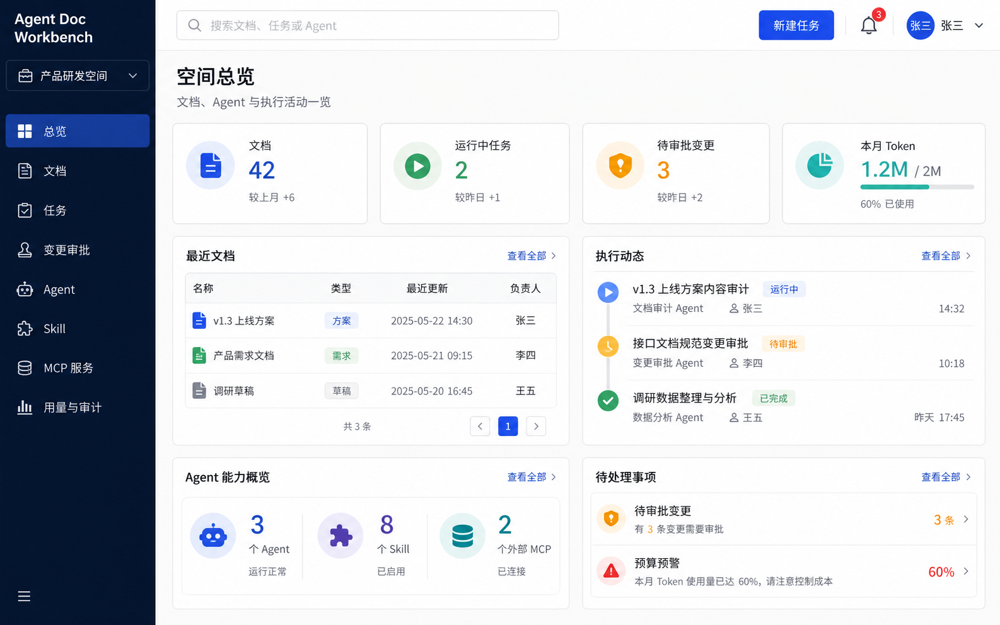
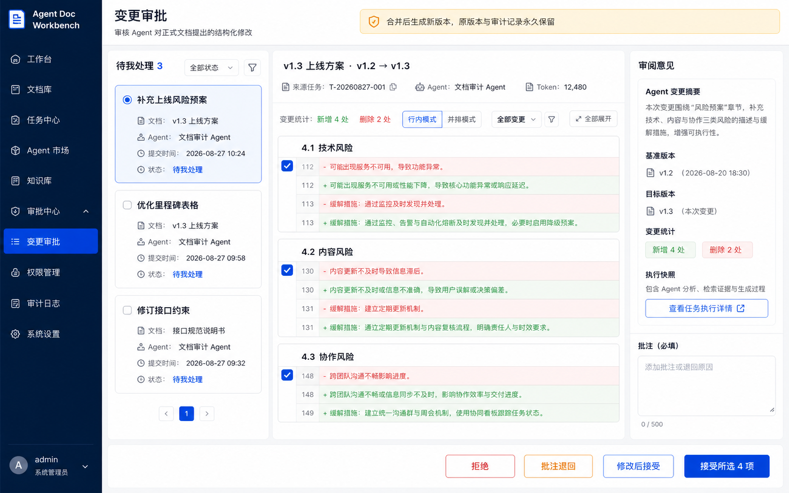
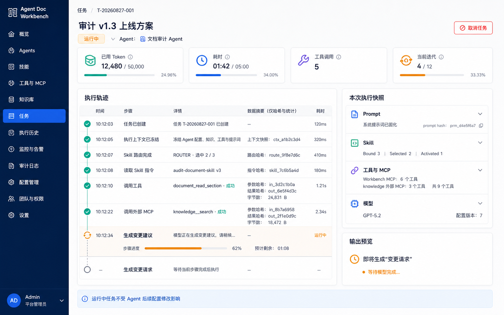
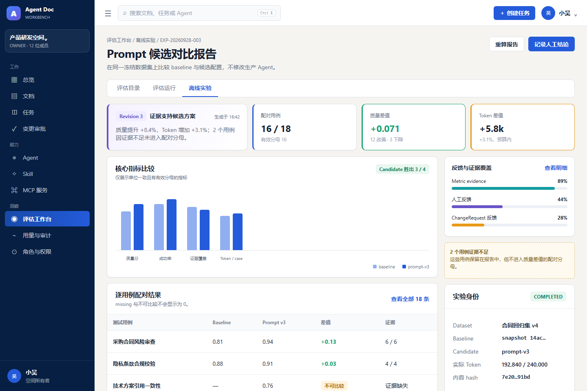
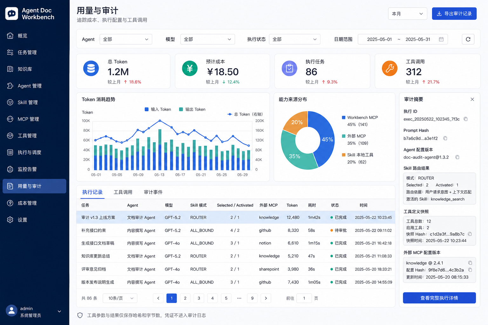
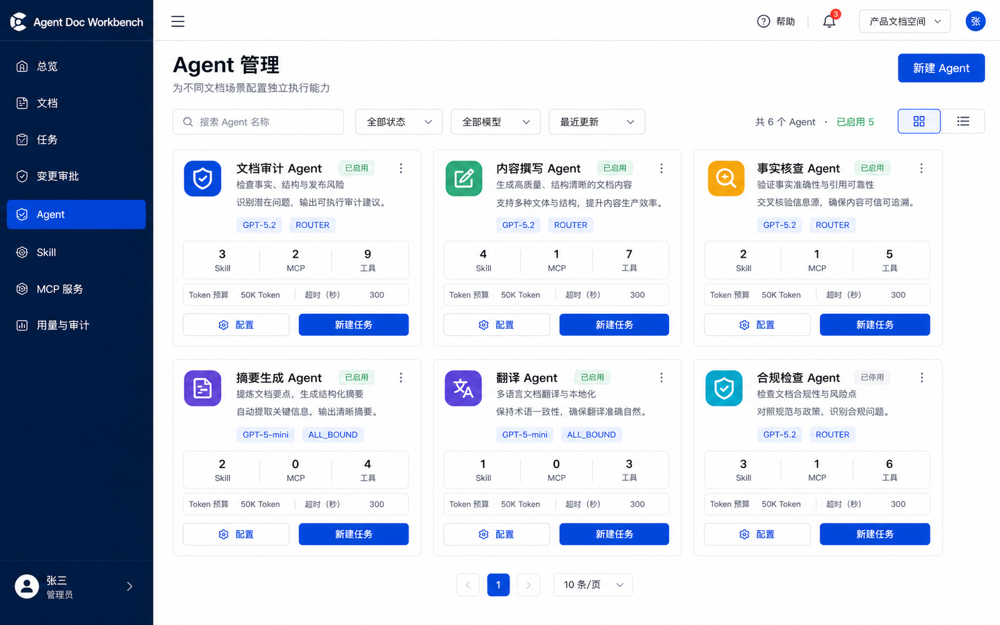
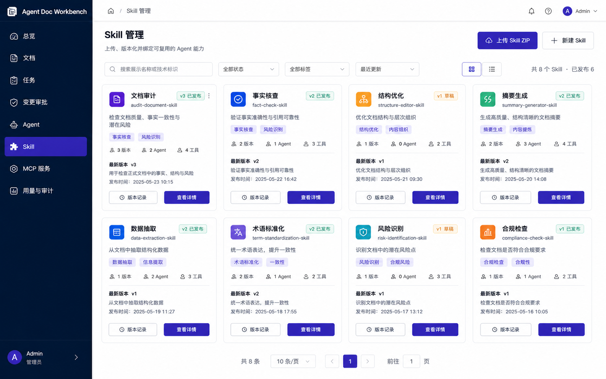
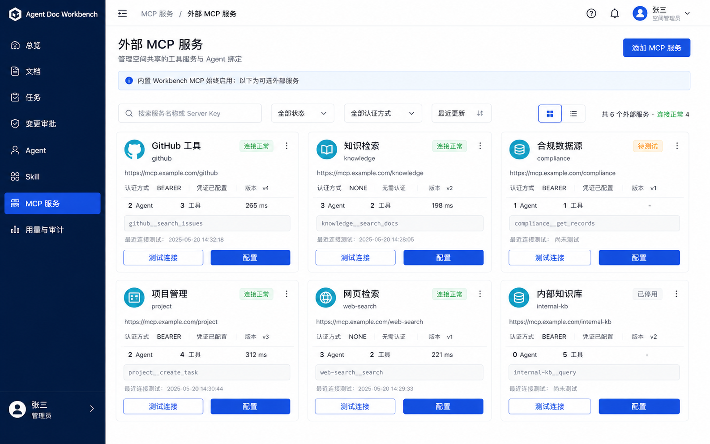

# Agent-Doc-Workbench

> **Let agents work autonomously --- without letting them silently
> change your canonical content.**

An open-source web workbench for practical Agent engineering.\
Agents can read documents, load versioned Skills, call built-in or
external MCP tools, and execute tasks. Changes to formal documents are
never applied silently: they become reviewable Change Requests first,
and humans decide what gets merged.

**Autonomous execution · Reviewable changes · Scoped permissions ·
Controlled cost · Traceable runs**

**English** \| [简体中文](./README.md)

[](LICENSE)
    

**Mirrors:** [GitHub](https://github.com/xiaowu0203/Agent-Doc-Workbench)
· [Gitee](https://gitee.com/wu_hai123/agent-doc-workbench)

## At a Glance

Page images in this README are design illustrations; the running UI may differ.



Many Agent demos ask one question:

> **Can the Agent finish the task?**

Agent-Doc-Workbench also asks:

> What exactly did the Agent do?\
> Why was it allowed to do it?\
> Which Agent, prompt, model, Skill, and MCP configuration did it use?\
> Which tools were called, and how many tokens were spent?\
> Who approves changes to canonical content?\
> Can a historical execution still be explained and traced?

The project explores how to move Agents beyond "chatbots that can call
tools" toward **governed engineering execution units**.

## AI Can Propose Changes. It Cannot Silently Rewrite Formal Documents.



Documents have two modes:

- **Draft documents** --- Agents may edit directly for fast iteration.
- **Formal documents** --- Agents cannot overwrite them directly.
    Every modification becomes a Change Request.

The formal-document flow is intentionally explicit:

``` text
Agent Execution
      │
      ▼
ChangeRequest / Structured Diff
      │
      ▼
Human Review
      │
      ├── Accept All
      ├── Partial Accept
      ├── Edit & Accept
      ├── Reject
      └── Comment & Return
      │
      ▼
New Document Version
```

Merges and rollbacks create new versions instead of destroying
historical snapshots.

## An Agent Run Is More Than a Chat Transcript



For an ordinary task, users explicitly choose one Agent; derived executions such as Replay follow their respective frozen-input rules. When execution
starts, the system freezes the runtime configuration used by that run,
including:

- Agent configuration version
- System prompt
- Model and model parameters
- Bound and selected Skills
- Effective tool definitions
- MCP configuration and tool allowlists
- Task Capability
- Token budget

Later configuration changes do not mutate an already-running execution.

The execution view records Skill routing, instruction loading, tool
calls, token usage, status, and key execution events so failures, cost,
and capability sources can be investigated.

## From Execution to Evaluation: the v0.2 Loop

v0.2.0 adds execution, observability, and evaluation capabilities to the document workbench:

```text
Task → Run / Trace / frozen snapshots → Test cases and datasets
                                                ↓
Human decision ← comparison report ← offline Experiment ← isolated Replay and evaluation
```

- **Runs and observability:** Task is the public Run identity; business inputs and execution configuration are frozen separately. Traces support diagnosis and do not replace snapshots, audit, or the Token ledger.
- **Datasets and evaluators:** turn existing tasks into versioned test cases and datasets, and record metrics with evidence references.
- **Isolated Replay:** rerun frozen inputs and configuration; candidate artifacts are captured for inspection rather than written to formal documents or submitted as formal changes.
- **Offline Experiment:** compare a baseline with a Prompt candidate on the same frozen dataset. Reports show quality, cost, latency, denominators, and missing evidence; promotion remains a human decision.
- **Controlled online A/B:** compare real tasks within explicit authorization, budget, routing, stop, and rollback boundaries. Deployment and safety gates apply; candidates are not promoted automatically.



This image is a design illustration, not a screenshot of a running instance. See the [v0.2.0 design gallery](docs/ui-mockups/v0.2.0/README.md) for more; current code and formal contracts define actual behavior.

## Core Capabilities

### 🧠 Let Agents Work

- **Independent Agent Runtime** --- tasks are dispatched to Agent
    Server over A2A.
- **Versioned Skills** --- Skills are immutable, versioned capability
    packages with publishing and Agent bindings.
- **Progressive Skill Loading** --- models first see lightweight Skill
    metadata and load full instructions/resources only when needed.
- **Skill Router** --- supports `ALL_BOUND` and `ROUTER` selection
    modes.
- **Built-in + External MCP** --- every Agent has Workbench MCP and
    may bind multiple space-scoped external MCP servers.

### 🔐 Keep Agents Bounded

- **Task Capability** --- every task scopes allowed Space, documents,
    and actions.
- **Agents do not inherit user permissions** --- human RBAC and Agent
    Capability are separate authorization boundaries.
- **Layered tool restrictions** --- Skills, Agent configuration, MCP
    bindings, and Task Capability constrain effective tools.
- **Token Budget Circuit Breaker** --- the effective task budget is the minimum of the task, Agent, and space budgets resolved at creation time. In-flight model calls can exceed the authorized amount, so the budget is not a strict cost cap.
- **External MCP security** --- tool namespaces, allowlists, encrypted
    credentials, HTTPS and network-address validation.

### 📝 Review What They Change

- **Draft / Formal document model**
- **Structured ChangeRequest / Diff**
- **Accept all / partial accept / edit & accept / reject / comment &
    return**
- **Version snapshots and non-destructive rollback**
- **Traceable links between task, execution, review, and document
    version**

### 🔎 Know Exactly What Happened

- **Execution snapshots**
- **Skill / MCP / tool provenance**
- **Token and usage ledger**
- **Redacted tool-call auditing**
- **Human / Agent actor auditing**
- **Platform roles + Space RBAC**



## Agent / Skill / MCP

An Agent is not just a prompt. It is a governed collection of executable
capabilities.



A configured Agent may include:

``` text
Agent
├── Main Model
├── System Prompt
├── Skill Selection Mode
├── Versioned Skills
├── Built-in Workbench MCP
├── External MCP Servers
├── Tool Whitelist
└── Execution Limits
```

Skills and MCP solve different problems:

- **Skill** --- describes how the Agent should perform a class of
    work, with versioned instructions, resources, and allowed tool
    scope.
- **MCP** --- exposes actual Workbench or external capabilities the
    Agent can invoke.
| Skills | MCP Servers |
| --- | --- |
|  |  |
See the complete [UI gallery](docs/ui-mockups/README.md).

## A2A and MCP Have Deliberately Different Roles

Agent-Doc-Workbench does not treat A2A and MCP as interchangeable RPC
mechanisms.

``` text
                         A2A
┌──────────────┐  ─────────────────►  ┌───────────────┐
│ task-service │                      │ agent-service │
│ Orchestration│  ◄─────────────────  │ Agent Runtime │
└──────────────┘   Task / Callback    └───────┬───────┘
                                             │
                                             │ MCP
                                             ▼
                                    ┌──────────────────┐
                                    │ Workbench Tools  │
                                    │ External MCPs    │
                                    └──────────────────┘
```

**A2A moves the work. MCP gives Agents capabilities.**

- **A2A** is the Agent task protocol for send, query, cancel, status
    synchronization, and callbacks.
- **MCP** is the capability protocol for reading documents and Skills,
    submitting changes, and accessing external tools.

`agent-service` does not directly own or access Workbench
document/task/change-request tables. It uses Workbench capabilities
through MCP.

## Permission Model

Humans and Agents intentionally use different authorization models:

``` text
Human User
    │
    ▼
Space RBAC
OWNER / EDITOR / VIEWER / Custom Role

Agent Execution
    │
    ▼
Task Capability
Space + Document + Actions + Budget
```

An Agent does not automatically receive all permissions of the user on
whose behalf it runs.

Effective tool access is constrained by multiple layers:

``` text
Effective Tools =
Skill Allowed Tools
∩ Agent Tool Whitelist
∩ MCP Binding Whitelist
∩ Task Capability
```

The Skill Router may reduce the Skill set needed for a task. It cannot
expand authorization.

## Architecture

``` text
Frontend (Vue 3 + TypeScript)
          │
          │ Bearer JWT
          ▼
┌─────────────────────────────┐
│ Spring Cloud Gateway :9090  │
└──────────────┬──────────────┘
               │
     ┌─────────┼───────────┬─────────────┬─────────────┐
     ▼         ▼           ▼             ▼             ▼
   Auth     Document      Task          Agent       Evaluation
  :8081      :8082        :8083         :8084          :8085
                            │              ▲              │
                            └──── A2A ─────┘              │
                            ◄──── Replay / evaluation ────┘
```

Task provides the Workbench MCP; Agent can use built-in and configured external MCPs. OpenTelemetry captures the technical trace across services.
| Service | Responsibility |
| --- | --- |
| `auth-service` | Login, JWT, and platform identity |
| `document-service` | Spaces, directories, documents, versions, ChangeRequest / Diff |
| `task-service` | Agent tasks, A2A Client, Workbench MCP Server, Token Ledger, Audit |
| `agent-service` | Agent / Model / Skill / MCP configuration, A2A Server, Spring AI Runtime |
| `evaluation-service` | Test assets, evaluation, replay, and experiments |
| `gateway-service` | API gateway and unified entry point |

## Tech Stack

| Layer | Technology |
| --- | --- |
| Backend | Java 21 · Spring Boot 3.5 · Spring Cloud 2025 · MyBatis-Plus |
| Database | MySQL 5.7 |
| Messaging / Cache | RabbitMQ · Redis |
| Object Storage | MinIO |
| Registry / Config | Nacos 3.2.2 (shipped via Compose; current services use static routes and do not register with it) |
| Agent | Spring AI · Official A2A Java SDK · MCP Java SDK |
| Frontend | Vue 3 · TypeScript · Vite · Pinia · Element Plus · Markdown |
| Auth | Spring Security Resource Server · JWT RS256 |
See [docs/tech/README.md](docs/tech/README.md) for technical choices and
constraints.

## Quick Start

### Requirements

Recommended local environment:

- Java 21
- Node.js 22
- pnpm 10.24.0
- Docker / Docker Compose
- Maven Wrapper (included)

### 1. Start Infrastructure

``` bash
docker compose up -d
```

Run this command from the repository root. You can first copy [`.env.example`](.env.example) to `.env` there and adjust the values; Compose uses it for variable substitution. Existing volumes retain previously initialized data and credentials, so changing `.env` does not reset MySQL or other persistent services.

The Compose file provides example Nacos identity settings for local development. Before production deployment, replace `NACOS_AUTH_TOKEN`, `NACOS_AUTH_IDENTITY_KEY`, and `NACOS_AUTH_IDENTITY_VALUE` through environment variables.

The default infrastructure includes:

``` text
MySQL
Redis
RabbitMQ
MinIO
Nacos
```

If MySQL and Redis already run locally:

``` bash
docker compose up -d rabbitmq minio nacos
```

### 2. Start Backend Services

The backend is a Maven multi-module project. Install local module dependencies first, then run each service in its **own terminal**; enter the repository's `backend` directory in every terminal. Auth owns database migrations; wait for it to start successfully before starting the other services.

Linux / macOS:

```bash
cd backend

./mvnw -DskipTests install

# Run each line in a separate terminal
./mvnw -pl auth-service spring-boot:run
./mvnw -pl gateway-service spring-boot:run
./mvnw -pl document-service spring-boot:run
./mvnw -pl agent-service spring-boot:run
./mvnw -pl task-service spring-boot:run
./mvnw -pl evaluation-service spring-boot:run
```

On Windows PowerShell or Command Prompt, replace `./mvnw` with
`.\mvnw.cmd`.

Before starting, configure the database, Redis, RabbitMQ, MinIO, and required keys in each application process. The root `.env` is not automatically injected into Java processes started on the host; set the relevant environment variables in each terminal:

- `MYSQL_PASSWORD` must match the actual MySQL password. Without a Compose `.env`, the initial Compose password defaults to `change-me`, while Java services default to `root`.
- Document and Agent need `MINIO_ACCESS_KEY` and `MINIO_SECRET_KEY` matching the actual MinIO credentials. The services do not automatically receive the Compose credentials and fail to start without them.
- Use separate Base64-encoded AES keys for `AGENT_CONFIG_KEY`, `TASK_CAPABILITY_KEY`, and `EVALUATION_CAPABILITY_KEY` (16, 24, or 32 decoded bytes). Store them safely and keep them consistent across instances that need to read existing encrypted data. Evaluation instances must share the WorkerCapability encryption key.
- Evaluation uses the shared `MYSQL_*`, `REDIS_*`, and `AUTH_JWKS_URL` settings by default; `DB_URL`, `DB_USERNAME`, and `DB_PASSWORD` can explicitly override its database. See [`.env.example`](.env.example) for variable names.

When JWT RSA keys are absent, Auth generates temporary keys for local use, so old tokens may become invalid after a restart. Production environments should provide persistent `JWT_PRIVATE_KEY` and `JWT_PUBLIC_KEY` values.

Automatic initial offline experiment reports require the same independent `EXPERIMENT_REPORT_PROOF_KEY` in the Agent and Evaluation process environments (at least 32 random bytes, Base64 encoded). Evaluation connects directly to Agent using `AGENT_INTERNAL_URL`; use a trusted encrypted network across hosts and synchronize clocks. Without the key, automatic report generation fails closed.

Default ports:

| Service | Port |
| --- | ---: |
| Gateway | `9090` |
| Auth | `8081` |
| Document | `8082` |
| Task | `8083` |
| Agent | `8084` |
| Evaluation | `8085` |

### 3. Start Frontend

In a new terminal, run the following from the repository root:

```bash
cd frontend
pnpm install --frozen-lockfile
pnpm dev
```

Open `http://localhost:5173` by default (or use the address printed by Vite if the port is occupied), then register and sign in to create a Space. Configure a working model and Agent in the workbench before running model tasks.

Frontend variables are documented in
[`frontend/.env.example`](frontend/.env.example). Infrastructure and
secret templates are in [`.env.example`](.env.example).

> For LLM provider and external MCP configuration, follow the current
> configuration templates and documentation under `docs/`.

## Who Is This For?

This project may be useful if you are exploring:

- Java / Spring AI Agent engineering
- Practical A2A / MCP protocol boundaries
- Agent Skills and progressive loading
- External MCP and tool governance
- Human-in-the-loop workflows
- Agent permissions and task-scoped capabilities
- Execution snapshots, auditing, and token-cost control
- AI-assisted document collaboration
- Governed and traceable Agent runtimes

It is intentionally more than a "chat UI + tool calling" demo. The
project focuses on **how Agents should be executed and governed inside a
real engineering system**.

## Project Status

### v0.1.0 --- First Open-Source Release

`v0.1.0` is the project's first open-source release, including the complete source tree, public documentation, and reproducible validation evidence. This release is source-only and does not include prebuilt JARs, frontend static assets, or container images.

The main v0.1 loop is implemented:

- Space / Document / Version
- Draft / Formal documents
- ChangeRequest / Diff Review
- Agent / Model configuration
- Skill / Skill Router / Progressive Loading
- Built-in Workbench MCP
- External Multi-MCP
- A2A task execution
- Task Capability
- Token Budget
- Audit
- Platform roles / Space RBAC
- Vue Web UI

v0.1 intentionally uses:

> **One user-selected Agent per Task.**

The project does not add free-form Multi-Agent orchestration merely for
demo value.

### v0.2 Capabilities and Scope

v0.2.0 provides Run-compatible Execution, OpenTelemetry, Evaluation / Safe Replay, Offline Experiment, Engineering UX, and controlled online A/B. Memory, Skill Sandbox, standard OAuth2 / OIDC, and Workflow remain conditional candidates requiring independent design and demonstrated need. See the [CHANGELOG](CHANGELOG.md) for validation scope and known limitations.

Next areas include:

``` text
Continued improvements to execution, evaluation, and operations
```

Multi-Agent orchestration is a later step, after the execution and
evaluation foundations are solid.

See the repository Roadmap / Architecture documents for the long-term
direction.

## Documentation

| Document | What it covers |
| --- | --- |
| [Full Development Plan](docs/Agent-Doc-Workbench%20项目完整开发规划文档.md) | Product scope, MVP, and iteration background (Chinese) |
| [Tech Stack](docs/tech/README.md) | Backend / frontend / auth choices |
| [v0.2.0 upgrade guide](docs/operations/v0.2-upgrade.md) | Database preflight, backup, and rollback limitations (Chinese) |
| [Common Modules](docs/common-modules.md) | Common modules and infrastructure |
| [Database Design](docs/database-design.md) | Database design and migration constraints |
| [A2A / MCP Design](docs/agent-server-a2a-mcp-design.md) | Agent Server, A2A, and MCP architecture |
| [Agent Task Execution](docs/agent-task-execution-guide.md) | End-to-end Agent task execution |
| [External MCP](docs/external-mcp-architecture-design.md) | Multi-MCP architecture, permissions, and security |
| [Skill Selection](docs/skill-selection-and-progressive-loading-design.md) | Skill routing and progressive loading |
| [UI Gallery](docs/ui-mockups/README.md) | Complete UI mockups and interaction constraints |
| [Security Policy](SECURITY.md) | Vulnerability reporting, security boundaries, and production guidance (Chinese) |
| [Contributing](CONTRIBUTING.md) | Development environment, tests, and pull-request workflow (Chinese) |
| [Changelog](CHANGELOG.md) | Version changes, fixes, and known limitations (Chinese) |

## Open Source Direction

Agent-Doc-Workbench is currently driven primarily by **technical
exploration, engineering practice, knowledge sharing, and community
discussion**, and is open by default.

The long-term architecture is gradually evolving toward:

``` text
Agent Platform Core
        +
Document Workbench
        +
Extensible Runtime / Evaluator / Sandbox / Memory
```

Document Workbench remains the first real-world domain and reference
workbench for the platform core.

Core Agent capabilities are not intentionally held back for a
hypothetical closed edition.

The project is ultimately interested in questions such as:

> Why did the Agent act this way?\
> Which capabilities did it use?\
> What evidence supports the result?\
> Were its permissions bounded?\
> Can the execution be traced and reproduced?\
> How good was the result?\
> After changing the Agent, can we prove that it actually improved?

## Contributing

Issues, architecture discussions, bug reports, documentation
improvements, and code contributions are welcome. Read the
[contribution guide](CONTRIBUTING.md) before starting. Report security
issues privately according to the [security policy](SECURITY.md).

Topics especially worth discussing include:

- A2A vs MCP
- Agent Capability
- Skill / Tool boundaries
- Human-in-the-loop
- Execution snapshots
- Agent Memory
- Evaluation / Experiment
- Sandbox execution
- Multi-Agent governance

For significant architectural changes, opening an Issue first to discuss
the problem, proposed design, and trade-offs is recommended.

## License

Licensed under the [Apache License 2.0](LICENSE).
<p align="center">
<strong>Open by default. Extensible by design. Governed in execution.</strong><br/>
<sub>Let agents act while keeping every action bounded, reviewable, and traceable.</sub>
</p>
