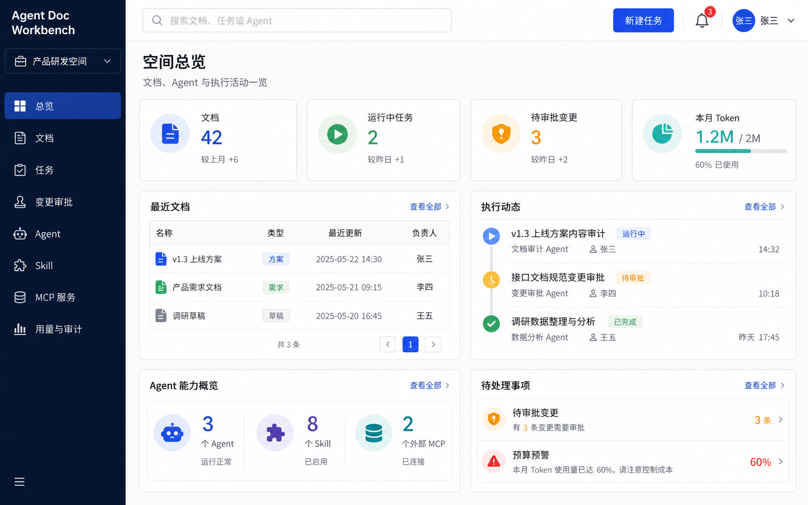
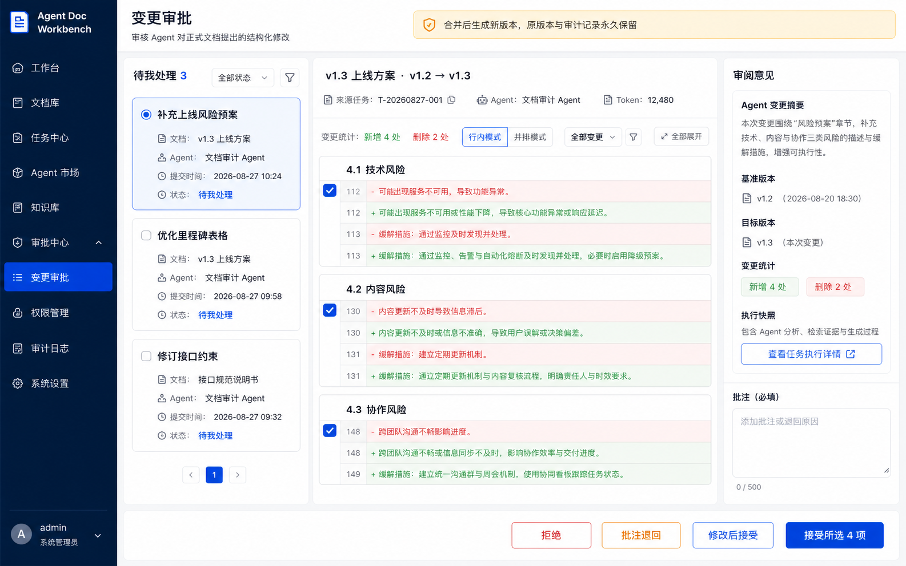
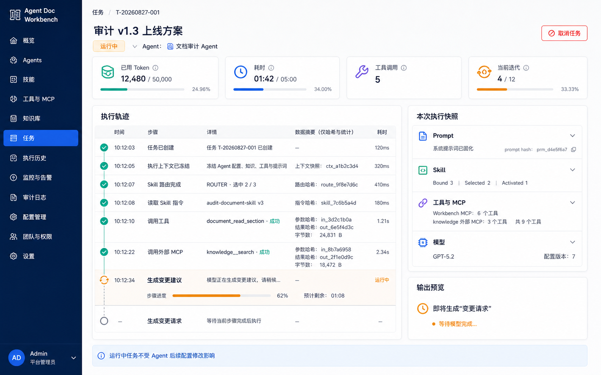
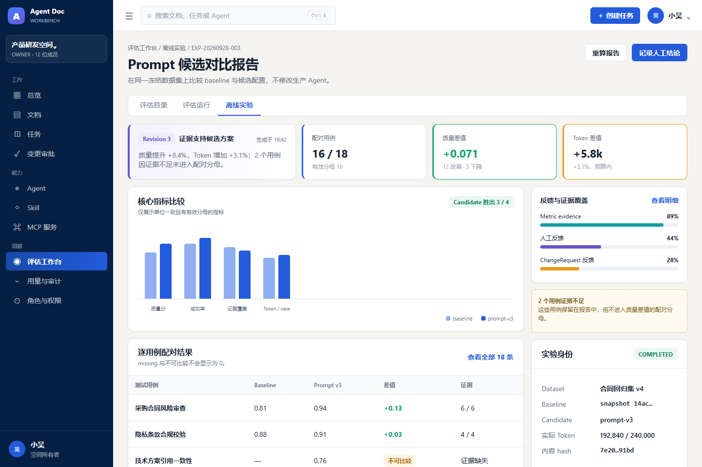
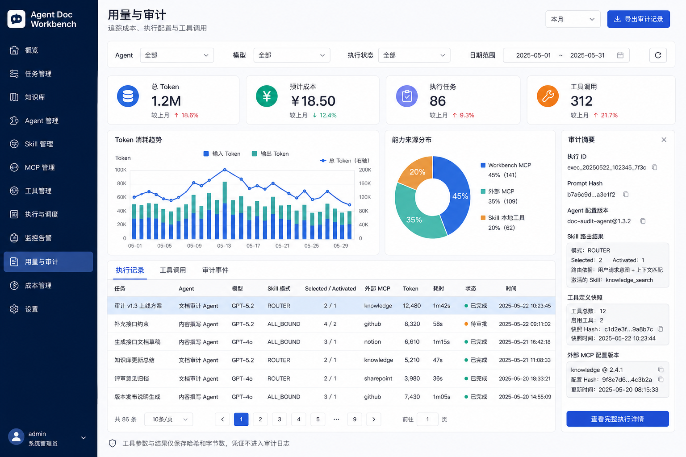
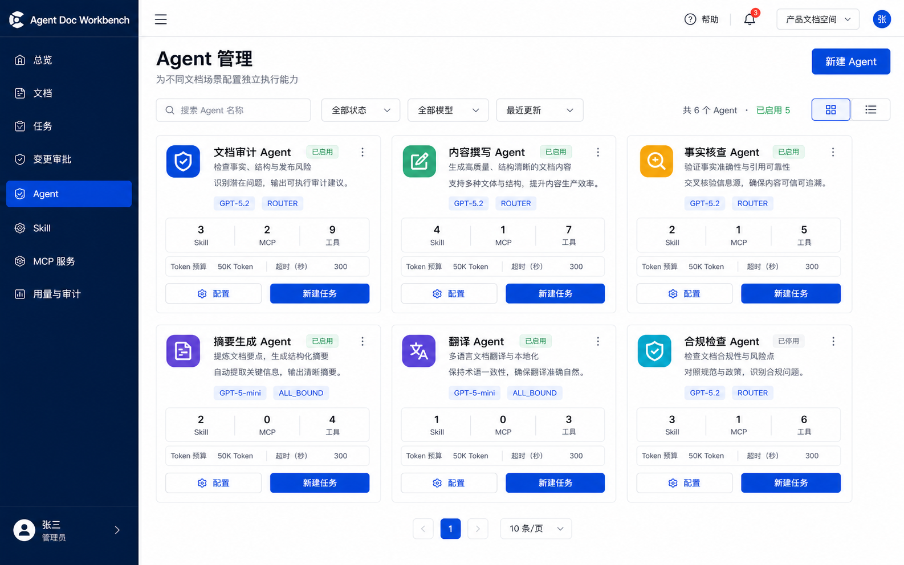
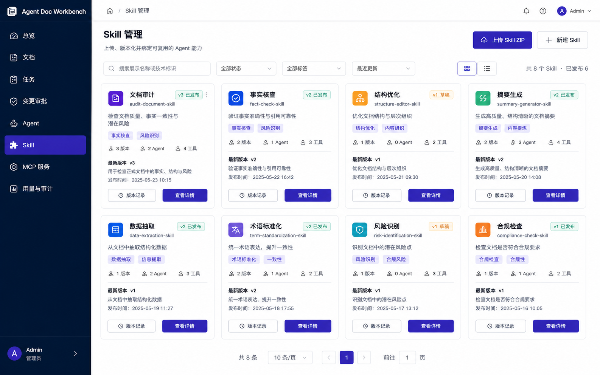
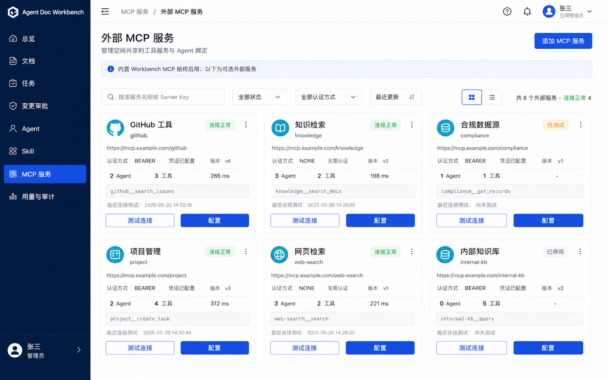

# Agent-Doc-Workbench

> **让 Agent 自主工作，但不让它悄悄修改你的正式内容。**

一个面向 Agent 工程实践的开源 Web 工作台。
Agent 可以读取文档、加载版本化 Skill、调用内置或外部 MCP
工具并执行任务；对正式文档的修改不会被直接覆盖，而是先形成可审查的
ChangeRequest，由人决定接受、部分接受、拒绝或退回。

**自主执行 · 变更可审 · 权限受控 · 成本可管 · 执行可追溯**

[English](./README.en.md) | **简体中文**

[](LICENSE)
    

**仓库：** [GitHub](https://github.com/xiaowu0203/Agent-Doc-Workbench) ·[Gitee](https://gitee.com/wu_hai123/agent-doc-workbench)

## 一眼看懂

本文中的页面图片为设计示意，实际界面以运行版本为准。



很多 Agent Demo 关注的是：

> **Agent 能不能把任务做完？**

Agent-Doc-Workbench 还关心另一组问题：

> Agent 做了什么？
> 它为什么拥有这些权限？
> 它使用了哪个 Agent / Prompt / Model / Skill / MCP 配置？
> 它调用了哪些工具、花了多少 Token？
> 它修改正式内容之前，谁来批准？
> 一次历史执行还能不能被解释和追溯？

这个项目尝试把 Agent

从"会调用工具的聊天机器人"，推进到一个**可治理的工程执行单元**。

## AI 可以提出修改，但不能偷偷改正式文档



文档分为两种模式：

- **草稿文档**：允许 Agent 直接编辑，适合快速试错。
- **正式文档**：Agent 禁止直接覆盖，所有修改必须形成 ChangeRequest。

正式文档的修改流程：

``` text
Agent 执行
    │
    ▼
ChangeRequest / Structured Diff
    │
    ▼
Human Review
    │
    ├── 全部接受
    ├── 部分接受
    ├── 修改后接受
    ├── 拒绝
    └── 批注退回
    │
    ▼
New Document Version
```

合并和回滚都会创建新的版本，不破坏历史快照。

## 一次 Agent 执行，不只是一段聊天记录



每个任务由用户明确选择一个
Agent。执行开始后，系统冻结本次运行所使用的配置，包括：

- Agent 配置版本
- System Prompt
- Model 与模型参数
- Skill 绑定与选择结果
- 实际可见 Tool Definitions
- MCP 配置与工具白名单
- Task Capability
- Token Budget

Agent 配置之后发生变化，也不会改变已经运行中的任务。

执行详情会记录 Skill 路由、指令读取、工具调用、Token
使用、状态和关键执行轨迹，方便定位成本、失败点和实际能力来源。

## 从执行到评估：v0.2 工程闭环

v0.2.0 正在发布收口。它在文档工作台之上增加执行、观测与评估能力，让一次改动可以沿着证据反复检查：

```text
任务执行 → Run / Trace / 执行快照 → 测试用例与数据集
                                     ↓
人工决定 ← 对比报告 ← 离线 Experiment ← 隔离 Replay 与评估
```

- **Run 与可观测性**：Task 是公开的 Run 身份，执行配置和业务输入分别冻结；Trace 用于排查技术链路，不能代替业务快照、审计或 Token 账本。
- **Dataset 与 Evaluator**：将已有任务沉淀为版本化测试用例和数据集，通过确定性评估器记录指标和证据引用。
- **隔离 Replay**：复用冻结输入和执行配置重新运行；候选产物只供检查，不直接写入正式文档或创建正式变更。
- **离线 Experiment**：在同一冻结数据集上比较 baseline 与 Prompt 候选，报告展示质量、成本、延迟、分母与缺失证据；结果由人判断，不自动推广候选。
- **受控线上 A/B**：在授权、预算、路由、停止和回退边界内比较真实任务；上线需满足部署和安全门禁，候选不会自动晋升。



上图为设计示意，不是实际运行截图；更多设计示意见 [v0.2.0 页面图集](docs/ui-mockups/v0.2.0/README.md)。功能和发布状态以当前代码、下方状态说明及正式契约为准。

## 核心能力

### 🧠 Let Agents Work

- **独立 Agent Runtime**：任务通过 A2A 分发到 Agent Server。
- **版本化 Skill**：Skill 以 ZIP 能力包管理，支持不可变版本、发布和
    Agent 绑定。
- **渐进式 Skill
    Loading**：模型先看到轻量目录，再按需读取完整指令和资源。
- **Skill Router**：支持 `ALL_BOUND` / `ROUTER` 两种选择模式。
- **Built-in + External MCP**：每个 Agent 始终拥有 Workbench
    MCP，并可绑定多个空间级外部 MCP。

### 🔐 Keep Agents Bounded

- **Task Capability**：每个任务绑定允许访问的 Space、Document 和
    Action。
- **Agent 不继承用户权限**：人类 RBAC 与 Agent Capability
    是两套不同的授权边界。
- **多层工具约束**：Skill、Agent、MCP Binding 与 Task Capability
    共同限制最终可调用能力。
- **Token Budget Circuit
    Breaker**：任务级预算超限自动终止；任务创建时按任务 / Agent / 空间预算取最小值收敛，
    空间月度预算用于创建期约束与用量报表。
- **外部 MCP 安全约束**：工具命名空间、白名单、认证信息加密、HTTPS /
    网络地址检查。

### 📝 Review What They Change

- **Draft / Formal 双文档模型**
- **Structured ChangeRequest / Diff**
- **全部接受 / 部分接受 / 修改后接受 / 拒绝 / 批注退回**
- **版本快照与非破坏性回滚**
- **任务、执行、审批与版本之间可追溯关联**

### 🔎 Know Exactly What Happened

- **Execution Snapshot**
- **Skill / MCP / Tool 来源记录**
- **Token 与用量账本**
- **脱敏工具调用审计**
- **人类 / Agent 操作主体审计**
- **平台角色 + Space RBAC**



## Agent / Skill / MCP

Agent 不是一个单纯的 Prompt，而是一组受治理的执行能力。



一个 Agent 可以配置：

``` text
Agent
├── Main Model
├── System Prompt
├── Skill Selection Mode
├── Versioned Skills
├── Built-in Workbench MCP
├── External MCP Servers
├── Tool Whitelist
└── Execution Limits
```

Skill 与 MCP 分别解决不同问题：

- **Skill**：告诉 Agent "如何完成某类工作"，包含版本化
    Instructions、Resources 和允许使用的工具范围。
- **MCP**：向 Agent 提供真正可以调用的 Workbench 或外部能力。
| Skill | MCP |
| --- | --- |
|  |  |
完整 UI 图集见 [docs/ui-mockups/README.md](docs/ui-mockups/README.md)。

## A2A 与 MCP：刻意保持不同职责

Agent-Doc-Workbench 不把 A2A 和 MCP 混成同一种调用方式。

``` text
                         A2A
┌──────────────┐  ─────────────────►  ┌───────────────┐
│ task-service │                      │ agent-service │
│ Orchestration│  ◄─────────────────  │ Agent Runtime │
└──────────────┘   Task / Callback    └───────┬───────┘
                                             │
                                             │ MCP
                                             ▼
                                    ┌──────────────────┐
                                    │ Workbench Tools  │
                                    │ External MCPs    │
                                    └──────────────────┘
```

**A2A moves the work. MCP gives Agents capabilities.**

- **A2A**：Agent 任务协议，用于发送、查询、取消、状态同步和回调。
- **MCP**：能力协议，用于 Agent 读取文档、读取
    Skill、提交变更以及访问外部工具。

`agent-service` 不直接读写文档、任务、ChangeRequest 等业务表；它通过 MCP
使用 Workbench 能力。

## 权限模型

人类用户与 Agent 使用不同的权限模型：

``` text
Human User
    │
    ▼
Space RBAC
OWNER / EDITOR / VIEWER / Custom Role

Agent Execution
    │
    ▼
Task Capability
Space + Document + Actions + Budget
```

Agent 不因为"代表某个用户执行"就自动获得该用户的全部权限。

最终工具能力继续受到多层约束：

``` text
Effective Tools =
Skill Allowed Tools
∩ Agent Tool Whitelist
∩ MCP Binding Whitelist
∩ Task Capability
```

Skill Router 只能缩小当前任务需要的 Skill 范围，不能扩大权限。

## 架构概览

``` text
Frontend (Vue 3 + TypeScript)
          │
          │ Bearer JWT
          ▼
┌─────────────────────────────┐
│ Spring Cloud Gateway :9090  │
└──────────────┬──────────────┘
               │
     ┌─────────┼───────────┬─────────────┬─────────────┐
     ▼         ▼           ▼             ▼             ▼
   Auth     Document      Task          Agent       Evaluation
  :8081      :8082        :8083         :8084          :8085
                            │              ▲              │
                            └──── A2A ─────┘              │
                            ◄──── Replay / 评估编排 ──────┘
```

Task 提供 Workbench MCP，Agent 可按配置调用内置和外部 MCP；OpenTelemetry 采集跨服务技术链路。

主要服务：
| 服务 | 职责 |
| --- | --- |
| `auth-service` | 登录、JWT 和平台身份 |
| `document-service` | Space、目录、文档、版本、ChangeRequest / Diff |
| `task-service` | Agent Task、A2A Client、Workbench MCP Server、Token Ledger、Audit |
| `agent-service` | Agent / Model / Skill / MCP 配置、A2A Server、Spring AI Runtime |
| `evaluation-service` | 测试资产、评估、Replay 与实验 |
| `gateway-service` | API Gateway、统一入口 |

## 技术栈

| 层 | 技术 |
| --- | --- |
| Backend | Java 21 · Spring Boot 3.5 · Spring Cloud 2025 · MyBatis-Plus |
| Database | MySQL 5.7 |
| Messaging / Cache | RabbitMQ · Redis 7 |
| Object Storage | MinIO |
| Registry / Config | Nacos 3.2.2（随 Compose 提供；当前服务使用静态路由，暂不接入注册中心） |
| Agent | Spring AI · Official A2A Java SDK · MCP Java SDK |
| Frontend | Vue 3 · TypeScript · Vite · Pinia · Element Plus · Markdown |
| Auth | Spring Security Resource Server · JWT RS256 |
技术选型与约束见 [docs/tech/README.md](docs/tech/README.md)。

## 快速开始

### 环境要求

建议准备：

- Java 21
- Node.js 22
- pnpm 10.24.0
- Docker / Docker Compose
- Maven Wrapper（仓库已提供）

### 1. 启动基础设施

``` bash
docker compose up -d
```

Compose 已为本地开发提供 Nacos 启动所需的示例身份参数；生产部署前必须通过环境变量替换 `NACOS_AUTH_TOKEN`、`NACOS_AUTH_IDENTITY_KEY` 和 `NACOS_AUTH_IDENTITY_VALUE`。

默认会使用：

``` text
MySQL
Redis
RabbitMQ
MinIO
Nacos
```

如果本机已经运行 MySQL / Redis，也可以只启动其余基础设施：

``` bash
docker compose up -d rabbitmq minio nacos
```

### 2. 启动后端

后端为 Maven 多模块工程。先在 `backend` 安装本地模块依赖，再在**各自的终端**按顺序启动服务。Auth 负责数据库迁移，确认它启动成功后再启动其他服务。

Linux / macOS：

```bash
cd backend

./mvnw -DskipTests install

# 以下每行分别在一个终端执行
./mvnw -pl auth-service spring-boot:run
./mvnw -pl gateway-service spring-boot:run
./mvnw -pl document-service spring-boot:run
./mvnw -pl agent-service spring-boot:run
./mvnw -pl task-service spring-boot:run
./mvnw -pl evaluation-service spring-boot:run
```

Windows PowerShell 或 Command Prompt 将 `./mvnw` 替换为 `.\mvnw.cmd`。

启动前在各应用的进程环境中配置数据库、Redis、RabbitMQ、MinIO 和所需密钥。`AGENT_CONFIG_KEY`、`TASK_CAPABILITY_KEY` 和 `EVALUATION_CAPABILITY_KEY` 是各自独立的 Base64 编码 AES 密钥；Evaluation 多实例须使用一致的 WorkerCapability 加密密钥。Evaluation 默认使用共享的 `MYSQL_*`、`REDIS_*` 和 `AUTH_JWKS_URL`，也可用 `DB_URL`、`DB_USERNAME`、`DB_PASSWORD` 单独指定数据库。根目录 `.env` 用于 Compose 变量替换，不会自动注入宿主机启动的 Java 进程；具体变量和长度要求见 [`.env.example`](.env.example)。

离线实验自动首次报告需要在 Agent 和 Evaluation 进程中配置相同的独立 `EXPERIMENT_REPORT_PROOF_KEY`（Base64 编码至少 32 随机字节）。Evaluation 通过 `AGENT_INTERNAL_URL` 直连 Agent；跨主机应使用受信任的加密网络并保持时钟同步。缺少密钥时自动报告不会生成。

默认端口：

| Service | Port |
| --- | ---: |
| Gateway | `9090` |
| Auth | `8081` |
| Document | `8082` |
| Task | `8083` |
| Agent | `8084` |
| Evaluation | `8085` |

### 3. 启动前端

```bash
cd frontend
pnpm install --frozen-lockfile
pnpm dev
```

前端环境变量模板见
[`frontend/.env.example`](frontend/.env.example)，基础设施与敏感配置模板见
[`.env.example`](.env.example)。

> 不同 LLM Provider / MCP Server 所需配置请以仓库当前配置模板和 `docs/`
> 文档为准。

## 适合谁？

如果你正在研究或实践下面这些方向，这个项目可能值得看看：

- Java / Spring AI Agent 工程化
- A2A / MCP 在真实系统中的职责边界
- Agent Skill 与 Progressive Loading
- External MCP 与 Tool Governance
- Human-in-the-loop
- Agent 权限与 Capability
- Agent 执行快照、审计和 Token 成本控制
- AI + Document Collaboration
- 可治理、可追溯的 Agent Runtime

它不是一个"聊天页面 + Tool Calling"的 Demo，更偏向于探索 **Agent
在真实工程系统里应该如何被执行和治理**。

## Project Status

### v0.1.0 --- 首个开源版本

`v0.1.0` 是项目首个开源版本，包含完整源码、公开文档和可复现验证结果。本版本以源码形式发布，不附带预构建 JAR、前端静态包或容器镜像。

当前 v0.1 已完成主要闭环：

- Space / Document / Version
- Draft / Formal Document
- ChangeRequest / Diff Review
- Agent / Model
- Skill / Skill Router / Progressive Loading
- Built-in Workbench MCP
- External Multi-MCP
- A2A Task Execution
- Task Capability
- Token Budget
- Audit
- Platform Role / Space RBAC
- Vue Web UI

v0.1 当前采用：

> **一个 Task 由用户明确选择一个 Agent 执行。**

项目不会为了展示效果提前加入自由 Multi-Agent 编排。

### v0.2 开发进度

v0.2.0 的 Run-compatible Execution、OpenTelemetry、Evaluation / Safe Replay、离线 Experiment、Engineering UX 与受控线上 A/B 已进入发布收口；正式发布仍需通过安装升级、安全回归和发布验收。Memory、Skill Sandbox、标准 OAuth2 / OIDC、Workflow 等能力仍需按独立设计和真实需求评估，不因长期路线图自动进入版本范围。

后续方向包括：

``` text
发布验证与文档收口
```

更长期再探索 Multi-Agent Orchestration。

详细规划以仓库中的 Roadmap / Architecture 文档为准。

## 文档导航

| 文档 | 内容 |
| --- | --- |
| [完整开发规划](docs/Agent-Doc-Workbench%20项目完整开发规划文档.md) | 产品功能、MVP 与迭代背景 |
| [技术栈](docs/tech/README.md) | Backend / Frontend / Auth 技术选型 |
| [v0.2.0 升级指南（草案）](docs/operations/v0.2-upgrade.md) | 数据库升级预检、备份和回退限制 |
| [Common Modules](docs/common-modules.md) | Common 模块与基础设施 |
| [Database Design](docs/database-design.md) | 数据库设计与迁移约束 |
| [架构决策记录](docs/adr/README.md) | v0.2.0 起的重要架构决策与取舍 |
| [A2A / MCP Design](docs/agent-server-a2a-mcp-design.md) | Agent Server、A2A 与 MCP 架构 |
| [Agent Task Execution](docs/agent-task-execution-guide.md) | Agent Task 完整执行链路 |
| [External MCP](docs/external-mcp-architecture-design.md) | 多 MCP、权限与安全模型 |
| [Skill Selection](docs/skill-selection-and-progressive-loading-design.md) | Skill Router 与渐进加载 |
| [UI Gallery](docs/ui-mockups/README.md) | 完整 UI 效果图与交互约束 |
| [安全策略](SECURITY.md) | 漏洞报告方式、运行边界与生产部署建议 |
| [贡献指南](CONTRIBUTING.md) | 开发环境、工程约束、测试和 PR 流程 |
| [变更日志](CHANGELOG.md) | v0.1.0 能力、修复与已知限制 |

## 开源与设计方向

Agent-Doc-Workbench
当前以**技术探索、工程实践、技术分享和社区讨论**为主要目标，并默认保持开放。

长期希望逐步沉淀：

``` text
Agent Platform Core
        +
Document Workbench
        +
Extensible Runtime / Evaluator / Sandbox / Memory
```

Document Workbench 是当前第一个真实业务场景，也是 Platform Core 的
Reference Workbench。

项目不会为了假设中的商业版本，刻意把核心 Agent 能力留在闭源层。

更重要的是持续回答这些问题：

> Agent 为什么这样做？
> 它用了什么能力？
> 依据是什么？
> 权限是否可控？
> 执行能否追溯和复现？
> 结果质量如何？
> 修改 Agent 后，能不能证明它真的变好了？

## Contributing

Issue、架构讨论、Bug Report、文档改进和代码贡献都欢迎。开始前请阅读
[贡献指南](CONTRIBUTING.md)；安全漏洞请按[安全策略](SECURITY.md)私密报告。

如果你对以下主题有不同设计观点，也很欢迎直接讨论：

- A2A vs MCP
- Agent Capability
- Skill / Tool Boundary
- Human-in-the-loop
- Execution Snapshot
- Agent Memory
- Evaluation / Experiment
- Sandbox
- Multi-Agent Governance

在提交较大的架构改动前，建议先通过 Issue 描述问题、方案和 Trade-off。

## License

Licensed under the [Apache License 2.0](LICENSE).
<p align="center">
<strong>Open by default. Extensible by design. Governed in execution.</strong><br/>
<sub>让 Agent 能做事，也让每一次行动都可控、可审、可追溯。</sub>
</p>
