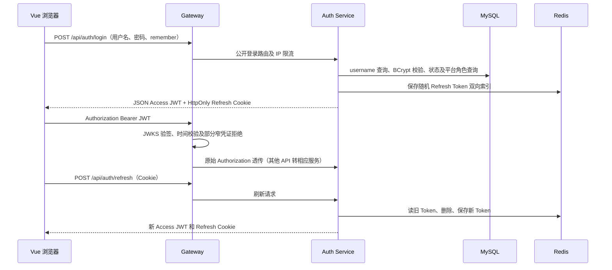
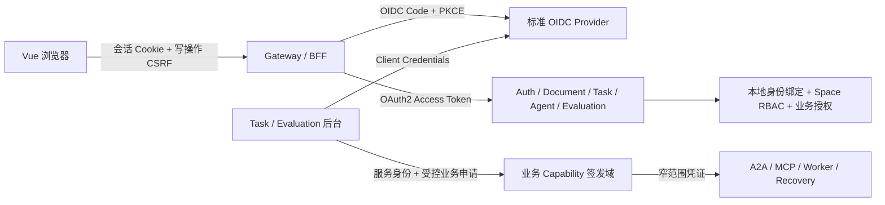

# v0.3.0 登录鉴权现状、身份认证标准化与业务授权边界评估

> 分析日期：2026-11-02（Asia/Shanghai）
> 代码基线：提交 `2bbf372`（Merge pull request #25，release/v0.2.0）。后端和前端版本均为 `0.2.0`。
> 状态：讨论稿，不是已经批准的架构决策或 v0.3.0 承诺清单。
> 范围：源码、配置、迁移、测试代码和官方协议/产品资料的静态分析；未执行动态安全验证。

> 后续设计：维护者已于 2026-11-02 确认 Keycloak + Gateway BFF。以下保留分析阶段的方案比较与待定背景；目标方案见 [v0.3.0 详细技术设计](v0.3.0-identity-security-design.md) 和 [ADR-0008](../adr/0008-standard-identity-and-business-authorization.md)，不把本分析中的候选值自动视为已批准配置。

## 1. 结论与建议

当前系统是“自定义账号登录和令牌签发 + Spring Security Resource Server + Space RBAC + 多种业务 Capability”。已经具备 JWT 验签基础，但没有实现完整的标准 OAuth2 Authorization Server / OIDC Provider，也没有真正的 OIDC 登录客户端。

v0.3.0 适合把**人类登录、客户端身份、服务身份和令牌生命周期**迁移到标准体系；Space 成员权限、文档审批、任务冻结输入、Replay 隔离和线上实验授权仍应由业务系统裁决。OAuth2 / OIDC 不会自动提供这些业务规则。

术语：OP 是 OIDC Provider，Authorization Server 是 OAuth2 授权服务器，Resource Server 是受保护 API，BFF 是由服务端为浏览器管理 OAuth 客户端和会话的架构模式。Client Credentials 是 OAuth2 授权类型，不是人类 OIDC 登录。“窄凭证”指限定具体用途和资源范围的专用凭证，通常短时有效；本项目 Task Capability 的 6 小时 TTL 仍需单独评估。

建议优先验证以下组合：

1. **Keycloak 作为参考 OIDC Provider**，应用以标准 OIDC 协议接入；现有组织、平台业务身份和 Space RBAC 继续由 Workbench 管理。
2. **浏览器采用 BFF 会话模式**：在现有 Gateway 承担 BFF 职责，使用授权码 + PKCE；Access/Refresh Token 保存在服务端，浏览器持有安全会话 Cookie。
3. **各服务继续使用 Spring Security Resource Server**，补齐 issuer、audience、令牌用途和主体类型校验；不把网关验签当成唯一防线。
4. **后台服务使用 Client Credentials 建立身份**，任务/评估/恢复授权继续绑定具体业务记录。不能用一个长期有效、权限宽泛的服务 Token 替代所有 Capability。
5. **分离用户 Token 与业务 Capability 的信任域**。先完成发行者、密钥、解码器和授权入口的明确划分，再决定是否进一步用 Token Exchange 统一业务凭证签发协议。

这是一项基于当前代码和平台定位的建议，不是用户已经选择 Keycloak 或 BFF。若“尽量保留现有账号库、部署形态和自有登录体验”优先级更高，Spring Authorization Server（下称 SAS）也是合理方案，但团队需要继续承担身份产品的维护工作。

还有两个需要明确的范围解释：

| 解释 | 实际工作 | 判断 |
| --- | --- | --- |
| 登录和服务认证全面标准化 | OIDC 登录、标准 Token Endpoint、Client Credentials、标准客户端与注销；保留业务授权凭证 | 推荐作为 v0.3.0 的基本边界 |
| 所有业务凭证也全部转换成 OAuth2 Access Token | 还要设计任务级委托、Token Exchange / 业务授权扩展及完整生命周期 | 范围明显更大，应单独决策，不能当作更换登录页的附带工作 |

## 2. 分析范围、方法与统计口径

### 2.1 范围

- 六个服务：Gateway、Auth、Document、Task、Agent、Evaluation。
- 公共模块：Security、Web、Feign Starter，以及 common-core 的身份工具、凭证协议、常量和契约。
- 前端：登录注册页、会话 Store、Axios、启动恢复、路由守卫、权限 Gate、空间权限缓存、平台用户及角色页面。
- 数据：用户、组织、平台角色、空间 RBAC、客户端预留表，任务/评估凭证存储及相关 Flyway 迁移。
- 非人类调用：MQ、A2A、Workbench MCP、回调、Evaluation Worker、线上实验保护、终态恢复和首次报告证明。
- 外部凭证：外部 MCP 认证、模型密钥和配置加密的边界。

### 2.2 方法与限制

1. 使用 `rg --files` 枚举源码；排除 `target`、`node_modules` 和生成产物。
2. 扫描六个服务全部 Java Controller 和 HTTP 映射；人工阅读核心签发、验证、权限及透传链路。
3. 对 `AuthUtils`、Capability Verifier、身份上下文和报告签名工具做引用统计，评估替换影响面。
4. 阅读现有测试，核查 OAuth/OIDC、Spring 和 Keycloak 官方资料。
5. 这是静态架构分析，不是对全部 409 个处理方法逐个完成的动态渗透测试，也没有查询线上账号、Token 或数据库实际行数。

“HTTP 处理方法数”统计 `@GetMapping/@PostMapping/@PutMapping/@DeleteMapping/@PatchMapping` 的声明数；一个映射声明计一个，不按请求参数或媒体类型展开。未计入 Actuator、Swagger、MCP 框架动态注册入口、未来 OIDC 框架入口。注解数量不等于安全覆盖率：没有 `@PreAuthorize` 的方法可能在 Service 校验；有 `@RequireLogin` 也不等于已经验证人类主体及资源权限。

### 2.3 六服务全量扫描统计

| 模块 | 主源码 Java 文件 | REST Controller | HTTP 处理方法 | `@RequireLogin` 声明 | `@PreAuthorize` 声明 | 调用 `AuthUtils` 的文件 |
| --- | ---: | ---: | ---: | ---: | ---: | ---: |
| auth-service | 61 | 9 | 37 | 5 | 3 | 5 |
| gateway-service | 6 | 0 | 0 | 0 | 0 | 0 |
| document-service | 97 | 14 | 76 | 12 | 23 | 6 |
| task-service | 180 | 18 | 80 | 20 | 0 | 12 |
| agent-service | 281 | 31 | 118 | 24 | 30 | 13 |
| evaluation-service | 290 | 19 | 98 | 21 | 0 | 19 |
| **合计** | **915** | **91** | **409** | **82** | **56** | **55** |

表注：`AuthUtils` 列按主源码中实际出现 `AuthUtils.` 调用的文件计数，不只统计 import；只计六个服务，公共模块不计入该列。

补充统计：

- Security Starter 有 **13 个主源码 Java 文件**。
- 六服务及公共模块共有 **95 个主源码 Java 文件**引用本次选定的身份基础组件。匹配组件为：`AuthUtils`、四种 Capability/Recovery Verifier、`AuthorizationContext`、`TaskCapabilityContext`、`ReportProofSignature`；包含组件自身与 import，不代表 95 个文件全部需要修改。
- 后端 `SpacePermissionConstant` 与前端权限目录均为 **31 项空间权限**。
- Auth 的 **37 个 HTTP 处理方法**中：账号会话 6、JWKS 1、平台用户/角色/部门 18、内部鉴权/凭证及用户查询 12。
- 后文保留 91 个 Controller、409 个映射的静态清单，便于实施时逐项归类和复核。

## 3. 当前体系实际如何工作

### 3.1 人类登录与会话



关键事实：

- `AuthService.login` **只按 username 查询**，虽然前端文案写“邮箱或用户名”；没有看到按邮箱登录实现。
- 密码使用 `BCryptPasswordEncoder`，注册、用户自改密码、管理员重置密码和管理员创建用户均在应用内完成。
- 用户 Access JWT：RS256；`iss=agent-doc-workbench`，`sub=本地数字 user.id`，`scope=user`，还有 `username`、`nickname`、`platformRoles`、`iat`、`exp`、`jti`。**没有用户 API 的 audience**。
- 默认 `access-ttl=7d`，`refresh-ttl=7d`；源码里“短期 Access Token”注释与默认值并不一致。
- Refresh Token 由 48 随机字节生成，Base64URL 编码；**不是 JWT**。
- Redis 保存 `token -> userId`、`userId -> token` 两个索引，后者保存原始 Token。新登录使旧 Refresh Token 失效，属于**单刷新会话**；旧 Access JWT 不会随之失效，因此不能理解为严格的“旧设备立即退出”。
- 刷新时先检查用户存在且启用，再撤销旧 Refresh Token 并签发新一对 Token。
- Cookie 名 `adw_refresh_token`、`adw_refresh_persistent`，均 HttpOnly，Path `/api/auth`，默认 SameSite Strict；本地 Secure=false，prod 配置 Secure=true。
- remember 只决定 Cookie 是否配置持久化 Max-Age；不改变服务器 7 天 TTL。
- `AuthResponseVO.refreshToken` 标注 `@JsonIgnore`，JSON 不向 JavaScript 返回 Refresh Token。
- 注销只撤销 Refresh Token；修改密码、管理员禁用/重置密码/变更平台角色也撤销 Refresh Token。没有统一的 Access JWT 撤销或登录会话版本校验。
- `/me` 从本地用户表读资料，存在性会检查；未在该方法中复核启用状态。普通空间请求也没有统一复核用户启用状态。

依据：`AuthController`、`AuthService`、`RefreshTokenService`、`JwtService`、`PlatformUserService`、`AuthResponseVO` 和 Auth 配置。

### 3.1.1 基础账号安全与密钥根现状（评审补查）

- 注册、自改密码、管理员创建/重置均只要求非空和 6–64 字符；用户名另有格式限制。当前 Auth/Gateway 源码未发现账号级连续失败计数与锁定、弱密码拦截、密码历史或异常登录检测；已有 IP 限流和登录结果日志不能等同这些能力。没有核查外部 WAF 或 IdP，不能据此断言部署侧完全没有防护。
- 不把“复杂字符组合、密码历史、永久锁号”机械列为必做功能；应根据账号场景确定长度、弱密码防护、失败节流和恢复策略，优先由选中 IdP 承担，避免新建一套即将退役的账号系统。
- 仓库 Auth 配置通过 `JWT_PRIVATE_KEY` / `JWT_PUBLIC_KEY` 环境变量读取 PEM，`.env.example` 为空占位；本次读取的配置未包含 RSA 密钥正文。密钥加载到应用内存，没有发现 KMS/HSM 调用或完整密钥环。
- 没有读取真实部署环境、Secret 或备份，因此无法证明生产私钥的文件/进程访问权限、加密备份和运维授权已落实。prod 配置目前只强制 Cookie 属性，未强制拒绝缺失 RSA 配置的临时密钥模式。

### 3.2 前端登录、恢复与权限展示

| 位置 | 当前职责 | 替换影响 |
| --- | --- | --- |
| `views/LoginView.vue` | 账号/密码、注册、remember；OAuth2/GitHub/企业登录/忘记密码为“即将支持” | 改为标准跳转或 IdP 登录入口；注册及密码管理归属要先确定 |
| `features/auth/api/auth-api.ts` | login、refresh、register、logout、password | 替换自定义登录协议；保留应用会话查询按需设计 |
| `stores/auth.ts` | Access Token、用户、平台角色保存在 Pinia 内存 | BFF 下去掉浏览器 Token 职责，保存用户和授权投影 |
| `main.ts` | 启动时 refresh 恢复会话，再挂载路由 | BFF 下改为查询应用会话；SPA 下由标准 OIDC 客户端恢复 |
| `api/auth-session.ts` | 同页面刷新单飞、会话过期回调 | BFF 下刷新在服务端；SPA 需考虑多标签协调 |
| `api/client.ts` | 自动加 Bearer、携带 Cookie、401/业务鉴权码时刷新重试一次 | BFF 下携带会话 Cookie 和 CSRF 信息；避免 API 302 被 Axios 当业务响应 |
| `router/guards.ts` | 登录、平台角色、空间成员、权限码守卫 | 保留 UI 守卫，更新会话来源及 OIDC 回调公开路由 |
| `PermissionGate.vue`、workspace Store | 按已加载空间权限展示组件 | 保留；权限变更后的刷新/失效策略应明确 |
| 平台用户、部门、AccessControl 页面 | 应用内账号及组织/角色管理 | 区分 IdP 凭据管理与 Workbench 业务资料/权限管理 |

本次未发现 Access/Refresh Token 写入 localStorage/sessionStorage。前端内存刷新单飞只协调当前 JavaScript 页面，不能解决多个标签页同时使用共享 Refresh Cookie 的后端轮换竞态。前端 `expiresIn` 当前没有用来做到期前的统一调度。

### 3.3 Gateway

- WebFlux Gateway，自定义 `GlobalFilter`，不是标准 `SecurityWebFilterChain` 实现的 Resource Server 门禁。
- `NimbusJwtDecoder.withJwkSetUri` 使用 Auth JWKS 验签，保留原始 Authorization；没有把 `X-User-*` 当作身份来源。
- 使用的是同步 `JwtDecoder.decode`；冷缓存/密钥刷新可能涉及阻塞远程访问，不适合长期放在响应式事件循环链路中。
- 免鉴权：注册、登录、refresh、logout、JWKS、健康/文档、favicon、Agent Card；OPTIONS 也放行。内部受限路径判断在白名单及 OPTIONS 之前执行。
- 明确拦截线上窄凭证相关路径、恢复相关路径、Agent 内部报告入口、Document 任务草稿入口，以及根 `/internal/**`。
- **不等于封禁所有路径中带 `/internal/` 的业务 API**：如 `/api/auth/internal/task-capabilities`、部分 `/api/agent/internal/executions/**` 不在当前封禁条件内。
- 全局 Redis IP 令牌桶配置为补充速率 100、容量 200；登录额外为速率 5、容量 10。真实生效顺序、反向代理后的客户端 IP 和 Redis 故障策略需部署验证；不能据配置就认定完整抵抗撞库。
- Gateway 和 Auth 都允许任意 Origin Pattern 并启用 credentials。

### 3.4 业务服务认证与鉴权

```text
Authorization Bearer
  -> Spring Security Resource Server -> JwtAuthenticationToken
  -> PermissionInterceptor（仅 /api/** 的 @RequireLogin）
  -> @PreAuthorize / Service 显式校验
  -> SpacePermission / PlatformRole / Capability / 资源归属规则
```

- Auth 自定义安全链：公开入口 permitAll，其余 authenticated。
- Document/Task/Agent/Evaluation 使用通用 Security Starter，默认 `anyRequest().permitAll()`；带 Bearer 时仍会验签，但不带 Token 时需要依靠注解/业务校验阻断。
- `PermissionInterceptor` 只判断认证对象是否非匿名且 authenticated，**不区分人类、Agent、服务**。
- `AuthUtils.getUserId()` 要求 `scope` **恰好等于** `user`，并将 `sub` 直接 `Long.valueOf`。接入通常使用字符串/UUID sub 的 OIDC Provider，或把 scope 改成 `openid profile ...`，都会直接破坏现有识别逻辑。
- `AuthUtils` 还同时承担 Agent task/space/document/action 读取。替换用户身份解析时不能破坏任务令牌路径。
- 无通用用户 `iss` 和 `aud` 显式校验配置；线上与恢复专用 Verifier 则有更严格的 issuer、audience、purpose、TTL 等校验。不能把这两类情况混为一谈。

### 3.5 平台角色、组织与空间 RBAC

| 层次 | 当前权威数据/判断 | 应保留的语义 |
| --- | --- | --- |
| 平台账号 | `user`、BCrypt、status | 迁移后保留本地业务 user.id 和审计关联；认证凭据可外置 |
| 组织 | `department`、user.department_id、职位、负责人 | 组织结构不自动授予 Space 权限 |
| 平台角色 | `platform_role`、`user_platform_role` | 平台管理操作实时复核，不仅信任 Token 里的角色投影 |
| 空间成员 | `member(user_id, space_id, role_id)` | 身份登录成功不代表有权访问任何 Space |
| 空间角色 | `space_role`、`space_role_permission` | OWNER 受保护；EDITOR/VIEWER 和自定义角色按业务规则管理 |
| 权限目录 | `permission`、31 项常量 | 保留稳定标识，不将每个 Space 权限全部塞进 IdP Token |
| 正式文档 | ChangeRequest/审批、版本条件写入 | 身份平台不能绕过审批和乐观锁 |

`SpacePermissionService` 是空间授权中心，其他服务通过 `DocumentFeign` 校验。平台超管仅能按明确的跨空间读权限集合获得例外；写操作不能直接全放行。线上保护还会实时检查授权人是真实受保护 OWNER，并具备评估和终止权限。

`PlatformAccessService` / `SpacePermissionService.isPlatformSuperAdmin` 先看 JWT 角色投影，再回 Auth 查询实时角色，远程失败拒绝。撤销高权限通常能被实时查询阻断；新增角色后前端/旧 JWT 仍需要刷新。迁移不能把这条链退化为只检查 IdP role claim。

## 4. 非人类凭证完整分类

### 4.1 当前 JWT 共有 9 种语义用途

按 subject、audience 和用途拆分，而不是只按签发 Java 方法数计算：

| # | 用途 | 传递入口 | audience / 关键约束 | 有效期 |
| ---: | --- | --- | --- | --- |
| 1 | 人类 Access JWT | Authorization Bearer | scope=user、数字 sub；当前无 aud | 默认 7 天 |
| 2 | Task Capability | A2A/MCP Bearer；X-Task-Capability | workbench-task-capability；任务/Agent/Space/Document、动作、冻结输入/版本/模式 | 6 小时 |
| 3 | Evaluation Worker | X-Evaluation-Worker-Capability | task-service-internal；runId、spaceId、任务集合 hash、workerActions | 签发参数限制 300–86400 秒 |
| 4 | 线上 WAIT | X-ONLINE-CAPABILITY | online-assignment-wait；单 Task、assignment、binding/manifest hash；不能执行 Agent 动作 | 300 秒 |
| 5 | 线上 CONTROL | X-ONLINE-CAPABILITY | online-experiment-control；实验及授权 OWNER | 最长 300 秒 |
| 6 | 线上 OBSERVE | X-ONLINE-CAPABILITY | online-experiment-observe；确切 Task 集合 | 最长 300 秒，受来源到期约束 |
| 7 | 线上 CANCEL | X-ONLINE-CAPABILITY | online-experiment-cancel；确切 Task 集合 | 最长 300 秒，受来源到期约束 |
| 8 | A2A 终态恢复 | X-Task-Recovery-Capability | agent-service-task-recovery；历史证明、冻结身份、现有 A2A task、QUERY/CANCEL | 300 秒 |
| 9 | 草稿终态收尾 | X-Task-Recovery-Capability | document-service-task-finalization；FINALIZE/DISCARD、终态 | 60 秒 |

这 9 类目前都由 `JwtService` 使用 Auth RSA 密钥签发并通过同一个 JWKS 发布。线上派发交换后的 Agent Token 属于第 2 类，额外绑定 assignment、slot generation/permit 等；A2A 回调复用第 2 类，不另算一种 JWT。

其他凭据至少还包括：

| 凭据 | 当前作用 | 与 OAuth2 迁移的关系 |
| --- | --- | --- |
| 随机 Refresh Token | 浏览器刷新会话，Redis 双向索引 | 用授权服务器/BFF 的生命周期替代 |
| X-Task-Recovery-Machine-Key | Task 向 Auth 申请恢复窄凭证的机器认证；支持短暂旧密钥重叠 | 可由专用服务 Client Credentials 替代机器身份；历史证明授权继续保留 |
| X-Report-Proof | 离线实验首次报告候选证明，HMAC-SHA256，60 秒 | 评估用标准服务认证替代后，仍须绑定 id/space/hash 和时效 |
| 外部 MCP 的 Bearer / Query API Key | 对第三方 MCP 的出站认证 | 不应自动换成 Workbench 用户 Token；第三方 OAuth 是另一个授权关系 |
| 模型 API Key | 调用模型供应商 | 不属于 OIDC 用户会话 |
| AES 配置/凭证加密密钥 | Agent 配置、Task Capability、Worker Capability 加密存储 | 属于静态数据保护，不因使用 OAuth2 就可以删除或随意轮换 |

### 4.2 任务、评估和恢复链路

1. 用户创建任务，经 Space 权限检查，Task 冻结业务输入并向 Auth 申请 Task Capability。
2. Capability 加密保存；MQ 主要投递 taskId。执行线程解密凭证，调用 A2A，再通过 Workbench MCP 和 Document 执行限定动作。
3. `TaskCapabilityAuthenticationFilter` 解析专用头，或指定 A2A/MCP 端点的 Bearer；设置 Agent SecurityContext 与 TaskCapabilityContext，请求结束恢复/清理。
4. A2A 校验消息输入与 Token 的 task/agent/space/document/mode/冻结 hash 一致；查询、取消等按绑定任务检查。
5. Document 的 Agent 写操作会复核任务范围与 Task 当前权威状态，不能只依靠签名。
6. Evaluation Worker 仅读取/校验/取消绑定 Run 的任务集合；它不是用户身份，不能获得任意空间访问权。
7. 线上 WAIT 只用于等待与交换；经权威槽校验后才能形成执行凭证。CONTROL/OBSERVE/CANCEL 不进入普通用户/Agent 上下文。
8. Task 超过原 Capability 有效期后的终态恢复使用专门机器身份及过期历史证明，不延长普通任务权限。历史 Decoder 关闭常规时间校验后，由专用代码逐项核验；这不是允许普通 API 接受过期 Token。
9. A2A Callback 使用 Notification Token 校验并回查远端状态；迁移时必须覆盖 callback、stream、subscribe、cancel 与推送配置接口，不能只验证 message:send。

### 4.3 Feign 与异步身份透传

`AuthHeaderForwardInterceptor` 当前优先使用 Servlet Authorization，其次使用 `AuthorizationContext`，并附加 `TaskCapabilityContext`。专用恢复、线上和报告证明调用会移除用户/Agent 头，避免混合身份。

同步用户调用较适合保留标准 Access Token 透传，但新 audience 必须覆盖实际下游。异步调用应使用明确的服务身份或任务委托，不能长期保存用户会话 Token。线程上下文在 finally 中清理的约束应保留，并新增跨线程/并发泄漏测试。

当前的准确缺口是：**缺少通用标准 OAuth2 服务客户端身份基线**。同步 Feign 大量依赖用户 Token 透传，但异步 Task、Evaluation Worker、恢复和报告链路已经有专用凭证，能够脱离用户会话运行；不能将现状描述为“所有服务间调用都依赖用户会话，后台无法独立运行”。

## 5. Auth 服务全部 37 个入口及迁移归属

### 5.1 账号、会话及公钥（7）

| 入口 | 当前认证 | 建议归属 |
| --- | --- | --- |
| POST `/api/auth/register` | 公开 | IdP 注册，或受控供应/邀请流程；不保留第二套密码写入 |
| POST `/api/auth/login` | 公开，用户名密码 | 标准授权码登录入口；切换后退役自定义 Token 登录 |
| POST `/api/auth/refresh` | Refresh Cookie | 授权服务器 Token Endpoint，由 BFF 调用 |
| POST `/api/auth/logout` | Refresh Cookie | 本地会话清理 + 选定的 OIDC 注销语义 |
| PUT `/api/auth/password` | 已认证，业务检查用户和旧密码 | IdP Account Console / 密码修改流程 |
| GET `/api/auth/me` | 已认证，读取本地 user | 保留业务资料/角色投影或改为 `/api/session`；不冒充标准 UserInfo |
| GET `/oauth2/jwks` | 公开 | 人类 Token 用 IdP discovery 中的 JWKS；业务凭证信任域另行迁移 |

### 5.2 平台管理（18）

| 资源 | 方法 | 当前授权 | 迁移建议 |
| --- | --- | --- | --- |
| `/api/platform/users/search`、`/stats`、`/{userId}` | POST search、GET stats/detail | 平台超管实时校验 | 保留应用用户查询 |
| `/api/platform/users` | POST | 同上 | 新增应用用户/绑定 IdP 的职责要明确 |
| `/api/platform/users/{userId}` | PUT | 同上 | 资料字段来源分工，避免双向覆盖 |
| `/api/platform/users/{userId}/status` | PUT | 同上，撤销 Refresh Token | 同时落实应用禁用及 IdP 会话处置语义 |
| `/api/platform/users/{userId}/password` | PUT | 同上，撤销 Refresh Token | 移至 IdP 管理或受限管理 API；避免后端持有过宽 IdP 管理凭据 |
| `/api/platform/users/{userId}/platform-roles` | PUT | 同上，最后超管保护 | 保留业务角色权威及最后有效超管保护 |
| `/api/platform/roles`、`/{roleId}` | GET list/detail、POST、PUT、DELETE | 同上 | 保留平台业务角色；不要与 IdP 管理角色混用 |
| `/api/platform/departments`、`/{departmentId}` | GET list/detail、POST、PUT、DELETE | 同上 | 保留，或以后另做组织同步专项 |

### 5.3 内部认证/凭证及查询（12）

| 入口 | 当前边界 | 迁移要求 |
| --- | --- | --- |
| POST `/api/auth/internal/task-capabilities` | 普通 authenticated；参数检查；未限制调用服务 | 专用 task-service 客户端 + 窄 scope + 任务权威授权复核 |
| POST `/api/auth/internal/evaluation-worker-capabilities` | 普通 authenticated；参数检查；未限制调用服务 | 专用允许签发方 + Run/任务集合授权复核 |
| GET `/api/auth/internal/platform-role` | 当前用户实时角色复查 | 保留用户上下文；服务身份不能冒充任意用户 |
| POST `/api/auth/internal/users/query` | authenticated，批量最小用户投影 | 明确允许的服务/用户用途和最小返回字段 |
| POST `/api/auth/internal/task-recovery-capabilities` | Security permitAll，但有机器密钥、传输和历史证明检查 | 服务认证替换机器密钥；保留证明、用途、TTL 和资源约束 |
| POST `/api/auth/internal/task-draft-finalization-capabilities` | 同上，草稿终态专用 | 同上，不能扩大为普通写入 |
| POST `/api/auth/internal/online-control-authorizations` | 人类登录 + OWNER/业务证明；公共网关封禁线上内部路径 | 保留真实用户授权人，再派生后台能力 |
| POST `/api/auth/internal/online-capabilities` | 专用 CONTROL 头、用途与权威证明 | 不接受普通用户/宽泛服务 Token 替代业务授权 |
| GET `/api/auth/internal/online-release` | 专用线上凭证 | 保留用途约束，不能成为一般匿名配置接口 |
| POST `/api/auth/internal/online-waits/{taskId}/human` | 人类登录及任务创建授权；内部直连 | 保留当前用户及 Task 绑定 |
| POST `/api/auth/internal/online-waits/{taskId}/renew` | 专用 WAIT 与权威状态 | 服务身份与 WAIT 业务授权分别检查 |
| POST `/api/auth/internal/online-waits/{taskId}/exchange` | 专用 WAIT、权威槽校验 | 不能用通用 Client Credentials 跳过槽交换 |

Security 层的 permitAll 不能单独作为漏洞证据：恢复和线上入口还存在传输过滤器及业务 Verifier。反过来，方法名叫 internal 也不构成认证或授权措施。

## 6. 已确认问题与待验证风险

下列“高/中”为本次规划排序，不是动态验证后的漏洞评分。没有向运行环境发送利用请求。

| 编号 | 优先级 | 发现及证据 | 影响与建议 |
| --- | --- | --- | --- |
| AUTH-F01 | 高 | Task/Worker 两个 DTO 接收调用者声明的资源 ID、hash、actions；AuthService 通过参数检查后直接调用 JwtService，未认证专用服务或复核 Task/Run/Space 归属；默认 Gateway 与 Auth 安全链允许有效用户 Bearer 走到该逻辑 | 已确认源码存在未经业务授权的签发路径；实际部署可达性与下游可利用上限尚未动态验证。不能据此断言可任意写正式文档，也不能把已读到的缺失校验仅写成猜测。阶段 0 优先验证并明确修复，证据见 6.1 |
| AUTH-F02 | 高 | Access 默认 7d；logout/禁用/改密仅撤销 Refresh；普通空间请求无统一启用状态检查 | 被盗或旧 Access Token 仍可在有效期内用于部分普通 API。短 Access TTL，并明确禁用/撤销传播 SLA；高风险操作实时复核 |
| AUTH-F03 | 高 | Gateway/Auth/通用 Decoder 手动使用 JWKS/public key，未给用户 Token 设置 issuer/audience Validator；用户 Token 本身无 aud | 信任边界仅依赖密钥不足。建立受信 issuer、API aud、用途/主体约束；保留专用凭证独立验证 |
| AUTH-F04 | 高，按暴露面复核 | 通用安全链 permitAll；部分内部投影无主体/资源授权；默认 Gateway 没有封禁这些 `/api/.../internal/**`；所查返回值为作用域、预算/价格、执行用量等元数据 | 未确认暴露模型密钥或文档正文。默认源码边界不足，生产入口、防火墙/mTLS/NetworkPolicy 尚未验证，不能视作已存在保护。内部服务接口和用户 API 应分别定义允许的主体，证据见 6.2 |
| AUTH-F05 | 当前按场景评估；BFF 上线前高优先级 | Auth 和 Gateway 允许任意 Origin Pattern + credentials；refresh/logout 使用 Cookie；CSRF 全关闭 | 普通 Bearer API 不自动携带用户 Token，不能泛称全部接口都有 CSRF。Strict 对跨站有缓解，但同站不同源不等于被阻断。先收紧 Origin；BFF 切换前落实会话绑定的 CSRF、回调及 Cookie 设计 |
| AUTH-F06 | 中 | Refresh validate/revoke/store 为多次 Redis 调用，非原子；无 Token family/复用检测；前端仅页面内单飞 | 并发刷新/登录可能产生索引竞态；旧 Token 复用不能撤销整条授权。迁移到成熟生命周期，并验证多标签/多实例并发 |
| AUTH-F07 | 中 | 所有 JWT 共用 RSA/JWKS；kid 在每次实例启动时随机；JWKS 仅当前一把公钥；prod 未强制拒绝临时密钥 | 人类会话迁移会连带影响 6 小时任务、Worker 和历史恢复证明；持久密钥多实例也可能 kid 不一致。稳定 kid、受控密钥环、旧公钥保留与用途分域 |
| AUTH-F08 | 中 | Gateway 使用同步 JwtDecoder；冷缓存/刷新可能拉远端 JWKS | 改为响应式 Resource Server/ReactiveJwtDecoder；验证 JWKS 不可用时的超时、缓存和恢复 |
| AUTH-F09 | 中 | PermissionInterceptor 仅判断 authenticated；AuthUtils 要求 scope=user 且数字 sub | 接入标准多 scope、UUID sub 后会错误拒绝、异常或混淆主体。身份映射与业务 user.id 应先设计 |
| AUTH-F10 | 中 | BusinessException 返回 HTTP 200 + 业务码；Security 返回 401；PreAuthorize 返回 403；部分 Filter 返回空 401 | 标准客户端无法只凭 HTTP 语义稳定工作。认证协议端点使用框架标准响应；API 统一 401/403 与前端恢复策略 |
| AUTH-F11 | 中 | oauth2_client 只有表、Entity、Mapper；未发现标准客户端仓储、Token Endpoint、Consent/Authorization 实现 | 不可把预留表视作已有 OAuth2 Server；不要直接套 SAS 表结构或声称已有 Client Credentials |
| AUTH-F12 | 中 | 用户 email 非唯一、当前无邮件验证；无 issuer/sub 绑定表 | 不能按邮箱自动合并外部账号。建立可靠绑定、冲突处理和迁移台账 |
| AUTH-F13 | 低 | UI 的 OAuth2/GitHub/忘记密码仅占位；用户名输入文案与后端不符 | 设计真正可用的登录/注册/恢复入口，不把“新增按钮”计作接入完成 |
| AUTH-F14 | 高，条件为 Redis/备份可读泄露 | Refresh Token 原值同时出现在 Redis 主键后缀和用户索引值；不是只有 value 泄露才有影响 | 当前签发服务可用 SHA-256(Token) 或带独立受管密钥的 HMAC 作为双向索引，避免保留可直接重放的原值。是否先修或随 IdP 切换退役按暴露期决定；不能将哈希方案直接照搬到必须向上游提交原 Token 的 BFF |
| AUTH-F15 | 中，策略待定 | 密码仅非空及 6–64 字符，未发现账号级失败节流/弱密码拦截/历史与异常检测实现 | 摸清账号及外围防护后确定最小策略，由 IdP 配置和测试；不将所有账号安全候选功能自动加入 v0.3.0 |

### 6.1 AUTH-F01：签发路径证据及验证边界

| 链路 | 已核查事实 |
| --- | --- |
| 请求参数 | `TaskCapabilityIssueDTO:24` 含 taskId/agentId/spaceId/documentId、冻结版本/hash、executionMode、actions；`EvaluationWorkerCapabilityIssueDTO:14` 含 runId/spaceId/taskIdsHash/ttlSeconds/actions。Worker 接收集合 hash，不是完整 taskSet |
| Controller | `AuthController:134/140` 将请求直接交 AuthService，没有专用 client/scope 的方法检查 |
| Auth 安全链 | `SecurityConfig:84` 中两条路径不在公开名单，走 `anyRequest().authenticated()`；没有要求专用服务身份 |
| 网关匹配 | `JwtAuthenticationFilter:87–114` 封禁根 `/internal/**`、线上前缀及特定恢复路径；这两个 `/api/auth/internal/...-capabilities` 均不匹配。之后校验 Bearer 并透传；默认 Auth 路由覆盖 `/api/auth/**` |
| Task 签发 | `AuthService:198` 拒绝非空 onlineIdentity，要求一组字段非空、actions 非空、派生 hash 满足格式；随后直接调用 `createTaskCapabilityToken`。未查 Task/Space/Agent 归属、动作授权或调用者服务身份 |
| Worker 签发 | `AuthService:226` 检查 ID 非空、taskIdsHash 长度、TTL 300–86400、actions 非空；随后直接签发。未查 Run/任务集合与授权来源 |
| 签名端 | `JwtService:215/310` 将传入范围和动作写入 JWT；未发现补充归属校验 |

因此，“调用者可提交超出自身授权的参数，源码签发路径没有业务授权拦截”已得到直接证据支持。动态验收应以低权限测试用户、合法/越权资源组合验证响应，再分别验证下游拒绝边界；没有完成这些步骤前，不报告“线上利用已确认”或“任意正式文档可写”。

### 6.2 AUTH-F04：内部投影的实际数据与网络边界

| 代表入口 | 已核查返回内容 | 边界结论 |
| --- | --- | --- |
| `/api/agent/internal/agents/{agentId}/execution-profile` | Agent/Space/Model ID、tokenBudget、documentScope、configVersion、enabled、输入/输出单价 | `AgentService:298` 无调用者授权；所查 VO 不含模型 API Key、Prompt 或文档正文 |
| `/api/agent/internal/executions/by-task/{taskId}/token-usage` 及批量查询 | executionId/modelId、计价版本/价格/币种、时间、Token 数及估算标记；批量仅用量投影 | 无统一服务身份检查；`recordOnlineExposure` 对人类线上读取还有额外调用，但不是所有内部请求的授权门禁 |
| `/api/agent/internal/executions/evaluation-evidence/query` | Task/Execution ID、执行状态、trace/span ID、起止时间、工具/失败/外部 MCP 调用数 | 元数据仍应按用途授权；不能升级描述成已暴露工具参数和正文 |

这几条入口在通用 permitAll 安全链和默认网关规则下缺少一致服务门禁。仓库 Compose 主要定义基础设施，未找到可据以证明这些业务入口已经受 NetworkPolicy/mTLS 保护的部署清单；这不证明生产没有外部防护。网络隔离能降低可达性，但不能代替应用服务身份及资源授权。对用户 API 则应保留用户身份和 RBAC，不能一刀切全部改为机器调用。

### 6.3 Refresh Token 验证存储与 BFF 代持存储的区别

当前 Auth 是随机 Refresh Token 的**签发/验证方**，可仅存摘要，用户索引指向摘要；撤销和原子轮换也须一起调整。Token family 的重放检测是另一项生命周期能力，不能由哈希存储自动获得。

BFF 是上游 IdP Token 的**持有/使用方**，刷新时需要原始 Refresh Token，因此通常需要受控的可解密存储或安全凭据存储，并限制 Redis、备份、进程和解密密钥的访问。不能承诺“所有 Refresh Token 一律只存哈希”。只读泄露风险与 Redis 写权限遭攻破也应分开讨论；哈希索引不能防止攻击者篡改整个授权存储。

### 6.4 密钥轮换和历史公钥退役的可执行约束

1. 同一公钥在多实例和重启后应保持稳定 kid，可采用已持久化的随机 ID，或基于 RFC 7638 的 JWK Thumbprint；**指纹是一种方案，不是唯一标准要求**。[RFC 7638](https://www.rfc-editor.org/rfc/rfc7638.html)
2. 生产缺失/不完整或解析失败的必要签名密钥应启动失败；开发临时密钥仅允许明确的开发模式。私钥由受管 Secret 或现有合适的密钥设施保管，权限、备份和轮换人可审计，不硬性要求为了本版新增 KMS/HSM。
3. 记录每个 key 的开始/停止签发时间、最后签发凭证的 exp、最晚接受历史证明的截止时间、用途与撤销状态。先发布新公钥并完成传播，再开始新私钥签发；旧私钥停止签发与旧公钥停止验签分别管理。
4. 正常轮换的验证保留期覆盖最后有效凭证、历史恢复证明接受窗口、缓存传播及明确 clock skew/安全余量；应按实际时间戳取所需窗口，不能只用“最长 JWT TTL”推算。缓存已保留旧公钥可能延长实际可接受时间，须测量，不能靠移出 JWKS 保证即时撤销。
5. 目前没有经本次确认的历史恢复证明最长保留 SLA，所以不能编造固定天数。阶段 0 应确定 Task/Worker/恢复的最长窗口及旧任务清单，形成每把旧 key 的退役日期；截止后拒绝原证明，未收尾任务进入明确人工处理，而非无限接受旧凭证。
6. 人类与服务 Token 若由同一受控 IdP 密钥签名，可通过严格 issuer/aud/client/主体/用途/权限约束区分；需要密码学隔离的业务签发域则使用独立密钥和受限验证器。**仅不同 kid 或不同 Decoder 包装同一把公钥，不提供密码学隔离**。
7. 密钥泄露/撤销是应急路径，不适用正常长重叠期：拒绝被撤销 key 及其历史证明，接受会话/任务受影响并走应急收尾。上线前演练正常轮换、多实例冷缓存和紧急撤销，结果形成记录。

还需要避免的错误判断：

- 持久化同一 RSA 公钥但随机更换 kid，并不等于密码学上的旧签名立刻失效；问题是缓存、kid 匹配和多实例 JWKS 的可靠性，需要验证。临时密钥重启才会直接改变验证密钥。
- 现有恢复机制刻意接受“过期的历史证明”，是专用、受限流程；不能为了统一 Decoder 而将普通访问 Token 的到期校验一起关闭。

## 7. 标准能力差距

| 能力 | 当前 | v0.3.0 建议 |
| --- | --- | --- |
| JWT RS256 / JWKS / Resource Server | 已有 | 继续使用标准组件，补齐验证契约 |
| OIDC Discovery / 标准 issuer URL | 无 | 必须 |
| Authorization Code + PKCE S256 | 无 | 浏览器标准登录必须 |
| state / nonce / 精确 redirect URI | 无 OIDC 流程 | 由标准客户端/Provider 处理，测试异常回调 |
| ID Token | 无 | 仅用于 OIDC 客户端登录验证，不能作为业务 API Access Token |
| 标准 Token Endpoint / refresh grant | 无，自定义 Cookie refresh | 由 Provider 实现 |
| 标准客户端注册/认证 | 预留表，未接入 | 首版静态登记客户端即可；无需公开动态注册 |
| Client Credentials | 无标准端点 | Task、Evaluation 等后台最小服务身份 |
| Refresh 复用检测与授权族撤销 | 当前无 | 选型验证，不能只看“每次生成新字符串” |
| UserInfo | `/me` 为应用用户资料接口 | 标准 UserInfo 与 Workbench 资料分开 |
| OIDC 注销 / 会话终止 | 本地撤销 Refresh | 至少定义本地注销与 Provider 注销；按需要验证后台注销 |
| Token revocation / introspection | 无标准端点 | Provider 能力；按真实撤销 SLA 选择，避免所有请求无条件远程 introspection |
| 稳定 kid / 密钥轮换重叠 | 不完整 | 必须演练 |
| MFA、邮件验证、密码找回 | 未见完整实现 | 若选择成熟 IdP，可配置启用；具体场景另定，不自动扩张版本承诺 |
| Space RBAC / 任务级授权 / 文档审批 | 已有 | 作为不可退化的业务契约保留 |

协议依据：OIDC 在 OAuth2 上定义身份层；用户标识必须结合 issuer 与 subject 理解。当前自定义 JWT 登录不是因为使用了 `/oauth2/jwks` 路径就成为 OIDC。[OpenID Connect Core](https://openid.net/specs/openid-connect-core-1_0.html)

安全基线应遵循授权码 + PKCE、受众约束和受保护的 Refresh 生命周期，不引入密码授权来包装旧登录接口。[RFC 9700](https://www.rfc-editor.org/rfc/rfc9700.html)

## 8. 授权服务器/身份平台选型

### 8.1 比较

| 维度 | Keycloak / 外置成熟 IdP | Spring Authorization Server |
| --- | --- | --- |
| 定位 | 身份产品，应用负责集成 | OAuth/OIDC 框架，团队仍建设身份产品 |
| 协议能力 | 标准发现、登录、Token、UserInfo、注销等由产品提供 | 框架提供标准端点、Grant 和扩展能力 |
| 现有 user/BCrypt 复用 | 需要迁移、重置或有界联邦方案，不能默认直接导入 | 比较容易继续使用本地账号及密码编码器 |
| 密码/MFA/注册/账号恢复 | 可使用产品能力及配置 | 仍需要实现或整合用户流程与运维能力 |
| 企业身份接入 | 可经身份代理/联邦集中接入 | 可以整合上游 IdP，但组合、管理和运维由团队承担 |
| 维护边界 | 新增 IdP 部署、数据库、备份、升级、监控 | 新增授权持久化、会话、密钥、UI、安全维护等应用职责 |
| 现有自定义凭证 | 应独立为业务授权域，避免大量 IdP 插件 | 容易留在 Java 体系，也容易再次混入自定义认证逻辑 |
| 开源用户部署 | 多一个身份平台组件，但有统一参考配置 | 进程数量可能较少；团队长期维护负担较大 |
| 本项目适配 | 与“Agent 平台，不建设完整 IAM”的路线图一致 | 当“自包含、保留账号、深度定制”是明确需求时适用 |

Keycloak 官方列出了标准 OIDC 发现、认证、Token、UserInfo、公钥、注销和撤销入口；这里的集成推荐是基于这些产品能力与项目边界做出的判断。[Keycloak OIDC endpoints](https://www.keycloak.org/securing-apps/oidc-layers)

本次查阅的 SAS **1.5.8 官方参考文档**列出授权码、Client Credentials、Refresh、Token Exchange 及 OIDC 端点；这是该文档版本的能力，不代表项目当前已引入这些功能，也不证明其他版本配置完全相同。SAS 是框架，不是安装依赖后就接管现有用户管理的完整 IAM 产品。[Spring Authorization Server Overview](https://docs.spring.io/spring-authorization-server/reference/overview.html)

### 8.2 推荐的取舍

建议先做 Keycloak 的参考实现，应用只依赖明确的 OIDC 契约。先把一个 Provider 跑通，不在 v0.3.0 同时实现 Keycloak、Authentik、SAS 三套运行模式或多个厂商管理 API 适配器。

若最终选择 SAS，应使用 Spring Boot 管理的兼容依赖，先核对当前 Boot 3.5.8、Cloud 2025.0.0、JDK 21 的解析结果。不要照官方最新版 7.x 示例就顺带升级整个 Spring 主版本。官方提供 Boot 授权服务器 Starter；采用它仍需真实持久化客户端、授权、同意记录、会话和稳定密钥。[SAS Getting Started](https://docs.spring.io/spring-authorization-server/reference/getting-started.html)

本次不锁定 Keycloak/SAS 新版本号：实施时需要按选定版本验证支持周期、数据库要求和依赖兼容。现有 MySQL 5.7 是 Workbench 的约束，不代表选中的 IdP 也能复用该数据库版本；IdP 应采用其支持的独立数据库/Schema 与迁移生命周期。

补充依赖边界：**Spring Boot 3.5.8 BOM**管理 Spring Security **6.5.7**、SAS **1.5.3**；仓库 POM 未发现覆盖这两项版本的配置，也尚未引入 SAS。它说明默认管理版本，不等于新增依赖后的完整 dependency tree 已验证。本次没有执行 Maven 解析或构建。后续选 1.5.3、兼容补丁升级或其他组合时，必须锁版本并跑实际依赖/协议测试。

Keycloak 的数据库支持应核对所选发行版的官方矩阵，不能只看数据库类型包含 MySQL 就假设支持 5.7。[Keycloak Database Guide](https://www.keycloak.org/server/db)

SAS 可以复用 BCrypt 和本地账号，但仍需验证用户状态、主体映射、会话、授权/同意记录和旧 Token 切换，不能称“无缝且几乎零迁移”。Keycloak 的企业上游是否内置也必须按 LDAP、具体 OIDC/SAML Provider 或其他协议逐一核查；不能将所有企业登录（例如任意企业微信适配）统称为开箱即用。无需定制的登录界面可用产品/框架默认能力，只有实际产品要求才开发定制页。

## 9. 浏览器方案：BFF 与 SPA + PKCE

| 维度 | Gateway BFF（建议优先） | SPA Public Client + PKCE |
| --- | --- | --- |
| OAuth Client | Gateway 中的机密客户端，仍建议 PKCE | 浏览器公开客户端，必须 PKCE，不能保存 client secret |
| 浏览器凭据 | HttpOnly/Secure 会话 Cookie | 内存中的 Access Token，Refresh 取决于 Provider 支持 |
| 刷新职责 | 服务端标准 OAuth Client | 浏览器标准 OIDC 库；多标签/隐私限制需处理 |
| 主要安全工作 | CSRF、会话固定防护、Cookie、服务端 Token 存储 | XSS、Token 暴露、跨域、回调和刷新协调 |
| 下游 API | BFF 使用标准 Access Token 调用 | 浏览器发送 Bearer，服务保持 Resource Server |
| 工程代价 | Gateway 增加会话/Authorized Client 持久化及刷新协调 | 前端增加标准 OIDC 客户端；Provider 选择会影响续期体验 |
| 适用场景 | 当前 Web 工作台与同源部署 | 必须独立分发纯静态 SPA、直接调用 API 的场景 |

本次查阅的 SAS **1.5.8 官方 PKCE 指南**明确说明 public client 不签发 Refresh Token，并建议 BFF 作为替代。项目 BOM 默认 SAS 为 1.5.3，因此这条是版本能力核查依据，实际选定版本仍须验证；不能默认承诺“纯 SPA PKCE + 与当前相同的 Refresh 体验”，也不据此禁止其他 Provider 的标准 SPA 方案。[SAS SPA with PKCE](https://docs.spring.io/spring-authorization-server/reference/guides/how-to-pkce.html)

### 9.1 推荐 BFF 目标链路



BFF 的会话是浏览器到服务端的应用会话，BFF 到 Provider 的认证/授权仍然是标准 OAuth2/OIDC。它不会要求每个业务服务都改成 Session，也不意味着后端 API 可以不验 Token。

实施要点：

- Web 前端与 BFF 优先同源部署；本地 Vite 代理也要覆盖标准登录及回调路径。
- 会话状态与 Authorized Client Token 均需多实例持久化设计；只有 Session 放 Redis，而授权客户端 Token 仍在内存，不能算完成。
- Spring Cloud Gateway 的 TokenRelay 是可复用基础，但默认授权客户端服务使用内存，需要按实际部署替换/配置并验证。[Gateway TokenRelay](https://docs.spring.io/spring-cloud-gateway/reference/spring-cloud-gateway-server-webflux/gatewayfilter-factories/tokenrelay-factory.html)
- API 未登录返回 401；用户点击登录才跳转 Provider，避免业务请求链中突然得到 HTML。
- 回调 Cookie 不应机械沿用当前 Strict；跨站顶层 GET 回调可评估 Lax，form_post 等模式另测。state、nonce、PKCE 由框架处理，不能只靠 SameSite。
- logout 明确区分“退出当前 Workbench 会话”与“退出 IdP SSO 会话”；后者可能影响其他应用，产品文案需表达。RP-Initiated Logout 定义了向 Provider 发起注销的协议。[OIDC RP-Initiated Logout](https://openid.net/specs/openid-connect-rpinitiated-1_0.html)
- 采用 BFF 后，不再向浏览器返回 Access/Refresh Token；业务资料接口仍可以是应用自己的 JSON 协议。

### 9.2 采用 BFF 时的完整验收边界

下表为目标要求，不是当前已有 BFF 的缺陷清单。不能仅完成“浏览器拿不到 Token”就通过验收。

| 项目 | 可验证行为 |
| --- | --- |
| 会话固定 | 认证成功后更新/更换会话 ID，旧匿名会话标识不能承接已登录身份；采用框架适配当前 WebFlux 模式的机制 |
| 会话时间 | 明确空闲、绝对超时和 remember；不把持续 Refresh 变成永不过期会话，时间值按 10.6 决策 |
| 多实例持久化 | Session 与 AuthorizedClient 均能跨实例恢复；Token 可解密存储权限与密钥受控，不在客户端返回 |
| 并发续期 | 同一授权会话跨标签/实例并发请求不产生重复轮换、误退出或旧 Token 覆盖新 Token；锁、CAS/版本控制等按存储方案选最小机制，不强制先引入分布式锁 |
| CSRF 与 CORS | Cookie 会话写操作校验与该会话关联的 CSRF 信息；同源优先，跨域只列精确可信 Origin，不采用任意 Origin Pattern + credentials |
| 注销 | 本地注销完成响应前，服务端 Session、关联 AuthorizedClient 和旧 CSRF 状态不再可用于新请求；按所选机制清 Cookie/旧 Token，是否退出 IdP SSO 另定 |
| 多标签状态 | 一个标签注销后其他标签下一次请求不能继续成功；UI 通过下一次会话检查或必要的事件同步更新，不要求新建实时会话系统 |
| API 行为 | API 未登录 401、权限不足 403；登录跳转由导航入口发起；失败回调不能重定向到任意外站 |

前端实施范围集中在 `stores/auth.ts`、`api/auth-session.ts`、`api/client.ts`、`main.ts`、`features/auth`、`router/guards.ts`、`LoginView.vue` 及相应测试：去除用户 Token/刷新职责，加入会话与 CSRF 获取，调整错误恢复及退出后状态。另查平台密码/注册入口和本地 Vite 代理。已有业务权限 Gate 和 Space RBAC 展示继续保留，不能据此估成“只改一个登录按钮”或宣称需要重写全部前端。工期待最小纵向验证后按实际变更估算。

## 10. 身份、数据和 Token 契约

### 10.1 保留本地 user.id，新增外部身份绑定

不要把已有 user.id、Space owner/member、文档 created_by、Task 创建人、平台审计授权人批量改成 IdP UUID。

建议新增最小身份绑定模型：`issuer + subject -> local_user_id`。唯一键按 issuer/sub 的精确语义设计，避免 MySQL 默认大小写不敏感排序规则把两个不同 subject 合并。是否用长度受控的精确字段或确定性 hash 索引，应在选型和 MySQL 5.7 索引限制确认后定稿。

issuer 与经校验的 discovery/Token 中值精确匹配，不自行小写、删除/补全尾部斜杠。issuer 迁移是显式身份迁移事件，应有映射台账和授权依据，不能把未知 issuer 静默重绑定到旧用户。

首版无需提前做任意数量 Provider 的动态配置中心，但数据身份不能只保存 sub，因为不同 issuer 可以给出相同 sub。

关键约束：

1. 绑定后本地 user.id 稳定；用户名、邮箱和显示名可变，不能作为主身份键。
2. 不按未验证/非唯一 email 自动合并旧账号；绑定必须由管理员可信迁移或用户同时证明两端账号。
3. JIT 新用户是否允许、是否仅限邀请、哪些域可加入平台，需要产品决策；登录成功不自动加入任何 Space。
4. 平台用户禁用继续有本地权威状态；IdP 启用状态不能自动覆盖 Workbench 的业务禁用。
5. 避免所有业务服务逐请求远程查询身份映射。只有 Provider 及 claim mapper 配置由可信管理员控制、用户不能修改该属性且绑定供应经过校验时，才考虑注入只读 `workbench_user_id` claim；否则使用服务端可信绑定缓存/解析方案。具体二选一取决于 IdP 控制权。无论哪种，都不能信任浏览器传来的 userId。
6. `AuthUtils` 在统一边界适配用户身份及多 scope，尽量保留业务层取得 Long user.id 的调用契约；它现有 Agent 解析路径应单独保留测试。
7. BFF 收到的 `OidcUser` 与业务服务收到的 `Jwt` 不是同一类型；不能直接让只接受 Jwt 的工具类承担全部 BFF 会话处理。

### 10.2 字段权威归属

| 数据 | 推荐权威来源 |
| --- | --- |
| 密码、MFA、认证邮箱验证、IdP 登录会话 | IdP |
| 外部身份 issuer/sub | IdP，Workbench 保存可信绑定 |
| 本地用户 ID、业务启停、Space 成员/角色、业务审计 | Workbench |
| 部门、职位、平台业务角色 | 首版保留 Workbench；不要自动映射外部组织为授权 |
| 昵称/头像/展示邮箱 | 选定一个更新方向；历史审计显示策略独立定义 |

### 10.3 用户与服务 Access Token 的最小验证契约

- 精确匹配受信 `iss`；使用该 issuer 对应的 JWKS，限制允许算法。
- 检查目标 API `aud`、到期/生效时间、必需字段及主体类型。签名有效不代表适合任何 API。
- 人类主体使用可信 issuer/sub 映射；服务主体使用客户端身份，不通过“能解析成数字的 sub”判断人类。
- scope 按集合处理；scope 表达 API 能力上限，Space RBAC 决定具体资源权限。
- ID Token 受众是登录客户端，不能当资源 API Token。
- 服务客户端只拿本服务需要的 scope，例如签发类权限；还必须校验申请对应的实际任务/Run，不能自选任意 actions。
- 首版可将人类 Workbench API 定义为一个明确、受控的资源组 audience，以减少 Feign 透传改动；内部服务调用与业务 Capability 必须分别约束受众/用途。凡接受统一人类 aud 的服务都处于同一 Token 可用边界，新增服务不能自动加入。
- 统一 aud 是否需要过渡退出应由 ADR 决定，**不是标准强制必须拆成每个微服务 aud**。服务共享一个应用资源边界时可持续采用；需要独立暴露、不同信任域或更严格横向隔离时，再拆资源 aud/采用 Token Exchange，并列触发条件和验收。采用每服务 aud 后必须同时实现合法 Token 获取/交换，不能关闭 aud 校验来维持旧透传。标准对资源/受众限制提供机制，具体资源边界由应用建模。[RFC 8707](https://www.rfc-editor.org/rfc/rfc8707.html)
- 采用标准 issuer-uri/jwk-set-uri 不会自动覆盖当前手写 Decoder Bean；必须改造装配和测试。Spring 官方说明了 Resource Server 的 issuer、时间、scope 及自定义验证扩展。[Spring Security 6.5 JWT Resource Server](https://docs.spring.io/spring-security/reference/6.5/servlet/oauth2/resource-server/jwt.html)

Access Token 建议先以 5–15 分钟作为产品/安全讨论起点，不把这个区间当标准强制值。禁用后必须多久失效要单独定义：短 TTL 不能提供即时失效；若要求立即撤销，还需会话/状态校验、撤销缓存或 introspection 等机制，并验证延迟与故障策略。

### 10.4 旧账号与密码迁移

| 方案 | 代价/风险 | 本次建议 |
| --- | --- | --- |
| 账号预导入 + 首次重置密码 | 迁移实现较简单，用户需重新设置密码；依赖可信找回/邀请渠道 | 可作为成熟 IdP 的优先验证路线，先确认邮箱/管理员发放机制 |
| 有界旧库联邦/首次登录迁移 | 保留用户体验，但引入凭据桥接、插件、可用性和退役负担 | 用户规模/体验确有需要时再做；必须有结束时间 |
| 直接导入旧 BCrypt hash | 取决于选中 Provider/版本及支持的编码格式，不能默认可用 | 只有官方接口和实测验证后采用；不接触明文密码 |
| SAS 直接复用当前账号库 | 账号迁移较少，但需持续维护身份功能 | 选择 SAS 时可用，不因此省略标准授权持久化及会话设计 |

当前 email 未强制验证，也非唯一，因此“给所有旧用户发重置邮件”不是现在就能保证可执行的迁移方案。需要先统计实际账号质量；本次未访问真实用户数据。

阶段 0 的数据摸底应仅产出必要聚合量：用户总数/启用数、邮箱缺失/重复/可验证比例、关键管理员是否有可用恢复渠道、已有外部绑定冲突。无可靠邮箱用户可按管理员核验后的邀请/一次性初始化渠道处理；临时凭据须限时、一次性并强制完成设置，不能在工单/日志中留明文。批量通知、人工支持、账号误绑定恢复与密码迁出后的回滚负责人也应明确。

绑定与同步的首版规则需在选型前批准：管理员预绑定、首次登录 JIT、用户主动关联中选哪些；邮箱冲突默认不自动合并；展示资料指定单一权威。只有登录时同步已足够时，不提前建设 Webhook/定时双向同步；如需要异步同步，再定义幂等、禁用传播及失败补偿。

### 10.5 业务 Capability 的去向

建议先把用户和服务身份标准化，业务授权保持小而明确的内部协议。业务 Capability 可独立签发/验证，不一定新增进程：逻辑、密钥和受众的分域比立刻拆服务更重要。

如果目标确实是“所有凭证签发也统一成标准 OAuth”，可以评估 RFC 8693 Token Exchange；其解决交换协议及委托表达，不自动决定某服务能否请求任意 Task 权限。[RFC 8693](https://www.rfc-editor.org/rfc/rfc8693.html)

需要表达细粒度授权请求时可以评估 `authorization_details`，但任务/文档/冻结版本/审批状态的语义仍由 Workbench 定义和执行，不应宣称 OAuth 标准自带这些规则。[RFC 9396](https://www.rfc-editor.org/rfc/rfc9396.html)

因此不建议首版为追求“全部只有一种 Token”而取消 9 类用途隔离，或把所有 action 展开成全局 IdP role。

### 10.6 会话与撤销传播的可验收时间（候选值，待确认）

原报告只要求 SLA 不足以作为出口；下表给出下一轮讨论起点，**不是已经确认的配置或 Provider 保证**。采用更严格要求时，必须同时批准相应状态查询/撤销传播成本。

| 事件 | 候选验收值/行为 | 实现前提与测量边界 |
| --- | --- | --- |
| 普通人类 Access Token | TTL 先按 10 分钟验证 | 在允许离线 JWT 校验的方案中，被复制的旧 Token 最坏仍可用至 exp，加明确 clock skew；不能声称退出即所有副本失效 |
| IdP 禁用 | 管理操作成功后，新登录/刷新最迟 60 秒被拒绝 | 按选定 IdP 的实际语义和缓存测量；既有 Access Token 单独按 TTL 或在线撤销策略验收 |
| Workbench 本地业务禁用 | 用户业务 API 最迟 60 秒拒绝 | 要覆盖 BFF 与直连 Resource Server，需可信本地状态/撤销缓存传播；只清 BFF Session 不够 |
| 高风险操作 | 执行敏感动作前实时复核本地有效状态和权限；状态服务不可用则拒绝 | 定义具体操作集合及检查点；对长操作/事务另定并发禁用边界，不承诺取消已经发生的写入 |
| 本地注销 | 成功响应后旧 BFF 会话不能发起新的已授权请求 | 清理关联 Session/AuthorizedClient/CSRF；已开始请求、复制到其他处的 Access Token 分开验收 |
| 空闲/绝对超时、remember | 暂不代用户决定具体时长，阶段 0 必须填确定值后才可进入会话验收 | 同时定义 BFF 与 IdP 两层会话；不得用“自动续期”代替绝对上限 |

### 10.7 服务客户端认证与审计

- 每个承担独立职责的后台服务注册独立 client；共享 secret 方案至少要求安全存储、最小 scope、吊销和有界轮换。若已有密钥/证书设施且 Provider 支持，再优先评估 `private_key_jwt` 或 mTLS 客户端认证，而不是为首版无条件新建 PKI。Spring 的客户端认证支持可用于选型验证。[Spring Security Client Authentication](https://docs.spring.io/spring-security/reference/6.5/servlet/oauth2/client/client-authentication.html)
- Client Credentials 只建立服务自身身份；用户委托、Task/Run、原授权人仍须独立绑定。`private_key_jwt` 客户端认证也不自动使最终 Access Token 具备持有者绑定；网络 mTLS、OAuth mTLS 客户端认证和证书绑定 Token 不是同一个保证。
- 身份平台记录登录/刷新/注销及管理事件，Workbench 保留用户绑定、平台/Space 权限变化、业务凭证申请/拒绝/签发和业务审计。按选定产品确认成功/失败事件是否开启以及保留期限，不要求自建一套复制全部 Provider 日志的平台。
- 关联字段采用受信 issuer/sub、本地 user.id、client_id、代理/授权人、task/run/execution ID、request/trace ID 和结果/拒绝原因；用户字段与服务字段分别记录。不得记录原始密码、code、Access/Refresh Token 或 client secret。跨系统没有共同 trace 时，使用受控关联 ID/本地审计记录，而非把敏感 Token 当关联键。

## 11. 按模块替换与保留清单

| 模块 | 必改 | 保留并回归 | 可退役内容（切换完成后） |
| --- | --- | --- | --- |
| Auth | 用户/服务信任域、身份绑定、资料归属、签发入口授权；按选型移出登录密码职责 | 平台用户业务资料、角色、部门、最后超管保护、业务授权 | 自定义 login/refresh、用户 Access JWT 签发；旧 Refresh Redis；外置 IdP 后的密码接口 |
| Gateway | 标准响应式安全链；BFF OAuth Client/会话；公开/机器/用户路径分链；CORS/CSRF | 路由、限流、日志、内部受限路径约束 | JwtAuthenticationFilter 的重复用户认证逻辑；旧自定义登录白名单 |
| Security Starter | 默认拒绝、明确公共入口；issuer/aud/类型验证；用户及业务凭证 Decoder 分离 | Task/Worker/Online/Recovery 的窄范围验证 | 新安全链覆盖完毕后再移除重复认证逻辑 |
| Web Starter | 统一认证错误语义；评估标准方法安全替代 RequireLogin | 统一业务错误处理、链路上下文 | RequireLogin/PermissionInterceptor 可以逐步退役，必须先覆盖全部入口 |
| common-core | 身份 claim/主体约定、AuthUtils 适配、最小 Feign 契约 | 31 权限码、任务/评估/隔离协议 | 无引用且本次替换造成的旧用户 Token 常量 |
| Feign Starter | 用户透传与服务 OAuth Client 职责明确，aud 与异步生命周期 | 专用调用避免混合头、ThreadLocal 清理 | 全局透传到任何目标的隐式假设 |
| Document | 默认安全链、用户身份读取及机器入口认证 | Space RBAC、Agent 范围回查、版本锁、审批边界 | 不因换认证重写角色/文档领域 |
| Task | Client Credentials、Capability 申请、回调/异步/恢复信任域 | 冻结输入、状态机、精确动作与 Task 状态复核 | 被标准服务认证替代且完成迁移的机器密钥认证 |
| Agent | A2A 全入口认证；内部投影/配置入口服务身份；用户/Agent 身份分离 | Runtime 白名单、冻结快照、A2A 范围和线上 admission | 已被标准机制替代的报告签名认证部分 |
| Evaluation | 后台服务 OAuth Client；Worker/线上授权边界；IdP 故障恢复 | Dataset/Evaluator/Experiment、OWNER、task-set 约束、盲评/证据访问规则 | 不再需要的私有机器认证部分 |
| Frontend | 登录跳转、回调或 BFF 会话、API 错误与 CSRF、启动恢复 | 业务路由守卫、权限 Gate、Space 权限展示 | 自定义账号密码登录/刷新协议及无效占位入口 |
| 数据/运维/CI | 新迁移、IdP 启动及 realm/client 初始化、HTTPS issuer、备份、升级、测试 | 旧发布 SQL、历史审计、现有加密数据可读性 | 安全切换后的旧会话与无引用配置；不修改历史 SQL |

Workbench 当前迁移最高为 **V44__evaluation_display_names.sql**。v0.3.0 新增迁移应接续 **V45 或届时下一个未占用编号**，不能复用已发布迁移编号，也不能修改 V1–V44。

`oauth2_client` 是现有预留表，不等同 SAS RegisteredClientRepository。选 Keycloak 时由 IdP 管客户端；选 SAS 时先决定是否新增标准持久化表/适配存储，避免为保留旧表强行引入永久兼容层。

## 12. 建议的实施阶段与出口

这些阶段是后续计划建议，不是当前已经授权实施代码改造。

| 阶段 | 工作 | 可验证出口 |
| --- | --- | --- |
| 0：决策与止损 | 定 Provider/BFF/主体及 aud 边界；量化 SLA；验证 F01/F04；摸底邮箱和部署防护；锁版本；记录 ADR | F01/F04 修复归属、CORS 收紧、密钥与旧 Refresh 存储整改/退役时点明确；账号和旧 key 退役清单可评审；不是默认等待大迁移才处置已确认暴露 |
| 1：最小纵向验证 | 一名本地用户绑定；OIDC 登录；Gateway 到一个业务 API；一个机器客户端；可重复导入 realm/client 配置 | 成功登录，错误 state/nonce/PKCE、wrong issuer/aud、用户/服务混用均拒绝；BFF 原型验证会话固定防护与 API 401 |
| 2：用户链路切换 | 前端、BFF/SPA、Auth 业务资料及全部资源服务；账号迁移、注册/找回；认证错误语义 | 若采用 BFF，9.2 全部会话出口通过；禁用/注销传播满足已批准 SLA；旧 user.id/RBAC 不变；协议端点标准错误、API 401/403，无 Axios 误收 302/HTML |
| 3：服务与业务凭证 | Task、Worker、A2A、MCP、回调、恢复、线上 WAIT/交换及报告证明 | 机器身份最小化；不能跨 Task/Space/用途；Replay 无正式写入；旧运行任务可收尾 |
| 4：灰度与发布 | 密钥轮换、IdP 故障、数据库迁移、可观测、旧入口退役及演练 | 全部门禁通过；旧登录入口关闭；部署/升级/回滚文档和 CI 完整 |

不建议在没有真实吞吐/部署数据时承诺精确工期，也不建议一开始建设通用 IAM 控制台、多个 IdP 同时管理、SCIM、动态租户、复杂策略引擎或自动组织授权。

阶段 0 的“可先行修复”应按暴露风险、迁移时间和最小变更排序，不能不加区分地把所有候选项都做一遍；比如即将关闭旧 Refresh 存储时，先收紧访问并限时退役可能比重写旧会话系统更合适。只在确认存在必须继续服务的旧客户端时设计有截止时间的错误协议兼容，不预设永久适配层。

## 13. 灰度、旧任务与回滚

1. 用户旧 JWT 切换时可以统一要求重新登录，提前公告并清除旧 Cookie/Refresh 会话。不要为了免一次登录永久保留旧登录协议。
2. 旧任务/Worker/恢复凭证与旧用户 Token 共用密钥，**不能删除旧公钥就结束迁移**。迁移前统计运行中任务、Worker 分段、待恢复任务与最长保留窗口。
3. 旧用户 Token 即使不再接受，旧业务凭证可在专用验证域中限时接受；使用明确 issuer、audience、purpose、截止时间，禁止任意双 issuer 放行所有 API。
4. 恢复流程会使用已过期的原 Capability 作为证明，旧证明的密钥保留期可能长于普通 Access TTL；现有本地公钥历史验证器仅持当前公钥，这一约束必须一并改造。
5. 新增绑定/客户端/会话数据尽量向前兼容；回滚应用不等于回滚 IdP，也不等于能恢复已迁出的密码。回滚步骤必须按具体账号方案演练。
6. IdP 不可用时：新登录/刷新失败应可观察；已有 Access Token 在有效期及可用公钥缓存内是否可继续访问、BFF 会话是否需要刷新，按设计测试。未知密钥拒绝，不能关闭验签降级。
7. IdP 管理更新和本地用户/绑定写入跨两个系统，不用一个本地事务假装原子；采用可审计的供应状态、重试/补偿，且只在确有管理 API 需求时实现。
8. 认证迁移不改变 Run 的 task.id、历史操作者、本地 Space 权限、ChangeRequest 审批和 Token 权威用量账本。

双轨验收至少包含以下主体/用途矩阵；不建立“任意接口接受任意两个 issuer”的总开关：

| 入口/请求 | 切换期间允许的身份 | 明确拒绝 |
| --- | --- | --- |
| 新人类登录、切换后的普通业务 API | 新 OIDC/BFF 身份，映射本地用户后走 RBAC | 旧用户 JWT、Task/Worker/Recovery 冒充人类 |
| 迁移前已受理 Task 的执行/查询/收尾 | 专用验证域中接受绑定历史 Task 的旧业务凭证，按时间和状态白名单核验 | 将旧凭证用于新建任意任务、跨 Space 或拓宽 actions |
| 历史证明恢复签发 | 已认证的指定机器身份 + 截止期内、绑定既有 Task 的历史证明 | 普通 Access Token/过期 Token 直接访问 API，或仅凭知道 taskId 申请恢复 |
| 新机器请求及新业务凭证 | 新受信 service client 和对应新业务授权域 | 通过 legacy issuer 获得新通用用户/机器权限 |

是否短暂保留旧用户 API 必须单独批准并列具体路径/截止时间；默认方案是要求用户重新登录。信任域应在路径/安全链和验证器分流后约束，issuer 只能用于选择预登记配置，不能用未验证 Token 中的 URL 动态发现任意 Provider。

## 14. 测试现状与新增验收矩阵

本次选取 **24 个直接相关后端测试文件、105 个 JUnit 测试声明**，以及 **8 个前端测试文件、22 个 it/test 声明**。后端集合包括 Auth 非迁移测试、Security Starter 全部测试、Gateway JWT、Feign 透传、AuthUtils、Space RBAC、A2A 范围、Evaluation 安全装配、报告证明。不是全仓测试数；不展开参数化运行次数；**本次未运行这些测试，不宣称通过**。

已有测试能保护当前 JWT、Cookie、角色、窄凭证和部分真实安全链，但不能证明尚未实现的 OIDC 流程正确。实现阶段建议补充：

| 范围 | 必须覆盖 |
| --- | --- |
| 标准登录 | 授权码、PKCE S256、state/nonce 错误/缺失、code 重放、精确 redirect URI、回调失败与安全返回路径 |
| Token 验证 | wrong issuer/aud/alg/kid、过期/未来 nbf、必要字段缺失、ID Token 当 Access Token、服务/Agent 当人类 |
| 身份绑定 | UUID sub、同 sub 不同 issuer、大小写差异、重复绑定、未验证邮箱、旧 user.id、禁用用户/JIT 策略 |
| 浏览器会话 | 跨站回调、Cookie 属性、CSRF、CORS、session fixation、多标签刷新、多实例重启/恢复、API 不返回登录 HTML |
| 生命周期 | Refresh 轮换/复用、并发刷新、注销/改密/禁用/踢下线的实际传播时限；不把 Refresh 撤销误测成 Access 即时撤销 |
| 平台及空间 | 31 权限、自定义角色、跨 Space、超管只读例外、最后超管保护、OWNER 保护、权限变更/缓存失效 |
| 服务认证 | 非允许 client/scope 不能签发；合法 service 也不能自选越权 Task/Run/actions；直连服务与网关入口同样验证 |
| Runtime | A2A 全部操作、MCP、回调、MQ/ThreadLocal 隔离、6 小时到期恢复、Worker 精确 task-set |
| 线上/Replay | WAIT 不能执行、槽交换、CONTROL/OBSERVE/CANCEL 不混用、审批保护、ISOLATED 无正式写入/外部 MCP 污染 |
| 运维 | 稳定 kid、多实例 JWKS、双密钥重叠、旧过期证明、IdP/JWKS/Redis 故障、issuer 外部 URL/反向代理、回滚 |
| 协议与观测 | Token Endpoint 标准错误、API 401/403、日志/Span 不含 code/Token/密码；认证事件与业务审计可关联 |

实施时先补 F01/F04 的低权限调用回归，再跑受影响模块的已有基线。若采用 BFF，额外验证 realm/client 配置可重复初始化、多实例并发刷新与注销清理；若暂保留原 Refresh 签发器并改为摘要存储，验证 Redis 主键和值均不含原 Token、摘要碰撞/撤销语义及原子轮换。BFF 上游 Token 则测试加密、备份权限及解密密钥隔离，不能用“只存哈希”作为错误验收项。

本报告采用静态分析，未运行 Maven/前端构建或动态安全测试；测试声明数量不代表执行结果。

## 15. 下一轮需要确定的产品与架构问题

建议按以下顺序讨论，前两项决定主要实施路线：

1. **身份产品归属**：接受多部署一个成熟 IdP，还是明确要应用自带身份中心、由团队维护 SAS？
2. **“完全标准化”的范围**：人类和机器认证标准化，还是连 Task/Worker/Recovery 的签发也要求统一 Token Endpoint？
3. **旧用户体验**：允许全体重新登录/设置密码吗？已有用户是否都有可靠邮箱？能否有维护窗口？
4. **客户端范围**：v0.3.0 实际支持 Web、CLI、外部 API、第三方 Agent 中哪些？无明确需求就不加 Device Flow 或开放客户端注册。
5. **会话策略**：单设备/多设备、记住我、空闲/绝对超时、退出本应用或全局 SSO，以及禁用失效 SLA。
6. **账号管理归属**：现有平台用户页面保留哪些字段/操作？注册开放还是邀请？密码/MFA 是否统一去 IdP？
7. **部署约束**：公开 HTTPS issuer、同源 BFF、多实例、IdP 数据库、国内部署和离线初始化方式。
8. **受众/机器认证边界**：统一人类 API 资源组是否可接受、哪些内部域必须独立、是否已有可用证书/密钥设施、采用哪种 client 认证和轮换方式？
9. **上线门槛**：10.6 候选 SLA 接受哪些具体值、已有何种网络隔离/mTLS、旧恢复证明保留到何时、由谁验收和应急收尾？
10. **绑定和资料规则**：预绑定/JIT/手动关联采用哪些、邮箱冲突如何处理、资料何时按哪个来源同步、无可靠邮箱用户如何迁移？

## 16. 核心证据索引与资料边界

仓库事实以当前源码为准；下面官方资料用于验证协议与产品能力。官方文档可能随版本更新，实施时仍需锁定实际版本。项目已有公开 `docs/auth-signature-verification-flow.md` 主要描述早期两类 JWT，不能覆盖 v0.2.0 的全部 9 类用途；本次不顺手修改该公开文件。

本报告的建议均为候选方案，不等于 v0.3.0 已批准实施范围；最终选型、主体/凭证契约和发布出口应在后续 ADR 中确定。


### 16.1 核心源码定位

| 文件及行 | 本次核查重点 |
| --- | --- |
| [backend/auth-service/src/main/java/com/agentdoc/auth/controller/AuthController.java:67](../../backend/auth-service/src/main/java/com/agentdoc/auth/controller/AuthController.java) | Cookie、6 个账号入口和内部签发入口 |
| [backend/auth-service/src/main/java/com/agentdoc/auth/service/AuthService.java:81](../../backend/auth-service/src/main/java/com/agentdoc/auth/service/AuthService.java) | 登录、刷新、注销与业务凭证签发 |
| [backend/auth-service/src/main/java/com/agentdoc/auth/service/RefreshTokenService.java:45](../../backend/auth-service/src/main/java/com/agentdoc/auth/service/RefreshTokenService.java) | 双向 Redis 索引与非原子轮换 |
| [backend/auth-service/src/main/java/com/agentdoc/auth/service/JwtService.java:176](../../backend/auth-service/src/main/java/com/agentdoc/auth/service/JwtService.java) | RSA、kid、用户与 9 类用途签发 |
| [backend/auth-service/src/main/java/com/agentdoc/auth/config/SecurityConfig.java:84](../../backend/auth-service/src/main/java/com/agentdoc/auth/config/SecurityConfig.java) | Auth 公开入口与 authenticated 边界、CORS/CSRF |
| [backend/auth-service/src/main/resources/application.yml:46](../../backend/auth-service/src/main/resources/application.yml) | 7 天默认值、临时密钥和 Cookie |
| [backend/auth-service/src/main/resources/application-prod.yml:4](../../backend/auth-service/src/main/resources/application-prod.yml) | 生产 Cookie 配置 |
| [backend/auth-service/src/main/java/com/agentdoc/auth/service/PlatformUserService.java:1](../../backend/auth-service/src/main/java/com/agentdoc/auth/service/PlatformUserService.java) | 禁用、改密/角色与 Refresh 撤销 |
| [backend/auth-service/src/main/java/com/agentdoc/auth/service/PlatformRoleService.java:151](../../backend/auth-service/src/main/java/com/agentdoc/auth/service/PlatformRoleService.java) | 实时平台角色复核 |
| [backend/auth-service/src/main/java/com/agentdoc/auth/service/OnlineCapabilityIssuanceService.java:41](../../backend/auth-service/src/main/java/com/agentdoc/auth/service/OnlineCapabilityIssuanceService.java) | 真实 OWNER 和线上保护授权 |
| [backend/auth-service/src/main/java/com/agentdoc/auth/service/OnlineTaskCapabilityIssuanceService.java:28](../../backend/auth-service/src/main/java/com/agentdoc/auth/service/OnlineTaskCapabilityIssuanceService.java) | WAIT、续签和权威交换 |
| [backend/auth-service/src/main/java/com/agentdoc/auth/service/TaskRecoveryIssuanceService.java:41](../../backend/auth-service/src/main/java/com/agentdoc/auth/service/TaskRecoveryIssuanceService.java) | 机器密钥、过期历史证明和用途限制 |
| [backend/gateway-service/src/main/java/com/agentdoc/gateway/security/JwtAuthenticationFilter.java:73](../../backend/gateway-service/src/main/java/com/agentdoc/gateway/security/JwtAuthenticationFilter.java) | 公共网关内部路径封禁与同步验签 |
| [backend/gateway-service/src/main/java/com/agentdoc/gateway/config/GatewaySecurityConfig.java:39](../../backend/gateway-service/src/main/java/com/agentdoc/gateway/config/GatewaySecurityConfig.java) | JWKS Decoder 和 IP 限流键 |
| [backend/gateway-service/src/main/resources/application.yml:25](../../backend/gateway-service/src/main/resources/application.yml) | CORS、登录限流、路由及白名单 |
| [backend/common/common-security-spring-boot-starter/src/main/java/com/agentdoc/common/config/CommonSecurityAutoConfiguration.java:86](../../backend/common/common-security-spring-boot-starter/src/main/java/com/agentdoc/common/config/CommonSecurityAutoConfiguration.java) | 通用 permitAll 和手写 Decoder |
| [backend/common/common-security-spring-boot-starter/src/main/java/com/agentdoc/common/security/TaskCapabilityAuthenticationFilter.java:77](../../backend/common/common-security-spring-boot-starter/src/main/java/com/agentdoc/common/security/TaskCapabilityAuthenticationFilter.java) | Agent 上下文和专用头 |
| [backend/common/common-security-spring-boot-starter/src/main/java/com/agentdoc/common/security/TaskCapabilityVerifier.java:48](../../backend/common/common-security-spring-boot-starter/src/main/java/com/agentdoc/common/security/TaskCapabilityVerifier.java) | 任务类型、scope、aud 验证 |
| [backend/common/common-security-spring-boot-starter/src/main/java/com/agentdoc/common/security/EvaluationWorkerCapabilityVerifier.java:40](../../backend/common/common-security-spring-boot-starter/src/main/java/com/agentdoc/common/security/EvaluationWorkerCapabilityVerifier.java) | Worker 类型和受众验证 |
| [backend/common/common-security-spring-boot-starter/src/main/java/com/agentdoc/common/security/OnlineCapabilityVerifier.java:25](../../backend/common/common-security-spring-boot-starter/src/main/java/com/agentdoc/common/security/OnlineCapabilityVerifier.java) | 线上 purpose、issuer、aud、TTL |
| [backend/common/common-security-spring-boot-starter/src/main/java/com/agentdoc/common/security/TaskRecoveryVerifier.java:30](../../backend/common/common-security-spring-boot-starter/src/main/java/com/agentdoc/common/security/TaskRecoveryVerifier.java) | 恢复专用验证 |
| [backend/common/common-security-spring-boot-starter/src/main/java/com/agentdoc/common/filter/OnlineCapabilityTransportFilter.java:28](../../backend/common/common-security-spring-boot-starter/src/main/java/com/agentdoc/common/filter/OnlineCapabilityTransportFilter.java) | 加密直连和混合身份拒绝 |
| [backend/common/common-security-spring-boot-starter/src/main/java/com/agentdoc/common/filter/TaskRecoveryTransportFilter.java:42](../../backend/common/common-security-spring-boot-starter/src/main/java/com/agentdoc/common/filter/TaskRecoveryTransportFilter.java) | 恢复传输边界 |
| [backend/common/common-web-spring-boot-starter/src/main/java/com/agentdoc/common/security/PermissionInterceptor.java:41](../../backend/common/common-web-spring-boot-starter/src/main/java/com/agentdoc/common/security/PermissionInterceptor.java) | RequireLogin 仅判断 authenticated |
| [backend/common/common-web-spring-boot-starter/src/main/java/com/agentdoc/common/handler/GlobalExceptionHandler.java:42](../../backend/common/common-web-spring-boot-starter/src/main/java/com/agentdoc/common/handler/GlobalExceptionHandler.java) | 业务 200 与 Security 401/403 差异 |
| [backend/common/common-core/src/main/java/com/agentdoc/common/utils/AuthUtils.java:48](../../backend/common/common-core/src/main/java/com/agentdoc/common/utils/AuthUtils.java) | 数字 sub 与精确 scope=user 耦合 |
| [backend/common/common-core/src/main/java/com/agentdoc/common/feign/AuthFeign.java:16](../../backend/common/common-core/src/main/java/com/agentdoc/common/feign/AuthFeign.java) | 经网关访问 Auth 内部签发 |
| [backend/common/common-feign-spring-boot-starter/src/main/java/com/agentdoc/common/feign/interceptor/AuthHeaderForwardInterceptor.java:50](../../backend/common/common-feign-spring-boot-starter/src/main/java/com/agentdoc/common/feign/interceptor/AuthHeaderForwardInterceptor.java) | 用户、异步及窄凭证透传 |
| [backend/document-service/src/main/java/com/agentdoc/document/service/SpacePermissionService.java:100](../../backend/document-service/src/main/java/com/agentdoc/document/service/SpacePermissionService.java) | RBAC、超管例外、OWNER、Agent 任务回查 |
| [backend/agent-service/src/main/java/com/agentdoc/agent/service/PlatformAccessService.java:27](../../backend/agent-service/src/main/java/com/agentdoc/agent/service/PlatformAccessService.java) | 角色投影与远程实时复核 |
| [backend/agent-service/src/main/java/com/agentdoc/agent/service/AgentService.java:298](../../backend/agent-service/src/main/java/com/agentdoc/agent/service/AgentService.java) | 内部执行配置投影边界 |
| [backend/agent-service/src/main/java/com/agentdoc/agent/service/AgentExecutionQueryService.java:184](../../backend/agent-service/src/main/java/com/agentdoc/agent/service/AgentExecutionQueryService.java) | 内部执行事实投影边界 |
| [backend/agent-service/src/main/java/com/agentdoc/agent/a2a/service/A2aRequestAuthorizationService.java:51](../../backend/agent-service/src/main/java/com/agentdoc/agent/a2a/service/A2aRequestAuthorizationService.java) | A2A 冻结身份及资源范围 |
| [backend/task-service/src/main/java/com/agentdoc/task/a2a/A2aCallbackService.java:51](../../backend/task-service/src/main/java/com/agentdoc/task/a2a/A2aCallbackService.java) | 回调 Capability 与远端状态复核 |
| [backend/common/common-core/src/main/java/com/agentdoc/common/utils/ReportProofSignature.java:24](../../backend/common/common-core/src/main/java/com/agentdoc/common/utils/ReportProofSignature.java) | 60 秒 HMAC 报告证明 |
| [backend/agent-service/src/main/java/com/agentdoc/agent/execution/tool/TaskScopedMcpTools.java:65](../../backend/agent-service/src/main/java/com/agentdoc/agent/execution/tool/TaskScopedMcpTools.java) | Workbench 与外部 MCP 会话边界 |
| [frontend/src/stores/auth.ts:19](../../frontend/src/stores/auth.ts) | 前端内存会话 |
| [frontend/src/api/auth-session.ts:25](../../frontend/src/api/auth-session.ts) | 页面内刷新单飞 |
| [frontend/src/api/client.ts:11](../../frontend/src/api/client.ts) | Bearer、Cookie、重试 |
| [frontend/src/main.ts:31](../../frontend/src/main.ts) | 启动时 Refresh 恢复 |
| [frontend/src/router/guards.ts:14](../../frontend/src/router/guards.ts) | 用户、平台角色及 Space 权限守卫 |
| [backend/auth-service/src/main/resources/db/migration/V1__init.sql:30](../../backend/auth-service/src/main/resources/db/migration/V1__init.sql) | 旧客户端表和本地身份字段 |
| [backend/auth-service/src/main/resources/db/migration/V2__space_rbac.sql:6](../../backend/auth-service/src/main/resources/db/migration/V2__space_rbac.sql) | 平台与 Space RBAC |
| [backend/auth-service/src/main/resources/db/migration/V18__platform_user_department_management.sql:6](../../backend/auth-service/src/main/resources/db/migration/V18__platform_user_department_management.sql) | 组织归属与用户资料 |

### 16.2 本次统计的直接相关测试文件

| 后端文件 | JUnit 声明数 |
| --- | ---: |
| [backend/agent-service/src/test/java/com/agentdoc/agent/a2a/service/A2aRequestAuthorizationServiceTest.java](../../backend/agent-service/src/test/java/com/agentdoc/agent/a2a/service/A2aRequestAuthorizationServiceTest.java) | 4 |
| [backend/agent-service/src/test/java/com/agentdoc/agent/service/PlatformAccessServiceTest.java](../../backend/agent-service/src/test/java/com/agentdoc/agent/service/PlatformAccessServiceTest.java) | 2 |
| [backend/auth-service/src/test/java/com/agentdoc/auth/OnlineCapabilitySecurityIntegrationTest.java](../../backend/auth-service/src/test/java/com/agentdoc/auth/OnlineCapabilitySecurityIntegrationTest.java) | 4 |
| [backend/auth-service/src/test/java/com/agentdoc/auth/SecurityIntegrationTest.java](../../backend/auth-service/src/test/java/com/agentdoc/auth/SecurityIntegrationTest.java) | 3 |
| [backend/auth-service/src/test/java/com/agentdoc/auth/controller/AuthControllerTest.java](../../backend/auth-service/src/test/java/com/agentdoc/auth/controller/AuthControllerTest.java) | 4 |
| [backend/auth-service/src/test/java/com/agentdoc/auth/service/AuthServiceTest.java](../../backend/auth-service/src/test/java/com/agentdoc/auth/service/AuthServiceTest.java) | 7 |
| [backend/auth-service/src/test/java/com/agentdoc/auth/service/DepartmentServiceTest.java](../../backend/auth-service/src/test/java/com/agentdoc/auth/service/DepartmentServiceTest.java) | 1 |
| [backend/auth-service/src/test/java/com/agentdoc/auth/service/JwtServiceTest.java](../../backend/auth-service/src/test/java/com/agentdoc/auth/service/JwtServiceTest.java) | 4 |
| [backend/auth-service/src/test/java/com/agentdoc/auth/service/OnlineCapabilityIssuanceServiceTest.java](../../backend/auth-service/src/test/java/com/agentdoc/auth/service/OnlineCapabilityIssuanceServiceTest.java) | 6 |
| [backend/auth-service/src/test/java/com/agentdoc/auth/service/OnlineTaskCapabilityIssuanceServiceTest.java](../../backend/auth-service/src/test/java/com/agentdoc/auth/service/OnlineTaskCapabilityIssuanceServiceTest.java) | 3 |
| [backend/auth-service/src/test/java/com/agentdoc/auth/service/PlatformUserServiceTest.java](../../backend/auth-service/src/test/java/com/agentdoc/auth/service/PlatformUserServiceTest.java) | 1 |
| [backend/auth-service/src/test/java/com/agentdoc/auth/service/TaskRecoveryIssuanceServiceTest.java](../../backend/auth-service/src/test/java/com/agentdoc/auth/service/TaskRecoveryIssuanceServiceTest.java) | 7 |
| [backend/common/common-core/src/test/java/com/agentdoc/common/utils/AuthUtilsTest.java](../../backend/common/common-core/src/test/java/com/agentdoc/common/utils/AuthUtilsTest.java) | 11 |
| [backend/common/common-core/src/test/java/com/agentdoc/common/utils/ReportProofSignatureTest.java](../../backend/common/common-core/src/test/java/com/agentdoc/common/utils/ReportProofSignatureTest.java) | 1 |
| [backend/common/common-feign-spring-boot-starter/src/test/java/com/agentdoc/common/feign/interceptor/AuthHeaderForwardInterceptorTest.java](../../backend/common/common-feign-spring-boot-starter/src/test/java/com/agentdoc/common/feign/interceptor/AuthHeaderForwardInterceptorTest.java) | 3 |
| [backend/common/common-security-spring-boot-starter/src/test/java/com/agentdoc/common/security/OnlineCapabilityTransportFilterTest.java](../../backend/common/common-security-spring-boot-starter/src/test/java/com/agentdoc/common/security/OnlineCapabilityTransportFilterTest.java) | 3 |
| [backend/common/common-security-spring-boot-starter/src/test/java/com/agentdoc/common/security/OnlineCapabilityVerifierTest.java](../../backend/common/common-security-spring-boot-starter/src/test/java/com/agentdoc/common/security/OnlineCapabilityVerifierTest.java) | 6 |
| [backend/common/common-security-spring-boot-starter/src/test/java/com/agentdoc/common/security/TaskCapabilityAuthenticationFilterTest.java](../../backend/common/common-security-spring-boot-starter/src/test/java/com/agentdoc/common/security/TaskCapabilityAuthenticationFilterTest.java) | 4 |
| [backend/common/common-security-spring-boot-starter/src/test/java/com/agentdoc/common/security/TaskRecoveryTransportFilterTest.java](../../backend/common/common-security-spring-boot-starter/src/test/java/com/agentdoc/common/security/TaskRecoveryTransportFilterTest.java) | 3 |
| [backend/common/common-security-spring-boot-starter/src/test/java/com/agentdoc/common/security/TaskRecoveryVerifierTest.java](../../backend/common/common-security-spring-boot-starter/src/test/java/com/agentdoc/common/security/TaskRecoveryVerifierTest.java) | 9 |
| [backend/document-service/src/test/java/com/agentdoc/document/service/SpacePermissionServiceTest.java](../../backend/document-service/src/test/java/com/agentdoc/document/service/SpacePermissionServiceTest.java) | 9 |
| [backend/document-service/src/test/java/com/agentdoc/document/service/SpaceRoleInitializationTest.java](../../backend/document-service/src/test/java/com/agentdoc/document/service/SpaceRoleInitializationTest.java) | 1 |
| [backend/evaluation-service/src/test/java/com/agentdoc/evaluation/config/EvaluationSecurityConfigurationTest.java](../../backend/evaluation-service/src/test/java/com/agentdoc/evaluation/config/EvaluationSecurityConfigurationTest.java) | 3 |
| [backend/gateway-service/src/test/java/com/agentdoc/gateway/security/JwtAuthenticationFilterTest.java](../../backend/gateway-service/src/test/java/com/agentdoc/gateway/security/JwtAuthenticationFilterTest.java) | 6 |

| 前端文件 | it/test 声明数 |
| --- | ---: |
| [frontend/src/api/auth-session.spec.ts](../../frontend/src/api/auth-session.spec.ts) | 3 |
| [frontend/src/api/client.spec.ts](../../frontend/src/api/client.spec.ts) | 1 |
| [frontend/src/router/guards.spec.ts](../../frontend/src/router/guards.spec.ts) | 2 |
| [frontend/src/shared/components/PermissionGate.spec.ts](../../frontend/src/shared/components/PermissionGate.spec.ts) | 1 |
| [frontend/src/stores/auth.spec.ts](../../frontend/src/stores/auth.spec.ts) | 3 |
| [frontend/src/views/AccessControlView.spec.ts](../../frontend/src/views/AccessControlView.spec.ts) | 6 |
| [frontend/src/views/LoginView.spec.ts](../../frontend/src/views/LoginView.spec.ts) | 5 |
| [frontend/src/views/PlatformUserManagementView.spec.ts](../../frontend/src/views/PlatformUserManagementView.spec.ts) | 1 |

## 17. 评审补充与方案边界

本节归纳技术评审中补强的证据、验收要求和方案边界。讨论结论不自动转化为版本承诺或实施授权。

### 17.1 合理且已采纳/补强

| 评价主题 | 判断及处理 | 位置 |
| --- | --- | --- |
| F01/F04 证据与措辞 | 补 DTO、签发调用链、默认网关规则及真实投影字段，分开“源码已确认”和“部署/利用未验证”；没有将缺失授权一概降成猜测 | 6.1、6.2 |
| Refresh 原值在 Redis | 原报告写出现状却未单列风险，属于真实遗漏；新增 F14，覆盖 key 后缀、用户索引、只读泄露与存储角色区别 | 6、6.3 |
| BFF 生命周期 | 原有测试矩阵已包含 session fixation/多实例，但阶段出口不够具体；补会话轮换、超时、并发、注销与 CSRF 清理 | 9.2、12、14 |
| aud 范围及信任域 | 补共享资源组的横向可用范围、人与机器/业务授权分域、拆分触发条件 | 10.3 |
| kid/历史 key 退役 | 补稳定标识、私钥与验证公钥不同生命周期、缓存传播、恢复窗口、正常轮换/泄露应急和台账 | 6.4、13 |
| 禁用/注销 SLA | 补可量化候选值及实现前提，未冒称已经得到产品批准；空闲/绝对超时仍明确列为阶段 0 必填决策 | 10.6、12、15 |
| 产品版本核查 | 补 BOM 默认 1.5.3/6.5.7 与查阅指南 1.5.8 的区别；Keycloak 数据库独立核对 | 8.2、9 |
| 服务客户端认证 | 补独立 client、secret 轮换、private_key_jwt/mTLS 的选择条件及网络身份区别 | 10.7 |
| 账号安全和私钥根 | 补密码 6–64、未发现账号级控制实现、环境变量 PEM/内存加载、生产实际权限未查 | 3.1.1、F15、6.4 |
| issuer/身份 claim | 补精确匹配、迁移台账、mapper 权限限制，不允许用户可编辑属性冒充本地 ID | 10.1 |
| CORS/CSRF | 按 Bearer/Refresh Cookie/BFF 分场景说明；同站不同源也要考虑，目标采用精确可信 Origin | F05、9.2 |
| API 错误与兼容 | 标准协议错误、API 401/403 纳入出口；只有真实旧客户端存在才设短期兼容 | 12 |
| 邮箱、人工恢复、绑定规则 | 补聚合数据摸底、无可靠邮箱路径、人工支持/回滚责任、JIT/预绑定/冲突/资料同步决策 | 10.4、15 |
| 前端成本与灰度隔离 | 补核心链路文件范围及旧用户/旧任务/恢复/新机器的接受矩阵，不臆测工期 | 9.2、13 |
| 审计 | 补 IdP/业务事件归属、client_id/issuer/sub/本地用户与 Task 关联，继续禁止敏感 Token 入日志 | 10.7、14 |
| 术语和统计表注 | 明确 OP/AS/RS/BFF、Client Credentials 与 OIDC 区别，以及 AuthUtils 文件数口径 | 1、2.3 |

### 17.2 需要区分适用条件的表述

| 待澄清主张 | 复核结论 |
| --- | --- |
| 可达不等于成功签发，因此 F01 只能写成待验证 | 前半句正确；但本次已经读到“参数检查后直接签发、没有归属/服务授权”的完整源码路径。应补证而非弱化已证实的授权缺口；生产复现与下游越权上限仍待验证 |
| 所有 Refresh Token 都应仅保存 hash | 只适用于当前随机 Token 的签发/验证存储；BFF 代持上游 Token 要能取回原值发起刷新，应受控加密/保管 |
| 统一 audience 必须是过渡，最终一定每服务 aud/Token Exchange | 隔离意图合理，但每个进程是否独立资源不是协议强制结论；同一受控应用资源组可共享人类 API aud，拆分应有具体信任边界依据 |
| 不同密钥“或至少不同 kid/验证器”即可隔离 | 不同 kid 只选择 key；同一公钥换标签/包装不产生密码学隔离。是否需要独立密钥按签发域决定 |
| kid 必须由公钥指纹生成 | 稳定 kid 是当前需要，指纹是可选标准化方案；持久化随机 ID 也可满足稳定标识 |
| 所有 Feign 都依赖用户会话，异步无法独立运行 | 与现有 Task/Worker/恢复/报告凭证不符；缺口是未建立通用标准服务身份基线，不是完全没有机器认证 |
| 将当前 CORS/CSRF 风险与 BFF 风险统一定级 | 应按 Bearer、Refresh Cookie、网络暴露面和 BFF 上线前置要求分别评估 |
| 强制先上分布式锁、私钥认证/mTLS、KMS、密码历史等 | 这些是可选实现/策略，不应直接变成全部必做；先定义安全出口，再选择符合现有基础设施的最小机制 |
| SAS 几乎零迁移、Keycloak 必须先补全邮箱或开发桥接 | SAS 仍有主体/会话/授权存储迁移；Keycloak 也可采用经管理员核验的一次性供应/重置渠道。邮箱清洗和旧密码桥接不是仅有的两条路径 |
| Keycloak 对所有企业登录开箱即用 | LDAP/OIDC/SAML 等与具体企业 Provider 的支持应分别验证，不能泛化成任意企业微信/私有协议均内置 |
| 必须现在补跑全部基线测试 | 本次仅修订规划文档，不运行构建。实施阶段先补安全回归并跑受影响基线，不能用未执行测试声称通过 |

本轮修订保留原来的 Keycloak/BFF 优先验证建议，也保留 SAS 和纯 SPA 的条件性选择。未新增 Provider 实例、未锁定最终技术选型、未修改账号或会话策略。

## 附录 A：91 个 Controller 的静态入口统计

“类级登录”仅表示 Controller 类上有 `@RequireLogin`；“无”不表示匿名可用，还需查看方法注解、安全链、过滤器和 Service。`@PreAuthorize` 计该文件实际注解声明数。

| 服务 | Controller | HTTP 方法数 | 类级登录 | PreAuthorize 声明 |
| --- | --- | ---: | --- | ---: |
| agent-service | [A2aRestController](../../backend/agent-service/src/main/java/com/agentdoc/agent/a2a/controller/A2aRestController.java) | 11 | 无 | 0 |
| agent-service | [A2aTaskRecoveryController](../../backend/agent-service/src/main/java/com/agentdoc/agent/a2a/controller/A2aTaskRecoveryController.java) | 2 | 无 | 0 |
| agent-service | [AgentController](../../backend/agent-service/src/main/java/com/agentdoc/agent/controller/AgentController.java) | 7 | 有 | 0 |
| agent-service | [AgentExecutionController](../../backend/agent-service/src/main/java/com/agentdoc/agent/controller/AgentExecutionController.java) | 4 | 有 | 0 |
| agent-service | [AgentInternalCandidateConfigController](../../backend/agent-service/src/main/java/com/agentdoc/agent/controller/AgentInternalCandidateConfigController.java) | 2 | 无 | 0 |
| agent-service | [AgentInternalExecutionController](../../backend/agent-service/src/main/java/com/agentdoc/agent/controller/AgentInternalExecutionController.java) | 4 | 无 | 0 |
| agent-service | [AgentInternalOnlineConfigController](../../backend/agent-service/src/main/java/com/agentdoc/agent/controller/AgentInternalOnlineConfigController.java) | 3 | 有 | 0 |
| agent-service | [AgentMcpBindingController](../../backend/agent-service/src/main/java/com/agentdoc/agent/controller/AgentMcpBindingController.java) | 2 | 有 | 0 |
| agent-service | [AgentOnlineOriginalTextController](../../backend/agent-service/src/main/java/com/agentdoc/agent/controller/AgentOnlineOriginalTextController.java) | 1 | 有 | 0 |
| agent-service | [AgentOnlineTaskConfigController](../../backend/agent-service/src/main/java/com/agentdoc/agent/controller/AgentOnlineTaskConfigController.java) | 1 | 有 | 0 |
| agent-service | [AgentOverviewController](../../backend/agent-service/src/main/java/com/agentdoc/agent/controller/AgentOverviewController.java) | 1 | 有 | 0 |
| agent-service | [AgentSkillController](../../backend/agent-service/src/main/java/com/agentdoc/agent/controller/AgentSkillController.java) | 2 | 有 | 0 |
| agent-service | [AgentTemplateController](../../backend/agent-service/src/main/java/com/agentdoc/agent/controller/AgentTemplateController.java) | 6 | 有 | 3 |
| agent-service | [AgentTemplateInstallationController](../../backend/agent-service/src/main/java/com/agentdoc/agent/controller/AgentTemplateInstallationController.java) | 1 | 有 | 0 |
| agent-service | [AgentTemplateVersionController](../../backend/agent-service/src/main/java/com/agentdoc/agent/controller/AgentTemplateVersionController.java) | 4 | 有 | 4 |
| agent-service | [ExperimentReportCandidateController](../../backend/agent-service/src/main/java/com/agentdoc/agent/controller/ExperimentReportCandidateController.java) | 1 | 无 | 0 |
| agent-service | [InternalAgentController](../../backend/agent-service/src/main/java/com/agentdoc/agent/controller/InternalAgentController.java) | 4 | 无 | 0 |
| agent-service | [McpServerController](../../backend/agent-service/src/main/java/com/agentdoc/agent/controller/McpServerController.java) | 7 | 有 | 0 |
| agent-service | [McpTemplateController](../../backend/agent-service/src/main/java/com/agentdoc/agent/controller/McpTemplateController.java) | 6 | 有 | 3 |
| agent-service | [McpTemplateInstallationController](../../backend/agent-service/src/main/java/com/agentdoc/agent/controller/McpTemplateInstallationController.java) | 1 | 有 | 0 |
| agent-service | [McpTemplateVersionController](../../backend/agent-service/src/main/java/com/agentdoc/agent/controller/McpTemplateVersionController.java) | 4 | 有 | 4 |
| agent-service | [ModelController](../../backend/agent-service/src/main/java/com/agentdoc/agent/controller/ModelController.java) | 8 | 有 | 7 |
| agent-service | [OnlineConfigObservationController](../../backend/agent-service/src/main/java/com/agentdoc/agent/controller/OnlineConfigObservationController.java) | 1 | 无 | 0 |
| agent-service | [OnlineExecutionObservationController](../../backend/agent-service/src/main/java/com/agentdoc/agent/controller/OnlineExecutionObservationController.java) | 2 | 无 | 0 |
| agent-service | [OnlineReportExecutionController](../../backend/agent-service/src/main/java/com/agentdoc/agent/controller/OnlineReportExecutionController.java) | 1 | 有 | 0 |
| agent-service | [SkillController](../../backend/agent-service/src/main/java/com/agentdoc/agent/controller/SkillController.java) | 8 | 有 | 1 |
| agent-service | [SkillVersionController](../../backend/agent-service/src/main/java/com/agentdoc/agent/controller/SkillVersionController.java) | 5 | 有 | 0 |
| agent-service | [SpaceSkillInstallationController](../../backend/agent-service/src/main/java/com/agentdoc/agent/controller/SpaceSkillInstallationController.java) | 4 | 有 | 0 |
| agent-service | [SystemCapabilityCatalogController](../../backend/agent-service/src/main/java/com/agentdoc/agent/controller/SystemCapabilityCatalogController.java) | 2 | 有 | 1 |
| agent-service | [SystemSkillController](../../backend/agent-service/src/main/java/com/agentdoc/agent/controller/SystemSkillController.java) | 12 | 有 | 6 |
| agent-service | [SystemSkillVersionController](../../backend/agent-service/src/main/java/com/agentdoc/agent/controller/SystemSkillVersionController.java) | 1 | 有 | 1 |
| auth-service | [AuthController](../../backend/auth-service/src/main/java/com/agentdoc/auth/controller/AuthController.java) | 10 | 无 | 0 |
| auth-service | [DepartmentController](../../backend/auth-service/src/main/java/com/agentdoc/auth/controller/DepartmentController.java) | 5 | 有 | 1 |
| auth-service | [JwksController](../../backend/auth-service/src/main/java/com/agentdoc/auth/controller/JwksController.java) | 1 | 无 | 0 |
| auth-service | [OnlineCapabilityController](../../backend/auth-service/src/main/java/com/agentdoc/auth/controller/OnlineCapabilityController.java) | 2 | 无 | 0 |
| auth-service | [OnlineReleaseController](../../backend/auth-service/src/main/java/com/agentdoc/auth/controller/OnlineReleaseController.java) | 1 | 无 | 0 |
| auth-service | [OnlineTaskCapabilityController](../../backend/auth-service/src/main/java/com/agentdoc/auth/controller/OnlineTaskCapabilityController.java) | 3 | 无 | 0 |
| auth-service | [PlatformRoleController](../../backend/auth-service/src/main/java/com/agentdoc/auth/controller/PlatformRoleController.java) | 5 | 有 | 1 |
| auth-service | [PlatformUserController](../../backend/auth-service/src/main/java/com/agentdoc/auth/controller/PlatformUserController.java) | 8 | 有 | 1 |
| auth-service | [TaskRecoveryCapabilityController](../../backend/auth-service/src/main/java/com/agentdoc/auth/controller/TaskRecoveryCapabilityController.java) | 2 | 无 | 0 |
| document-service | [DocumentAssetController](../../backend/document-service/src/main/java/com/agentdoc/document/controller/DocumentAssetController.java) | 2 | 有 | 0 |
| document-service | [DocumentController](../../backend/document-service/src/main/java/com/agentdoc/document/controller/DocumentController.java) | 25 | 有 | 2 |
| document-service | [DocumentDirectoryController](../../backend/document-service/src/main/java/com/agentdoc/document/controller/DocumentDirectoryController.java) | 6 | 有 | 1 |
| document-service | [DocumentOnlineOriginalChangeController](../../backend/document-service/src/main/java/com/agentdoc/document/controller/DocumentOnlineOriginalChangeController.java) | 4 | 有 | 0 |
| document-service | [DocumentTaskRecoveryController](../../backend/document-service/src/main/java/com/agentdoc/document/controller/DocumentTaskRecoveryController.java) | 1 | 无 | 0 |
| document-service | [DocumentVersionController](../../backend/document-service/src/main/java/com/agentdoc/document/controller/DocumentVersionController.java) | 5 | 有 | 0 |
| document-service | [MemberController](../../backend/document-service/src/main/java/com/agentdoc/document/controller/MemberController.java) | 5 | 有 | 5 |
| document-service | [OnlineProtectionPermissionController](../../backend/document-service/src/main/java/com/agentdoc/document/controller/OnlineProtectionPermissionController.java) | 5 | 无 | 0 |
| document-service | [OnlineReleaseController](../../backend/document-service/src/main/java/com/agentdoc/document/controller/OnlineReleaseController.java) | 1 | 无 | 0 |
| document-service | [OnlineTaskPermissionController](../../backend/document-service/src/main/java/com/agentdoc/document/controller/OnlineTaskPermissionController.java) | 2 | 无 | 0 |
| document-service | [PlatformMembershipController](../../backend/document-service/src/main/java/com/agentdoc/document/controller/PlatformMembershipController.java) | 1 | 有 | 1 |
| document-service | [SpaceController](../../backend/document-service/src/main/java/com/agentdoc/document/controller/SpaceController.java) | 11 | 有 | 7 |
| document-service | [SpaceRoleController](../../backend/document-service/src/main/java/com/agentdoc/document/controller/SpaceRoleController.java) | 7 | 有 | 7 |
| document-service | [WorkbenchSearchController](../../backend/document-service/src/main/java/com/agentdoc/document/controller/WorkbenchSearchController.java) | 1 | 有 | 0 |
| evaluation-service | [EvaluationCatalogController](../../backend/evaluation-service/src/main/java/com/agentdoc/evaluation/controller/EvaluationCatalogController.java) | 34 | 有 | 0 |
| evaluation-service | [EvaluationFeedbackController](../../backend/evaluation-service/src/main/java/com/agentdoc/evaluation/controller/EvaluationFeedbackController.java) | 2 | 有 | 0 |
| evaluation-service | [EvaluationMetricController](../../backend/evaluation-service/src/main/java/com/agentdoc/evaluation/controller/EvaluationMetricController.java) | 2 | 有 | 0 |
| evaluation-service | [EvaluationResultController](../../backend/evaluation-service/src/main/java/com/agentdoc/evaluation/controller/EvaluationResultController.java) | 1 | 有 | 0 |
| evaluation-service | [EvaluationRetryController](../../backend/evaluation-service/src/main/java/com/agentdoc/evaluation/controller/EvaluationRetryController.java) | 2 | 有 | 0 |
| evaluation-service | [EvaluationRunController](../../backend/evaluation-service/src/main/java/com/agentdoc/evaluation/controller/EvaluationRunController.java) | 4 | 有 | 0 |
| evaluation-service | [EvaluationWorkbenchController](../../backend/evaluation-service/src/main/java/com/agentdoc/evaluation/controller/EvaluationWorkbenchController.java) | 7 | 有 | 0 |
| evaluation-service | [ExperimentController](../../backend/evaluation-service/src/main/java/com/agentdoc/evaluation/controller/ExperimentController.java) | 11 | 有 | 0 |
| evaluation-service | [OnlineAssignmentController](../../backend/evaluation-service/src/main/java/com/agentdoc/evaluation/controller/OnlineAssignmentController.java) | 9 | 无 | 0 |
| evaluation-service | [OnlineAuthorizationProofController](../../backend/evaluation-service/src/main/java/com/agentdoc/evaluation/controller/OnlineAuthorizationProofController.java) | 5 | 无 | 0 |
| evaluation-service | [OnlineBlindReviewController](../../backend/evaluation-service/src/main/java/com/agentdoc/evaluation/controller/OnlineBlindReviewController.java) | 2 | 有 | 0 |
| evaluation-service | [OnlineChangeReviewController](../../backend/evaluation-service/src/main/java/com/agentdoc/evaluation/controller/OnlineChangeReviewController.java) | 1 | 有 | 0 |
| evaluation-service | [OnlineEvaluationController](../../backend/evaluation-service/src/main/java/com/agentdoc/evaluation/controller/OnlineEvaluationController.java) | 1 | 有 | 0 |
| evaluation-service | [OnlineExperimentController](../../backend/evaluation-service/src/main/java/com/agentdoc/evaluation/controller/OnlineExperimentController.java) | 6 | 有 | 0 |
| evaluation-service | [OnlineExperimentLifecycleController](../../backend/evaluation-service/src/main/java/com/agentdoc/evaluation/controller/OnlineExperimentLifecycleController.java) | 2 | 有 | 0 |
| evaluation-service | [OnlineExperimentReportController](../../backend/evaluation-service/src/main/java/com/agentdoc/evaluation/controller/OnlineExperimentReportController.java) | 6 | 有 | 0 |
| evaluation-service | [OnlineRelatedExposureController](../../backend/evaluation-service/src/main/java/com/agentdoc/evaluation/controller/OnlineRelatedExposureController.java) | 1 | 有 | 0 |
| evaluation-service | [OnlineReviewAssignmentController](../../backend/evaluation-service/src/main/java/com/agentdoc/evaluation/controller/OnlineReviewAssignmentController.java) | 1 | 有 | 0 |
| evaluation-service | [OnlineTextReviewController](../../backend/evaluation-service/src/main/java/com/agentdoc/evaluation/controller/OnlineTextReviewController.java) | 1 | 有 | 0 |
| task-service | [A2aCallbackController](../../backend/task-service/src/main/java/com/agentdoc/task/controller/A2aCallbackController.java) | 1 | 无 | 0 |
| task-service | [AuditLogController](../../backend/task-service/src/main/java/com/agentdoc/task/controller/AuditLogController.java) | 1 | 有 | 0 |
| task-service | [ChangeRequestController](../../backend/task-service/src/main/java/com/agentdoc/task/controller/ChangeRequestController.java) | 16 | 有 | 0 |
| task-service | [DocumentActivityController](../../backend/task-service/src/main/java/com/agentdoc/task/controller/DocumentActivityController.java) | 1 | 有 | 0 |
| task-service | [InternalTaskController](../../backend/task-service/src/main/java/com/agentdoc/task/controller/InternalTaskController.java) | 12 | 无 | 0 |
| task-service | [OnlineCreationIntentController](../../backend/task-service/src/main/java/com/agentdoc/task/controller/OnlineCreationIntentController.java) | 1 | 有 | 0 |
| task-service | [OnlineDispatchController](../../backend/task-service/src/main/java/com/agentdoc/task/controller/OnlineDispatchController.java) | 3 | 无 | 0 |
| task-service | [OnlineObservationController](../../backend/task-service/src/main/java/com/agentdoc/task/controller/OnlineObservationController.java) | 3 | 无 | 0 |
| task-service | [OnlineReleaseController](../../backend/task-service/src/main/java/com/agentdoc/task/controller/OnlineReleaseController.java) | 1 | 无 | 0 |
| task-service | [TaskController](../../backend/task-service/src/main/java/com/agentdoc/task/controller/TaskController.java) | 21 | 有 | 0 |
| task-service | [TaskDraftController](../../backend/task-service/src/main/java/com/agentdoc/task/controller/TaskDraftController.java) | 6 | 有 | 0 |
| task-service | [TaskOnlineApprovalSourceController](../../backend/task-service/src/main/java/com/agentdoc/task/controller/TaskOnlineApprovalSourceController.java) | 1 | 有 | 0 |
| task-service | [TaskOnlineOriginalChangesController](../../backend/task-service/src/main/java/com/agentdoc/task/controller/TaskOnlineOriginalChangesController.java) | 2 | 有 | 0 |
| task-service | [TaskOnlineReportController](../../backend/task-service/src/main/java/com/agentdoc/task/controller/TaskOnlineReportController.java) | 1 | 有 | 0 |
| task-service | [TaskOriginalEvidencePermissionController](../../backend/task-service/src/main/java/com/agentdoc/task/controller/TaskOriginalEvidencePermissionController.java) | 3 | 有 | 0 |
| task-service | [TaskRecoveryController](../../backend/task-service/src/main/java/com/agentdoc/task/controller/TaskRecoveryController.java) | 2 | 有 | 0 |
| task-service | [TaskTraceController](../../backend/task-service/src/main/java/com/agentdoc/task/controller/TaskTraceController.java) | 1 | 有 | 0 |
| task-service | [TokenUsageController](../../backend/task-service/src/main/java/com/agentdoc/task/controller/TokenUsageController.java) | 4 | 有 | 0 |

## 附录 B：409 个 HTTP 处理方法清单

这是源码映射清单，用于新安全链迁移检查；不将路径名当作授权证据。实际公开、用户、服务、Agent、线上和恢复用途必须按本报告的信任域逐项标注验收。MCP 动态入口另见第 4 节，不在 409 中。

### auth-service

**AuthController（10）**

- `POST /api/auth/register`
- `POST /api/auth/login`
- `POST /api/auth/refresh`
- `POST /api/auth/logout`
- `PUT /api/auth/password`
- `GET /api/auth/me`
- `POST /api/auth/internal/task-capabilities`
- `POST /api/auth/internal/evaluation-worker-capabilities`
- `GET /api/auth/internal/platform-role`
- `POST /api/auth/internal/users/query`

**DepartmentController（5）**

- `GET /api/platform/departments`
- `GET /api/platform/departments/{departmentId}`
- `POST /api/platform/departments`
- `PUT /api/platform/departments/{departmentId}`
- `DELETE /api/platform/departments/{departmentId}`

**JwksController（1）**

- `GET /oauth2/jwks`

**OnlineCapabilityController（2）**

- `POST /api/auth/internal/online-control-authorizations`
- `POST /api/auth/internal/online-capabilities`

**OnlineReleaseController（1）**

- `GET /api/auth/internal/online-release`

**OnlineTaskCapabilityController（3）**

- `POST /api/auth/internal/online-waits/{taskId}/renew`
- `POST /api/auth/internal/online-waits/{taskId}/human`
- `POST /api/auth/internal/online-waits/{taskId}/exchange`

**PlatformRoleController（5）**

- `GET /api/platform/roles`
- `GET /api/platform/roles/{roleId}`
- `POST /api/platform/roles`
- `PUT /api/platform/roles/{roleId}`
- `DELETE /api/platform/roles/{roleId}`

**PlatformUserController（8）**

- `POST /api/platform/users/search`
- `GET /api/platform/users/stats`
- `GET /api/platform/users/{userId}`
- `POST /api/platform/users`
- `PUT /api/platform/users/{userId}`
- `PUT /api/platform/users/{userId}/status`
- `PUT /api/platform/users/{userId}/password`
- `PUT /api/platform/users/{userId}/platform-roles`

**TaskRecoveryCapabilityController（2）**

- `POST /api/auth/internal/task-recovery-capabilities`
- `POST /api/auth/internal/task-draft-finalization-capabilities`

### document-service

**DocumentAssetController（2）**

- `POST /api/document/documents/{documentId}/assets/images`
- `GET /api/document/documents/{documentId}/assets/{assetId}`

**DocumentController（25）**

- `POST /api/document/documents`
- `POST /api/document/documents/merge`
- `POST /api/document/documents/change-preview`
- `POST /api/document/documents/change-submission-preview`
- `POST /api/document/documents/evaluation-change-preview`
- `POST /api/document/documents/approval-merge`
- `POST /api/document/documents/draft-agent-apply`
- `POST /api/document/documents/draft-agent-finalize`
- `POST /api/document/documents/draft-agent-discard`
- `GET /api/document/documents/refs`
- `GET /api/document/documents/ids`
- `POST /api/document/documents/recent/query`
- `POST /api/document/documents/tree`
- `GET /api/document/documents/trash`
- `GET /api/document/documents/{id}/fragments`
- `GET /api/document/documents/{id}/execution-context`
- `GET /api/document/documents/{id}`
- `GET /api/document/documents/{id}/draft`
- `PUT /api/document/documents/{id}/draft`
- `DELETE /api/document/documents/{id}/draft`
- `PUT /api/document/documents/{id}`
- `PUT /api/document/documents/{id}/move`
- `PUT /api/document/documents/{id}/archive`
- `PUT /api/document/documents/{id}/restore`
- `PUT /api/document/documents/{id}/rollback`

**DocumentDirectoryController（6）**

- `POST /api/document/directories`
- `PUT /api/document/directories/{id}/move`
- `PUT /api/document/directories/{id}`
- `PUT /api/document/directories/{id}/archive`
- `PUT /api/document/directories/{id}/restore`
- `GET /api/document/directories/trash`

**DocumentOnlineOriginalChangeController（4）**

- `POST /api/document/documents/online-change-review-preview`
- `GET /api/document/documents/online-approval-differences/{changeRequestId}`
- `POST /api/document/documents/online-change-preview`
- `GET /api/document/documents/online-original-drafts/tasks/{taskId}`

**DocumentTaskRecoveryController（1）**

- `POST /api/document/internal/task-drafts/{taskId}/finalize`

**DocumentVersionController（5）**

- `GET /api/document/documents/{id}/versions`
- `GET /api/document/documents/{id}/versions/{versionNo}`
- `GET /api/document/documents/{id}/versions/{versionNo}/execution-context`
- `GET /api/document/documents/{id}/versions/{versionNo}/fragments`
- `GET /api/document/documents/{id}/versions/compare`

**MemberController（5）**

- `POST /api/document/spaces/{spaceId}/members`
- `GET /api/document/spaces/{spaceId}/members`
- `POST /api/document/spaces/{spaceId}/members/users/query`
- `PUT /api/document/spaces/{spaceId}/members/{userId}`
- `DELETE /api/document/spaces/{spaceId}/members/{userId}`

**OnlineProtectionPermissionController（5）**

- `GET /api/document/internal/online-authorizations/tasks/{taskId}/no-draft-staging`
- `GET /api/document/internal/online-authorizations/{experimentId}/resources`
- `POST /api/document/internal/online-authorizations/{experimentId}/scoped-permission/{purpose}`
- `GET /api/document/internal/online-authorizations/spaces/{spaceId}/human-permission`
- `GET /api/document/internal/online-authorizations/{experimentId}/permission`

**OnlineReleaseController（1）**

- `GET /api/document/internal/online-release`

**OnlineTaskPermissionController（2）**

- `GET /api/document/internal/online-authorization-tasks/{taskId}/execution-actions`
- `GET /api/document/internal/online-authorization-tasks/{taskId}/actions`

**PlatformMembershipController（1）**

- `POST /api/document/platform/user-memberships/query`

**SpaceController（11）**

- `GET /api/document/spaces/{id}/owner-permission`
- `POST /api/document/spaces`
- `GET /api/document/spaces`
- `GET /api/document/spaces/{id}`
- `GET /api/document/spaces/{id}/document-stats`
- `PUT /api/document/spaces/{id}`
- `GET /api/document/spaces/{id}/permission`
- `GET /api/document/spaces/{id}/me/permissions`
- `GET /api/document/spaces/{id}/execution-budget`
- `GET /api/document/spaces/{id}/token-budget`
- `DELETE /api/document/spaces/{id}`

**SpaceRoleController（7）**

- `GET /api/document/spaces/{spaceId}/permissions`
- `GET /api/document/spaces/{spaceId}/roles`
- `GET /api/document/spaces/{spaceId}/roles/{roleId}`
- `POST /api/document/spaces/{spaceId}/roles`
- `PUT /api/document/spaces/{spaceId}/roles/{roleId}`
- `PUT /api/document/spaces/{spaceId}/roles/{roleId}/permissions`
- `DELETE /api/document/spaces/{spaceId}/roles/{roleId}`

**WorkbenchSearchController（1）**

- `POST /api/workbench/search`

### task-service

**A2aCallbackController（1）**

- `POST /api/task/internal/a2a/events`

**AuditLogController（1）**

- `POST /api/task/audit-logs/query`

**ChangeRequestController（16）**

- `POST /api/task/change-requests`
- `POST /api/task/change-requests/query`
- `GET /api/task/change-requests/stats`
- `GET /api/task/change-requests/{id}`
- `PUT /api/task/change-requests/{id}/claim`
- `PUT /api/task/change-requests/{id}/unclaim`
- `PUT /api/task/change-requests/{id}/approve`
- `PUT /api/task/change-requests/{id}/accept`
- `PUT /api/task/change-requests/{id}/reject`
- `PUT /api/task/change-requests/{id}/return`
- `PUT /api/task/change-requests/{id}/merge`
- `POST /api/task/change-requests/{id}/comments`
- `PUT /api/task/change-requests/batch/approve`
- `PUT /api/task/change-requests/batch/accept`
- `PUT /api/task/change-requests/batch/reject`
- `PUT /api/task/change-requests/batch/merge`

**DocumentActivityController（1）**

- `POST /api/task/documents/activity/query`

**InternalTaskController（12）**

- `GET /api/task/internal/tasks/{taskId}/capability`
- `POST /api/task/internal/tasks/{taskId}/execution-artifacts`
- `GET /api/task/internal/tasks/{taskId}/replay-source`
- `POST /api/task/internal/tasks/version-sources/query`
- `POST /api/task/internal/tasks/document-version-rollback-audit`
- `POST /api/task/internal/tasks/space-role-audit`
- `POST /api/task/internal/tasks/workbench-search`
- `POST /api/task/internal/tasks/evaluation/status/query`
- `POST /api/task/internal/tasks/evaluation/evidence/query`
- `POST /api/task/internal/tasks/evaluation/document-changes/query`
- `POST /api/task/internal/tasks/evaluation/cancel`
- `GET /api/task/internal/tasks/change-requests/{id}/evaluation-feedback`

**OnlineCreationIntentController（1）**

- `GET /api/task/internal/online-creation-intents/{taskId}`

**OnlineDispatchController（3）**

- `GET /api/task/internal/online-dispatch/{taskId}/execution-identity`
- `GET /api/task/internal/online-dispatch/{taskId}/human-proof`
- `GET /api/task/internal/online-dispatch/{taskId}/wait-proof`

**OnlineObservationController（3）**

- `POST /api/task/internal/online-observation/{experimentId}/repair`
- `POST /api/task/internal/online-observation/{experimentId}/facts`
- `POST /api/task/internal/online-observation/{experimentId}/cancel`

**OnlineReleaseController（1）**

- `GET /api/task/internal/online-release`

**TaskController（21）**

- `POST /api/task/tasks`
- `GET /api/task/tasks`
- `POST /api/task/tasks/search`
- `POST /api/task/tasks/names-query`
- `POST /api/task/tasks/export`
- `POST /api/task/tasks/create-options`
- `POST /api/task/tasks/activity/query`
- `GET /api/task/tasks/stats`
- `GET /api/task/tasks/{id}`
- `GET /api/task/tasks/{id}/replay-eligibility`
- `POST /api/task/tasks/{id}/replays`
- `POST /api/task/tasks/replays/batch`
- `POST /api/task/tasks/experiments/batch`
- `POST /api/task/tasks/evaluation-worker-capability`
- `GET /api/task/tasks/{id}/execution-artifacts`
- `PUT /api/task/tasks/{id}/run`
- `GET /api/task/tasks/{id}/execution-detail`
- `POST /api/task/tasks/tool-calls/query`
- `POST /api/task/tasks/tool-calls/search`
- `PUT /api/task/tasks/{id}/terminate`
- `PUT /api/task/tasks/{id}/rerun`

**TaskDraftController（6）**

- `POST /api/task/task-drafts`
- `PUT /api/task/task-drafts/{id}`
- `GET /api/task/task-drafts/{id}`
- `POST /api/task/task-drafts/search`
- `DELETE /api/task/task-drafts/{id}`
- `POST /api/task/task-drafts/{id}/launch`

**TaskOnlineApprovalSourceController（1）**

- `GET /api/task/change-requests/{id}/online-approval-source`

**TaskOnlineOriginalChangesController（2）**

- `GET /api/task/tasks/{taskId}/online-original-proposal-payloads`
- `GET /api/task/tasks/{taskId}/online-original-changes`

**TaskOnlineReportController（1）**

- `POST /api/task/internal/online-report/facts`

**TaskOriginalEvidencePermissionController（3）**

- `GET /api/task/tasks/{taskId}/online-review-goal`
- `GET /api/task/tasks/{taskId}/online-original-input`
- `GET /api/task/tasks/{taskId}/original-evidence-permission`

**TaskRecoveryController（2）**

- `GET /api/task/tasks/{id}/recovery-status`
- `POST /api/task/tasks/{id}/recovery`

**TaskTraceController（1）**

- `GET /api/task/tasks/{id}/trace-view`

**TokenUsageController（4）**

- `GET /api/task/token-usage/today`
- `GET /api/task/token-usage/monthly`
- `GET /api/task/token-usage/trend`
- `POST /api/task/token-usage/dashboard/query`

### agent-service

**A2aRestController（11）**

- `GET /.well-known/agent-card.json`
- `POST /a2a/message:send`
- `POST /a2a/message:stream`
- `GET /a2a/tasks/{id}`
- `GET /a2a/tasks`
- `POST /a2a/tasks/{id}:cancel`
- `GET /a2a/tasks/{id}:subscribe`
- `POST /a2a/tasks/{taskId}/pushNotificationConfigs`
- `GET /a2a/tasks/{taskId}/pushNotificationConfigs`
- `GET /a2a/tasks/{taskId}/pushNotificationConfigs/{configId}`
- `DELETE /a2a/tasks/{taskId}/pushNotificationConfigs/{configId}`

**A2aTaskRecoveryController（2）**

- `GET /api/agent/internal/a2a/tasks/{a2aTaskId}/recovery`
- `POST /api/agent/internal/a2a/tasks/{a2aTaskId}/recovery-cancel`

**AgentController（7）**

- `POST /api/agent/agents`
- `GET /api/agent/agents`
- `POST /api/agent/agents/search`
- `GET /api/agent/agents/{id}`
- `PUT /api/agent/agents/{id}`
- `DELETE /api/agent/agents/{id}`
- `POST /api/agent/agents/{id}/template-upgrades`

**AgentExecutionController（4）**

- `POST /api/agent/executions/tool-calls/search`
- `GET /api/agent/executions/by-task/{taskId}`
- `POST /api/agent/executions/tool-calls/query`
- `POST /api/agent/executions/tool-usage/stats`

**AgentInternalCandidateConfigController（2）**

- `POST /api/agent/internal/candidate-configs`
- `GET /api/agent/internal/candidate-configs/{id}/identity`

**AgentInternalExecutionController（4）**

- `GET /api/agent/internal/executions/by-task/{taskId}/token-usage`
- `GET /api/agent/internal/executions/by-task/{taskId}/replay-identity`
- `POST /api/agent/internal/executions/by-task/token-usage/query`
- `POST /api/agent/internal/executions/evaluation-evidence/query`

**AgentInternalOnlineConfigController（3）**

- `GET /internal/online-configs/{experimentId}/prompt-comparison`
- `POST /internal/online-configs/prepare`
- `GET /internal/online-configs/{experimentId}/dependency`

**AgentMcpBindingController（2）**

- `GET /api/agent/agents/{agentId}/mcp-bindings`
- `PUT /api/agent/agents/{agentId}/mcp-bindings`

**AgentOnlineOriginalTextController（1）**

- `GET /api/agent/executions/tasks/{taskId}/online-original-text`

**AgentOnlineTaskConfigController（1）**

- `POST /api/agent/internal/online-configs/{experimentId}/task-dependency`

**AgentOverviewController（1）**

- `GET /api/agent/overview/stats`

**AgentSkillController（2）**

- `GET /api/agent/agents/{agentId}/skills`
- `PUT /api/agent/agents/{agentId}/skills`

**AgentTemplateController（6）**

- `POST /api/agent/agent-templates/search`
- `GET /api/agent/agent-templates/{id}`
- `POST /api/agent/agent-templates`
- `PUT /api/agent/agent-templates/{id}`
- `GET /api/agent/agent-templates/{id}/versions`
- `POST /api/agent/agent-templates/{id}/versions`

**AgentTemplateInstallationController（1）**

- `POST /api/agent/spaces/{spaceId}/agent-installations`

**AgentTemplateVersionController（4）**

- `POST /api/agent/agent-template-versions/{id}/publish`
- `PUT /api/agent/agent-template-versions/{id}`
- `POST /api/agent/agent-template-versions/{id}/disable`
- `POST /api/agent/agent-template-versions/{id}/enable`

**ExperimentReportCandidateController（1）**

- `GET /api/agent/internal/experiment-report/candidate-configs/{id}`

**InternalAgentController（4）**

- `GET /api/agent/internal/agents/{agentId}/execution-profile`
- `POST /api/agent/internal/agents/refs/query`
- `POST /api/agent/internal/agents/task-options/query`
- `POST /api/agent/internal/agents/workbench-search`

**McpServerController（7）**

- `POST /api/agent/mcp-servers`
- `POST /api/agent/mcp-servers/search`
- `GET /api/agent/mcp-servers/{id}`
- `POST /api/agent/mcp-servers/{id}/test-connect`
- `GET /api/agent/mcp-servers/{id}/tools`
- `PUT /api/agent/mcp-servers/{id}`
- `DELETE /api/agent/mcp-servers/{id}`

**McpTemplateController（6）**

- `POST /api/agent/mcp-templates/search`
- `GET /api/agent/mcp-templates/{id}`
- `POST /api/agent/mcp-templates`
- `PUT /api/agent/mcp-templates/{id}`
- `GET /api/agent/mcp-templates/{id}/versions`
- `POST /api/agent/mcp-templates/{id}/versions`

**McpTemplateInstallationController（1）**

- `POST /api/agent/spaces/{spaceId}/mcp-installations`

**McpTemplateVersionController（4）**

- `POST /api/agent/mcp-template-versions/{id}/publish`
- `PUT /api/agent/mcp-template-versions/{id}`
- `POST /api/agent/mcp-template-versions/{id}/disable`
- `POST /api/agent/mcp-template-versions/{id}/enable`

**ModelController（8）**

- `GET /api/agent/models`
- `POST /api/agent/models/search`
- `GET /api/agent/models/options`
- `POST /api/agent/models`
- `POST /api/agent/models/test-connect`
- `POST /api/agent/models/{id}/test-connect`
- `PUT /api/agent/models/{id}`
- `PUT /api/agent/models/{id}/status`

**OnlineConfigObservationController（1）**

- `GET /api/agent/internal/online-config-observation/{experimentId}/dependency`

**OnlineExecutionObservationController（2）**

- `POST /api/agent/internal/online-observation/{experimentId}/facts`
- `POST /api/agent/internal/online-observation/{experimentId}/cancel`

**OnlineReportExecutionController（1）**

- `POST /api/agent/internal/online-report/facts`

**SkillController（8）**

- `POST /api/agent/skills`
- `POST /api/agent/skills/import`
- `POST /api/agent/skills/search`
- `GET /api/agent/skills/{skillId}`
- `GET /api/agent/skills/{skillId}/agents`
- `PUT /api/agent/skills/{skillId}`
- `POST /api/agent/skills/{skillId}/disable`
- `POST /api/agent/skills/{skillId}/enable`

**SkillVersionController（5）**

- `POST /api/agent/skills-versions/{skillId}`
- `GET /api/agent/skills-versions/{skillId}`
- `GET /api/agent/skills-versions/{skillId}/{versionId}`
- `GET /api/agent/skills-versions/{skillId}/{versionId}/package`
- `POST /api/agent/skills-versions/{skillId}/{versionId}/publish`

**SpaceSkillInstallationController（4）**

- `GET /api/agent/spaces/{spaceId}/skill-installations`
- `POST /api/agent/spaces/{spaceId}/skill-installations`
- `PUT /api/agent/spaces/{spaceId}/skill-installations/{installationId}`
- `DELETE /api/agent/spaces/{spaceId}/skill-installations/{installationId}`

**SystemCapabilityCatalogController（2）**

- `POST /api/agent/system-capabilities/search`
- `GET /api/agent/system-capabilities/statistics`

**SystemSkillController（12）**

- `POST /api/agent/system-skills/search`
- `GET /api/agent/system-skills/{skillId}`
- `POST /api/agent/system-skills`
- `POST /api/agent/system-skills/import`
- `PUT /api/agent/system-skills/{skillId}`
- `POST /api/agent/system-skills/{skillId}/versions`
- `GET /api/agent/system-skills/{skillId}/versions`
- `GET /api/agent/system-skills/{skillId}/versions/{versionId}`
- `GET /api/agent/system-skills/{skillId}/agents`
- `GET /api/agent/system-skills/{skillId}/versions/{versionId}/package`
- `POST /api/agent/system-skills/{skillId}/disable`
- `POST /api/agent/system-skills/{skillId}/enable`

**SystemSkillVersionController（1）**

- `POST /api/agent/system-skill-versions/{versionId}/publish`

### evaluation-service

**EvaluationCatalogController（34）**

- `POST /api/evaluation/evaluator-versions/published-query`
- `POST /api/evaluation/datasets/search`
- `POST /api/evaluation/dataset-versions/search`
- `POST /api/evaluation/test-cases/search`
- `POST /api/evaluation/test-case-versions/search`
- `POST /api/evaluation/evaluators/search`
- `POST /api/evaluation/evaluator-versions/search`
- `GET /api/evaluation/datasets/{id}`
- `PUT /api/evaluation/datasets/{id}/archive`
- `GET /api/evaluation/dataset-versions/{id}`
- `GET /api/evaluation/dataset-versions/{id}/experiment-source`
- `PUT /api/evaluation/dataset-versions/{id}/archive`
- `GET /api/evaluation/test-cases/{id}`
- `PUT /api/evaluation/test-cases/{id}/archive`
- `GET /api/evaluation/test-case-versions/{id}`
- `GET /api/evaluation/test-case-versions/{id}/source`
- `PUT /api/evaluation/test-case-versions/{id}/archive`
- `GET /api/evaluation/evaluators/{id}`
- `PUT /api/evaluation/evaluators/{id}/archive`
- `GET /api/evaluation/evaluator-versions/{id}`
- `PUT /api/evaluation/evaluator-versions/{id}/archive`
- `POST /api/evaluation/datasets`
- `POST /api/evaluation/dataset-versions`
- `PUT /api/evaluation/dataset-versions/{id}/cases`
- `PUT /api/evaluation/dataset-versions/{id}/publish`
- `POST /api/evaluation/test-cases`
- `POST /api/evaluation/test-case-versions`
- `PUT /api/evaluation/test-case-versions/{id}`
- `PUT /api/evaluation/test-case-versions/{id}/evaluators`
- `PUT /api/evaluation/test-case-versions/{id}/publish`
- `POST /api/evaluation/evaluators`
- `POST /api/evaluation/evaluator-versions`
- `PUT /api/evaluation/evaluator-versions/{id}`
- `PUT /api/evaluation/evaluator-versions/{id}/publish`

**EvaluationFeedbackController（2）**

- `POST /api/evaluation/feedback`
- `POST /api/evaluation/feedback/import-change-request/{id}`

**EvaluationMetricController（2）**

- `POST /api/evaluation/metrics/search`
- `POST /api/evaluation/metrics/compare-input`

**EvaluationResultController（1）**

- `GET /api/evaluation/results/{id}`

**EvaluationRetryController（2）**

- `POST /api/evaluation/case-runs/{id}/retry-replay`
- `POST /api/evaluation/case-attempts/{id}/retry-evaluation`

**EvaluationRunController（4）**

- `POST /api/evaluation/runs`
- `GET /api/evaluation/runs/{id}`
- `PUT /api/evaluation/runs/{id}/resume`
- `PUT /api/evaluation/runs/{id}/cancel`

**EvaluationWorkbenchController（7）**

- `POST /api/evaluation/test-case-versions/names-query`
- `GET /api/evaluation/task-links/{taskId}`
- `POST /api/evaluation/runs/search`
- `POST /api/evaluation/experiments/search`
- `GET /api/evaluation/dataset-versions/{id}/cases`
- `GET /api/evaluation/test-case-versions/{id}/evaluators`
- `POST /api/evaluation/case-runs/{id}/attempts/search`

**ExperimentController（11）**

- `POST /api/evaluation/experiments`
- `GET /api/evaluation/experiments/{id}`
- `GET /api/evaluation/experiments/{id}/source-summary`
- `GET /api/evaluation/experiments/{id}/variants`
- `GET /api/evaluation/experiments/{id}/preflight`
- `POST /api/evaluation/experiments/{id}/start`
- `PUT /api/evaluation/experiments/{id}/cancel`
- `GET /api/evaluation/experiments/{id}/reports`
- `GET /api/evaluation/experiments/{id}/reports/{revision}`
- `POST /api/evaluation/experiments/{id}/reports/recalculate`
- `POST /api/evaluation/experiments/{id}/decision`

**OnlineAssignmentController（9）**

- `GET /api/evaluation/internal/online-assignments/{taskId}/human-binding`
- `GET /api/evaluation/internal/online-assignments/{taskId}/binding`
- `GET /api/evaluation/internal/online-assignments/{taskId}/waiting`
- `POST /api/evaluation/internal/online-assignments/{taskId}/claim`
- `GET /api/evaluation/internal/online-assignments/{taskId}/permit`
- `GET /api/evaluation/internal/online-assignments/{taskId}/execution-permit`
- `POST /api/evaluation/internal/online-assignments/{taskId}/begin`
- `POST /api/evaluation/internal/online-assignments/route`
- `POST /api/evaluation/internal/online-assignments/check-scope`

**OnlineAuthorizationProofController（5）**

- `GET /api/evaluation/internal/online-authorizations/{experimentId}/resource-scope`
- `GET /api/evaluation/internal/online-authorizations/{experimentId}/human-proof`
- `GET /api/evaluation/internal/online-authorizations/{experimentId}/control-proof`
- `POST /api/evaluation/internal/online-authorizations/{experimentId}/bindings`
- `POST /api/evaluation/internal/online-authorizations/{experimentId}/scoped-bindings/{purpose}`

**OnlineBlindReviewController（2）**

- `POST /api/evaluation/online-experiments/{id}/assignments/{assignmentId}/quality-feedback-history/search`
- `GET /api/evaluation/online-experiments/{id}/assignments/{assignmentId}/blind-review-context`

**OnlineChangeReviewController（1）**

- `GET /api/evaluation/online-experiments/{id}/assignments/{assignmentId}/change-review-context`

**OnlineEvaluationController（1）**

- `POST /api/evaluation/online-experiments/{id}/assignments/{assignmentId}/evaluations`

**OnlineExperimentController（6）**

- `GET /api/evaluation/online-experiments/{id}/prompt-comparison`
- `POST /api/evaluation/online-experiments/{id}/assignments/search`
- `POST /api/evaluation/online-experiments`
- `POST /api/evaluation/online-experiments/search`
- `GET /api/evaluation/online-experiments/{id}`
- `GET /api/evaluation/online-experiments/{id}/preflight`

**OnlineExperimentLifecycleController（2）**

- `POST /api/evaluation/online-experiments/{id}/start`
- `POST /api/evaluation/online-experiments/{id}/{action:pause|resume|stop|emergency-stop|reauthorize}`

**OnlineExperimentReportController（6）**

- `GET /api/evaluation/online-experiments/{id}/reports/range-suggestion`
- `GET /api/evaluation/online-experiments/{id}/reports`
- `GET /api/evaluation/online-experiments/{id}/reports/{revision}`
- `GET /api/evaluation/online-experiments/{id}/reports/{revision}/summary`
- `POST /api/evaluation/online-experiments/{id}/reports/recalculate`
- `POST /api/evaluation/online-experiments/{id}/decision`

**OnlineRelatedExposureController（1）**

- `POST /api/evaluation/internal/online-review/exposures`

**OnlineReviewAssignmentController（1）**

- `POST /api/evaluation/online-experiments/{id}/review-assignments/search`

**OnlineTextReviewController（1）**

- `GET /api/evaluation/online-experiments/{id}/assignments/{assignmentId}/text-review-context`
