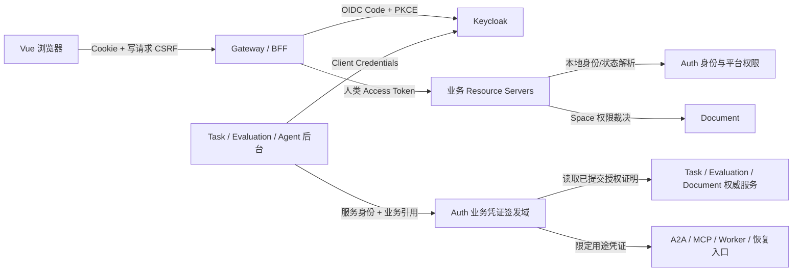
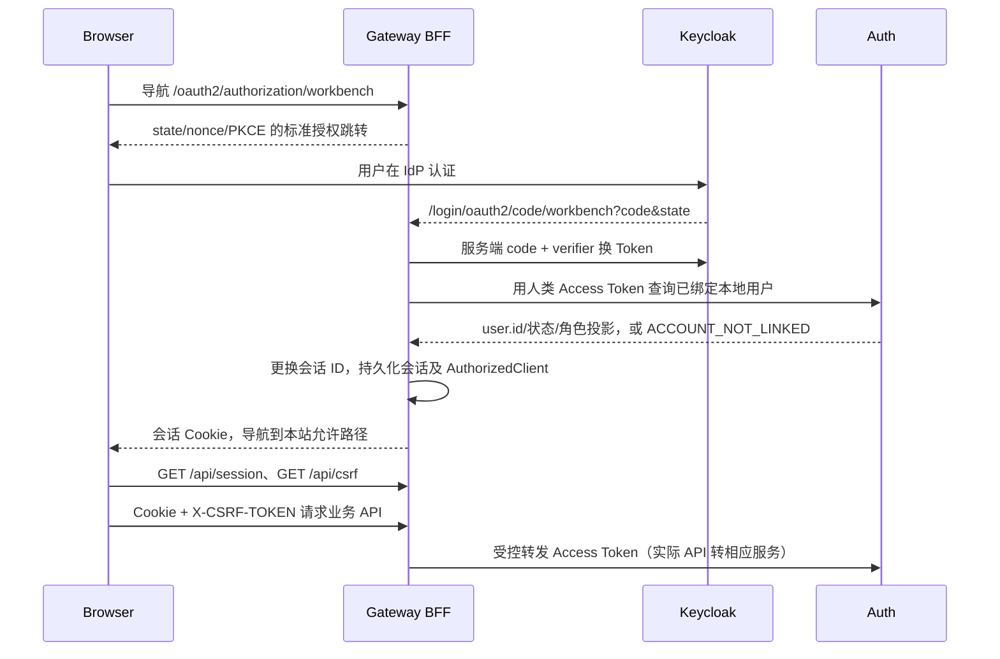

# v0.3.0 身份认证与业务授权技术设计

> 状态：详细设计草案。Keycloak + Gateway BFF 已于 2026-11-02 获维护者确认；本文其余新接口、数据模型及时间策略仍待设计评审和验证。描述的是目标行为，不表示代码已经实现。
> 基线：`2a6aa88`，应用代码为 v0.2.0；开发分支 `refactor/oauth2-oidc-auth`。

## 1. 目标、范围和约束

以标准 OIDC 完成人类登录，以 OAuth2 Client Credentials 建立服务身份；用户密码、登录会话及认证因素由 Keycloak 管理。Gateway 作为浏览器 BFF 保存 OAuth 客户端状态，业务服务继续使用 Resource Server。Workbench 保留本地用户、组织、平台角色、31 项 Space 权限及任务授权。

关联：[现状评估](auth-oidc-analysis.md)、[ADR-0008](../adr/0008-standard-identity-and-business-authorization.md)、[Run 身份](../adr/0001-run-compatible-execution-model.md)、[Replay 隔离](../adr/0002-replay-side-effect-isolation.md)、[审计边界](../adr/0003-telemetry-audit-ledger-boundaries.md)、[终态恢复](../adr/0006-task-terminal-recovery.md)、[线上 A/B](../adr/0007-controlled-online-ab.md)。

本版目标范围：

| 编号 | 要求 |
| --- | --- |
| ID-01 | 授权码 + PKCE S256 + OIDC，关闭自定义密码换 Token 协议 |
| ID-02 | 浏览器仅持应用会话 Cookie；BFF 多实例恢复、刷新及退出正确 |
| ID-03 | 可信 issuer/sub 绑定本地 user.id；不按邮箱自动合并 |
| ID-04 | 服务端默认拒绝，公开/人类/服务/Agent/线上/恢复用途分离 |
| ID-05 | 内部服务认证独立于用户；签发范围来自领域权威记录 |
| ID-06 | 保留 Task/Worker/WAIT/CONTROL/OBSERVE/CANCEL/恢复/收尾等窄授权 |
| ID-07 | 旧任务安全收尾，旧用户重新登录，历史身份和审批不重写 |
| ID-08 | 禁用、注销、超时及凭证撤销具有可测量的传播边界 |
| ID-09 | 现有平台用户/组织/权限 UI 与外置凭据管理分工明确 |
| ID-10 | 正常/紧急密钥轮换、依赖故障和升级回退可操作 |
| ID-11 | 不增加明文秘密快照、日志或遥测；审计可关联 |
| ID-12 | 全入口清单、协议测试、跨服务与真实浏览器验收覆盖 |

不纳入：SAS 并行实现、通用 IAM 控制台、公开动态客户端注册、SCIM、自动组织授权、外部 MCP OAuth 接入、CLI/Device Flow、多 IdP 动态租户、自主 Agent 编排。MFA 等使用 Keycloak 既有配置，不据此承诺所有认证方式本版全部开放。

本地 MySQL 5.7、JDK 21、Boot 3.5.8、Cloud 2025.0.0 为当前约束；不为本次接入隐式升级 Spring 主版本。Keycloak 必须采用所选发行版支持的独立数据库，不假定兼容 Workbench MySQL 5.7。版本锁定和依赖装配是开发前置出口。

## 2. 系统职责及信任域

| 组件 | 负责 | 权限边界 |
| --- | --- | --- |
| Keycloak | 认证、标准授权端点、用户凭据、SSO、服务客户端、IdP 密钥 | 不管理 Space 成员和文档审批 |
| Gateway/BFF | 登录回调、浏览器会话、CSRF、AuthorizedClient、受控 TokenRelay | 不通过 X-User-* 给下游赋予身份 |
| Auth | 本地身份绑定/启停、平台角色、用户投影；独立业务凭证签名 | 不跨域访问 Task/Document Mapper，不自行重写领域授权规则 |
| Document | Space RBAC、文档归属、审批/版本写入约束 | 有效 Access Token 不等于有资源权限 |
| Task/Evaluation | 任务、批次、Run、线上保护的权威业务状态与已授权范围 | 后台 service 不能自行扩展任务范围 |
| Agent | A2A 接入、冻结上下文、执行和回调证据 | 服务身份不能取代单 Task/文档动作授权 |

首版只有一个预登记 Keycloak issuer；它的发现元数据、JWKS 和客户端配置来自可信部署配置，不能用未验证 Token 的 iss 动态访问任意 URL。未来新增 issuer 必须显式配置和评审。

## 3. 主体、Token 和 audience 契约

### 3.1 三类在线主体

| 主体 | 认证输入 | 本地身份 | 使用位置 |
| --- | --- | --- | --- |
| HUMAN | Keycloak 人类 Access Token | issuer/sub 映射为 user.id | 用户 API、平台权限、Space RBAC |
| SERVICE | 受信服务客户端 Access Token | 受信 client_id；Keycloak 默认字段 azp 经适配归一化 | 明确允许的内部 API |
| AGENT | Workbench Task Capability | taskId/agentId/冻结输入及动作 | 指定 A2A、MCP、任务文档工具 |

线上保护和恢复凭证不进入通用 HUMAN/SERVICE/AGENT SecurityContext，通过专用入口校验。BFF 内部 `OidcUser` 只表示浏览器 OAuth 登录状态，业务服务依然验证真正的 Access Token。

不能把数字 sub 当作 HUMAN 标志；不能把任意签名 JWT 当作服务 Token；不能只凭调用者提供的 actorType/client_id 请求头分类。Keycloak 的 azp/client_id 映射以及 Access/ID Token 的类型检查以锁定版本夹具验证。

### 3.2 目标受众与最小客户端集合

| 类别 | 建议 audience | 约束 |
| --- | --- | --- |
| 人类应用 API | `workbench-api` | 仅接受登记的人类 BFF client，scope 含 `workbench:access`，再查本地身份与 RBAC |
| Auth 内部 | `workbench-auth-internal` | 身份解析、特定签发/用户投影按各自 service scope 放行 |
| Task 内部 | `workbench-task-internal` | 任务/Worker 证明读取等单用途 scope |
| Agent 内部 | `workbench-agent-internal` | 执行事实/报告证明按操作区分，敏感内容另受授权约束 |
| Evaluation 内部 | `workbench-evaluation-internal` | Run/线上业务证明读取，不直接授予实验控制 |
| Document 内部 | `workbench-document-internal` | 对既有业务主体的权限证明查询，不模拟用户会话 |
| 业务 Capability | 保留各现有用途 aud | 与上面 Keycloak Access Token 不互换 |

这些名称是目标契约建议，Phase 0 冻结后客户端配置和测试必须使用同一组常量。人类 API 作为一个明确的应用资源组，不要求与微服务进程一一对应；新服务不得自动加入接受范围。

最小注册客户端：`workbench-web`（机密 BFF，authorization_code + refresh，启用 PKCE）；`workbench-auth`、`workbench-task`、`workbench-agent`、`workbench-evaluation`、`workbench-document`（按实际出站调用授予 client_credentials）。某服务没有对应出站需求就不配置额外 scope；不按服务名自动授予全部 internal 访问。

建议的关键 scope 与调用者：

| scope | 允许客户端/作用 |
| --- | --- |
| `identity:resolve` | 需要解析人类主体的资源服务，向 Auth 解析已绑定用户 |
| `user:projection:read` | 原批量展示信息调用方；返回最小资料 |
| `capability:task:issue` | Task；只申请已受理任务的凭证 |
| `capability:worker:issue` | Task；只申请已授权 Run/精确任务集的 Worker 凭证 |
| `capability:recovery:issue` | Task；仍需原历史证明与既有远端绑定 |
| `proof:task:read`、`proof:worker:read` | Auth；读取 Task 权威签发证明 |
| `proof:evaluation:read` | 经过需要性评审的 Task/Auth，用于 Run/批次权威复核 |
| `proof:permission:read` | 明确登记的业务服务，校验由领域记录确定的用户/空间/权限 |
| `execution:projection:read`、`report:proof:read` | 对应事实读取调用方；不能借此读取任意 Prompt/正文 |

scope 只是 API 能力上限。签发 Task/Worker 前还要核对第 8 节的权威证明，不能仅因 service 拥有 scope 就接受任意 actions。

### 3.3 签名与验证

Keycloak Access Token 校验：允许算法、签名、精确 iss、期望 aud、exp/nbf、必需字段、受信 client、scope 集合及用途。ID Token 不能调用 API。规范允许的时钟偏差先按最多 30 秒验证，强撤销操作不额外加宽为 JWT 的宽限时间。

业务 JWT 使用独立 issuer 和独立 RSA 密钥环，建议 issuer 为 Workbench 固定 HTTPS `/capabilities` 标识、JWKS 为 Auth 内部 `/internal/security/capabilities/jwks`。该 issuer 是业务签发域标识，不伪称 OIDC Discovery Provider。旧 issuer `agent-doc-workbench` 仅进入限时 legacy 验证器。

同一把 key 的 kid 稳定；人类和服务 Token 可共享同一 Keycloak realm 的签名密钥，靠受众、client、scope 和主体约束分流。业务独立签名域不能仅换 kid 继续复用 Keycloak 私钥。

## 4. 人类登录、BFF 会话和前端

### 4.1 正常流程

认证过程使用 Spring Security 标准 OAuth2 Login；WebFlux API、可用配置和 PKCE 行为以 Spring Security 6.5.x 实际版本验证，不复制 7.x 示例直接升级依赖。[Spring WebFlux OAuth2 Login](https://docs.spring.io/spring-security/reference/6.5/reactive/oauth2/login/advanced.html)

### 4.2 BFF 协议

| 入口 | 目标行为 |
| --- | --- |
| GET `/oauth2/authorization/workbench` | 框架标准登录发起；导航使用，不由 Axios 当 JSON 请求 |
| GET `/login/oauth2/code/workbench` | 框架回调，严格 state/nonce/PKCE；精确 redirect URI |
| GET `/api/session` | 200 返回 user、platformRoles、会话到期提示；未登录 401；不返回任何 OAuth Token |
| GET `/api/csrf` | 200 返回当前会话 CSRF Token/headerName；Cache-Control no-store，允许建立匿名会话 |
| POST `/api/session/logout` | CSRF 保护，通过校验后退出返回 204；重复请求不恢复会话，已失效 CSRF 仍可被拒绝 |
| POST `/api/session/logout-sso` | CSRF 保护，清本地后返回经服务端验证的标准 IdP 注销导航地址，前端进行导航 |
| GET `/logged-out` | 无副作用静态退出页，不自动发起新登录 |

`/api/session` 示例：`{"user":{"id":"...","username":"...","nickname":"..."},"platformRoles":[],"expiresAt":"..."}`。雪花 ID 作为字符串输出。会话到期提示不构成可绕过服务端的授权证据。

API 未认证返回 HTTP 401，已认证但未绑定/被业务禁用返回 403 和稳定原因；依赖临时不可用返回 503，不伪造成密码错误或必定清除所有会话。不得把异常中的 Provider HTML、Token 响应或原始错误直接转给浏览器。

Keycloak 回调认证成功但应用绑定失败时，不完成可用业务会话；撤销/移除本地 AuthorizedClient，进入受控错误页。unknown subject 不自动按 email 建用户，也不能因 IdP 登录成功访问任意 Space。

### 4.3 Cookie、CSRF 与会话时间

生产 Cookie 建议 `__Host-adw-session`，Secure、HttpOnly、Path `/`、不设置 Domain，SameSite=Lax 配合顶层 GET 回调；本地 HTTP 使用明确不同开发 Cookie 配置。若改用 form_post 必须重新验证策略，不能全局降级 SameSite=None 后关闭 CSRF。

采用会话型 `WebSessionServerCsrfTokenRepository`，通过 `/api/csrf` 获取 Token 并在写方法带 `X-CSRF-TOKEN`。前端只将 CSRF Token 保存在内存；它不是 Access Token。OAuth 回调端点按框架匹配精确处理，不豁免所有 `/api/**`。Spring WebFlux 默认支持会话 CSRF 仓储。[Spring CSRF](https://docs.spring.io/spring-security/reference/6.5/reactive/exploits/csrf.html)

同源为默认部署；跨域仅精确可信 Origin。外部代理转发头仅信任实际登记的代理，issuer 和 callback 依据公开 HTTPS 地址，不能信任任意 Host/X-Forwarded-* 构造重定向。

| 参数 | 设计候选值 | 状态 |
| --- | --- | --- |
| 人类 Access TTL | 10 分钟 | 待 Phase 0 验证/批准 |
| BFF 空闲/绝对超时 | 30 分钟 / 8 小时 | 待产品确认；自动刷新不延长绝对上限 |
| remember | 首版不启用跨浏览器持久登录；移除当前无独立生命周期的 remember | 待产品确认，不能默认为已通过 |
| 本地业务禁用传播 | 最迟 60 秒，敏感操作前实时复核 | 待容量和故障验证 |
| 本地注销 | 成功响应后旧会话不能发起新授权请求 | 目标约束 |

Keycloak SSO 会话与 BFF 会话分别配置。IdP 禁用后的新登录/刷新最迟 60 秒拒绝为候选验收值；已签发的离线 Access Token 不因此即时失效。若要求后者也 60 秒失效，应额外批准 introspection/撤销通知及可信缓存策略，不能仅缩短 UI 会话。

### 4.4 多实例持久化与并发

采用 Redis 支持的 Reactive Session 和持久化 Reactive AuthorizedClient；不能把 Servlet Session 或 JDBC 阻塞访问直接放到 Gateway 事件循环。ClientRegistration/AuthorizedClientManager 使用标准接口，必要的存储适配控制在 Gateway 边界。[Spring Reactive OAuth Client](https://docs.spring.io/spring-security/reference/6.5/reactive/oauth2/client/core.html)

浏览器 AuthorizedClient 必须按 **sessionId + clientRegistrationId** 隔离，不能只按 user/sub/principalName 共用一条记录，否则同用户两个独立登录会相互覆盖 Refresh Token。优先验证会话型 ServerOAuth2AuthorizedClientRepository 与 Redis WebSession 组合，避免无必要地另建一套用户级 Token 表；OAuth Login、TokenRelay 和刷新 Manager 必须实际使用同一持久仓储，不能其中一条悄悄回到默认内存服务。Gateway 到 Auth/Keycloak 的调用使用响应式客户端，不能为复用 MVC Feign 而阻塞事件循环。

Session 值中可能含 OidcUser/ID Token，AuthorizedClient 含 Access/Refresh Token：两条序列化路径都要覆盖敏感值加密，不能只加密单独的 Refresh 字段。使用带 keyVersion 的认证加密，密钥经受管 Secret 提供，认证附加数据绑定存储域/格式版本；不把模型配置的 AES key 复用为 BFF key。Redis key 中的 Session ID 依然敏感，加密 value 不等于 Redis 只读泄露后不能劫持会话，必须限制网络、命令权限、备份和运维访问。

刷新使用同一 session/client 的串行化与版本条件保存：取短租约 → 重新读最新 AuthorizedClient → 必要时刷新 → 带版本/会话有效性条件保存 → owner-token 释放。等待者重新读结果，不再次消耗同一个 Refresh Token。网络超时总预算必须小于租约；丢失租约不继续覆盖状态。

IdP 已成功轮换但本地持久化失败时，旧 Refresh Token 不可安全复用；终止该登录会话并要求重新认证，不无限重试原 Token。注销与刷新竞争时，注销后的失效标记/Session 版本必须阻止迟到刷新复活会话。具体仓储/租约代码在 PoC 验证后冻结，不再发明第二套通用 Session 框架。

### 4.5 前端改造

- `stores/auth.ts` 保留 user/platformRoles/initialized，去掉用户 Access Token；恢复会话调用 `/api/session`。
- `api/client.ts` 保留 credentials，写操作带 CSRF；不再拦截 401 后调用自定义 refresh，也不自动重放可能已执行的写操作。
- `api/auth-session.ts` 收敛为会话失效/CSRF 获取协调；同页面并发 401 只触发一次退出 UI。
- LoginView 以导航发起 OIDC；密码/注册不再在 Workbench 输入，未启用供应入口不展示“即将支持”的假能力。
- `main.ts` 先恢复应用会话；匿名 401 正常进入登录页；503 显示重试，不误导为已退出。
- 保留路由及 PermissionGate；403 不尝试刷新登录；API 不能把 302/HTML 当作 JSON 成功。
- Vite 代理补 `/oauth2`、`/login/oauth2`、`/api`，并验证 Host、回调来源和 Cookie；生产静态资源与 Gateway 同源。
- 用户改密/找回转 Keycloak Account/登录恢复入口；跨标签退出至少在下一次请求受服务端阻断，前端更新用户和 Space 权限缓存。

## 5. 本地身份、用户状态和平台管理

### 5.1 身份绑定表（拟新增迁移）

| 字段 | 类型建议 | 约束/用途 |
| --- | --- | --- |
| id | BIGINT | 既有雪花 ID 规则 |
| identity_key | BINARY(32) | 唯一，issuer/sub 精确输入的 SHA-256 |
| issuer | VARCHAR(512) utf8mb4_bin | 精确匹配可信 issuer，不做小写/尾斜杠归一化 |
| subject | VARCHAR(255) utf8mb4_bin | 精确 sub，不假定 UUID/数字 |
| user_id | BIGINT | 本地 user.id，普通索引；通过 Auth 领域校验 |
| status | VARCHAR(16) | ACTIVE / REVOKED |
| bound_by / bound_at | BIGINT / DATETIME | 首次绑定操作者及时间 |
| revoked_by / revoked_at | BIGINT / DATETIME NULL | 撤销记录 |

摘要输入协议 v1：ASCII `adw-identity-v1`，后接 issuer UTF-8 字节长的 4 字节大端无符号数、issuer UTF-8 字节，再接 subject 的同样长度与字节；不增加分隔换行。唯一实现、边界/Unicode 固定向量测试。查询命中摘要后仍核验原字段完全相同；冲突拒绝，不自动合并。只有 binary(32) 参与唯一键，避免 MySQL 5.7 长联合索引限制。

绑定一旦使用不得静默换 user_id；撤销保留历史映射，不能靠逻辑删除释放唯一键重绑另一人。误绑定修复需要专用审计、两端身份核验和会话撤销，首版由受控运维流程办理，不做任意用户自助重绑。

`user` 增加 `auth_version BIGINT NOT NULL DEFAULT 0`；业务禁用、身份撤销及需要强制退出时递增。新增外部用户允许 `password_hash` 为 NULL；现有 BCrypt 暂保留到明确回滚截止，不写假密码哈希。旧密码登录关闭后不得因有旧 hash 而自动回退本地校验。

### 5.2 解析与缓存

Auth 作为唯一绑定权威，自己的用户请求在本地查询；其他服务的标准 JWT 转换器通过服务认证的批量解析契约查询 Auth。请求只接收已由调用方校验的 issuer/sub，未知 issuer 拒绝；该接口不接受“需要解析成哪个 user.id”的客户端指令。

建议接口 `POST /api/auth/internal/identities/resolve`，仅 `identity:resolve`；返回本地 userId、enabled、authVersion、绑定状态、平台角色投影和缓存到期，不返回密码/凭证。最大批量和字段边界在接口 schema 定义，调用场景不逐条 N+1。受信 service 证明结果不能被当作人类 Bearer 直接调用用户 API。

正缓存最长 30 秒、负缓存不超过 5 秒为实现候选值；状态变更主动失效是优化，不能依赖消息必达满足 60 秒上限。缓存超期且 Auth 不可用时拒绝新的受保护操作并返回 503；不能无限 stale-while-error。敏感操作直接重新取当前启用状态及权限。

HUMAN 的 `JwtAuthenticationToken.name` 由可信转换器设为本地数字 userId，保留原 Jwt 的 sub/iss 不变；`AuthUtils` 只在已识别人类 Token 的认证对象中取映射后的 name。SERVICE 的 name 为登记 client，Task 的 sub/name 语义保持任务身份。必须有反混淆测试，不能将任意 Authentication.name 直接 Long.valueOf 当用户。

不采用 Keycloak 自定义 `workbench_user_id` mapper 作为首版必要条件，避免应用信任用户可编辑属性；后续需要时另评审。平台角色仍由 Auth 实时裁决，IdP realm role 不直接成为平台超级管理员。

现有 `AuthUtils.hasPlatformRole` 依赖原自签 JWT 的 platformRoles，必须同步改为读取可信转换器从 Auth 解析得到的角色 authorities；不能在新 Keycloak Token 没该 claim 时让全部超管入口失效，也不能直接复制 realm roles。角色投影用于 UI/快速拒绝，敏感平台操作沿用实时 Auth 复核；撤销与新增角色的缓存可见时限分别测试。

### 5.3 账号供应与管理 UI

建议首版关闭 JIT、公开自助注册及自动邮箱关联，采用 IdP 建账号 + Workbench 管理员预绑定。此产品策略需 Phase 0 确认；启用自注册时另定义可信邀请/供应流程，不能默认继承 Space 权限。

| 原能力 | 目标处理 |
| --- | --- |
| 用户资料、部门、职位、业务禁用、平台角色 | Workbench 保留 |
| 创建账号/密码/MFA/找回/认证邮箱验证 | Keycloak Console/Account 负责；不在应用中保存宽权限 realm-admin secret |
| 平台创建用户 | 调整为创建本地业务档案并绑定受核验 issuer/sub；不再接收密码。UI 明确先完成 IdP 账号供应 |
| 管理员重置密码 | 显示 IdP 管理操作入口，退役 Workbench 重置密码 API |
| 修改昵称/头像/展示邮箱 | 首版以 Workbench 业务展示字段为准，不登录即覆盖；认证邮箱归 Keycloak |
| 禁用用户 | Workbench 启停独立生效；需要同时退出 IdP 时通过已确认管理流程操作，不假装一个本地事务覆盖两系统 |
| 最后平台超管 | 保留本地保护；至少两个完成绑定和恢复渠道验证的管理员后才允许切换 |

接口变更是 v0.3.0 明示的升级行为；不预设旧密码 API 永久兼容。若选中使用场景要求应用内一键 IdP 供应，再单独设计最小管理凭据和跨系统补偿，不混入基础接入。

## 6. 安全链、入口和错误协议

### 6.1 默认拒绝与入口分类

| 分类 | Gateway | 下游 |
| --- | --- | --- |
| 健康/明确公开资料/静态资源 | 精确公开列表 | 同样精确公开，不开放整个 Actuator/Swagger 家族 |
| OIDC 发起/回调 | 框架链；状态验证 | Keycloak 处理标准协议 |
| 浏览器 API | Cookie 会话 + CSRF，TokenRelay 受控人类 Access | 人类 Token + 本地启用状态 + RBAC |
| 内部服务 API | 公共 Gateway 拒绝，不依赖白名单放行 | 直连 HTTPS/可信加密网络，service aud/client/scope + 用途授权 |
| A2A/MCP | 首版作为内部任务数据面，不经公共浏览器路由 | Task Capability，限定入口和冻结资源；不是通用 Keycloak 服务身份 |
| 专用线上/恢复 | 公共 Gateway 拒绝 | 传输约束 + 专用凭证；机器认证只在特定签发入口 |

冻结现有 409 个 HTTP 映射与 MCP 动态入口的分类表；每个方法必须有上述一类及对应测试，新增方法默认拒绝。部分 `/api/.../internal/**` 当前用于用户透传的查询应区分：真正用户资源入口迁移到用户语义路径；内部事实投影使用 service 身份，不简单全开或全部靠字符串 internal 判断。

通用安全链不再 `anyRequest().permitAll()`。先完成用户、任务和特殊头的分链/过滤器顺序，再切默认 authenticated/deny；不能让 Task 的专用头因为普通 Bearer 链先拒绝而断链。精确匹配、路径编码、matrix 参数、重复斜杠、OPTIONS 均纳入测试。

`@RequireLogin` 在标准链覆盖之后逐个退役；`@PreAuthorize` 和 Service 资源授权保留。不能删除一个注解就认为已有全部授权。

### 6.2 错误协议

| 场景 | HTTP | 应用语义 |
| --- | --- | --- |
| 无认证/过期/签名错误 | 401 | UNAUTHORIZED，用户 API 返回 JSON，Bearer 入口保留合适的挑战头 |
| 业务禁用/未绑定/无权限/CSRF 失败 | 403 | 明确但不泄密的稳定原因，不自动刷新 |
| 幂等键内容冲突/版本冲突 | 409 | 不覆盖历史状态 |
| Auth/Keycloak/Redis/证明服务临时不可用 | 503 | 不能返回认证成功，也不伪造无权限或执行终态 |
| 旧密码登录/刷新已关闭 | 410 或明确的升级拒绝状态 | 最终状态码 Phase 0 冻结，无自动 fallback |

OAuth/OIDC 标准端点的协议响应交框架/IdP，不套 Workbench Result。业务 API 保留 Result 结构，但认证/授权错误不继续 HTTP 200；本次不扩大为统一重构所有无关业务错误。

## 7. 服务调用与凭证传递

同步以用户身份完成的跨服务用例，保留该人类 Access Token 的受控透传；不同时附带“可替代用户”的 service Token。真正内部查询使用标准 OAuth Client 获取目标 aud/scope 的服务 Token。Bearer 只能有一个，不能把两个 Token 逗号拼接。

`AuthHeaderForwardInterceptor` 改为按声明的 Feign 契约/客户端分类处理，不对所有 URL 无差别透传用户头。内部出站 service Token、用户委托和 Task/线上/恢复专用凭证各有明确入口；未知类别拒绝。身份解析向 Auth 发起的机器请求不得再次进入人类解析，防止递归调用。

服务 Token 缓存在内存至安全刷新窗口即可；Client Credentials 没有必要依赖浏览器会话或保存用户 Refresh Token。每服务独立 secret，由部署 Secret 管理、支持轮换；如已有证书设施可评估 private_key_jwt/mTLS，不为首版强制搭建 PKI。网络 mTLS 和 OAuth 客户端认证不替代应用 scope/资源判断。

异步 MQ 不携带用户 Token。保留 taskId 及既有 Trace Context，执行通过 Task/Worker 等授权凭证。业务授权人的 user.id 来自被冻结且可追踪的领域记录，服务不能通过任意 X-User-ID 冒用用户。线程上下文继续 finally 清理。

## 8. 业务 Capability 签发与执行

### 8.1 签发模型

Auth 保留单一业务签名实现，但与 Keycloak 用户认证分域。请求者只提交已受理的业务引用、用途和版本，不再提交任意 actions/TTL/Space/文档冻结值让签名端照抄。

| 签发申请 | 唯一申请方 | 权威证明 | 目标约束 |
| --- | --- | --- | --- |
| Task | Task service client | 已提交 Task、原授权人、冻结输入、文档类型/模式、固定签发窗口 | actions 按模式/文档类型固定推导 |
| Worker | Task service client | 已提交 Run 授权及精确批次 Task 集合/版本，当前 Run 生命周期 | 固定 workerActions，原任务集不得拓宽 |
| Recovery/Finalization | Task service client | 既有 Task/A2A 身份、历史签名证明、当前活动/取消事实、可信终态 | 沿用 ADR-0006 的 300/60 秒及动作 |
| Online CONTROL | 真实人类 OWNER 操作 + 已认证协调服务 | Document 当前 OWNER/权限、Evaluation manifest | 不把 client_credentials 直接当 OWNER |
| WAIT/交换/OBSERVE/CANCEL | 指定 Task/Evaluation 服务 + 来源窄凭证 | assignment、binding、权威槽/精确 Task 集合 | 沿用 ADR-0007，不跳过 WAIT 交换 |

### 8.2 Task 权威证明与事务顺序

目标签发入口仍可复用 `/api/auth/internal/task-capabilities`，载荷改为 `{taskId, grantVersion}`。Auth 使用自己的 service 身份请求 Task 的专用只读签发证明；Task 在本领域读取权威记录，并通过 Document/Agent 契约复核当前允许条件，Auth 不跨域查表。

证明至少含 taskId、agentId、spaceId、documentId、docType、executionMode、冻结版本/输入 hash、lineage/派生 hash、原授权人、grantVersion、固定 issuedAt/expiresAt，以及线上标志。普通 Task 签发拒绝线上分配身份，线上仍走专用交换。

批量场景按集合加载 Task、Run、用户状态及权限证明，必要时提供批量证明/签发契约；不能在批次循环中逐条跨域查库/RPC。真正独立到达的单任务异步派发仍可按单Task处理，不为此预先建设通用批处理框架。

顺序：用户权限/归属检查 → 短事务保存 Task 和冻结授权窗口 → 提交 → Auth 受控读取证明并签名 → 短事务条件写入加密凭证 → 提交后发布 MQ。Task 被取消/版本改变/权限失效时证明拒绝；领取签名不等于已经准许执行，接收方继续回查当前状态。

现有普通创建、clientRequestKey 创建意图、手动 Replay、批量 Replay 的事务入口必须分别审查。**不能在未提交 Task 的事务中调用 Auth，再让 Auth 回调读取该 Task**；也不能在长期事务中等待 IdP/签名网络调用。

拟在 Task 增加最少签发元数据：授权代次、首次签发时间、固定到期时间。具体列与现有创建意图复用方式在 PoC 冻结；不新增通用授权工作流。动作仍由单一领域策略生成：ISOLATED 仅 READ_FRAGMENT/CAPTURE_EXECUTION_ARTIFACT；LIVE 草稿 READ_FRAGMENT/WRITE_DRAFT；LIVE 正式 READ_FRAGMENT/CREATE_CHANGE_REQUEST。

重试只复用同一代次/冻结窗口，不刷新历史 Task 的完整能力有效期。并发签名可能得到不同 jti，但只将条件更新胜出的凭证作为当前 Task 证明和派发输入；失败者重新读取胜出记录，不将未持久化凭证派发。超时/签发成功但写入失败保留幂等重试，不伪造已执行或删除已提交 Task。

### 8.3 Worker 授权与批次

Evaluation 必须先提交 Run、原授权人与冻结计划，再请求 Task 创建批次；Task 预检 Run/Space/允许派生请求后，以短事务持久化任务集和不可变 Worker 授权引用，再向 Auth 申请签发。不存在“给一个未知 runId 和任意 taskIdsHash 就签名”的入口。

Worker 授权最少保存 runId、spaceId、grantVersion、原授权人、排序 Task ID 集合及 hash、固定 actions/到期、状态。优先复用现有批次/分片实体；确实无法表达时在 Task 领域新增专用 `task_worker_grant`，不建设通用 IAM grant 表。Proof 返回由权威集合计算的 hash，签发端不信任调用者提供的替代集合。

续签/追加批次沿用当前业务条件和明确授权，不因换 OAuth 自动获得无限续期。Worker 只能管理其精确 Run/集合，不能进入人类 API、LIVE 文档写、普通 A2A send 或别的实验。授权失效时保留必要的安全查询/取消路径是否可继续，按既有领域策略逐动作验证，不借自动续签重新授予读取/写入。

### 8.4 长任务与历史证明

Task 默认仍为 6 小时业务凭证，Worker 的 300–86400 秒上限、线上 300 秒、恢复 300/60 秒不随人类 Access TTL 改动。正常调用拒绝过期，恢复专用历史证明 Decoder 才能接受过期 exp，其签名/issuer/aud/冻结身份/iat/nbf 仍严格验证。

ADR-0006 机器密钥由受限 Task OAuth 客户端替换，Query/Cancel/Finalize/Discard 的业务约束保留；迁移重叠按每个入口和截止期控制。ADR-0007 的 CONTROL/WAIT/slot 与真实 OWNER 复核不变。A2A callback、stream、subscribe、cancel、推送配置及 MCP tools 全部纳入认证回归。

报告首次证明的 HMAC 可在新 service 认证 + 已保存候选/Run/hash 权威授权覆盖后退役；仅有普通 service Token 尚不充分时保留窄证明。是否完成替换必须有证明请求完整性与跨 Run 拒绝测试，不能为了“全 OAuth”先删保护。

## 9. 数据迁移、密钥与部署

V1–V44 不可变。拟从 V45 或届时下一个未占用编号新增身份绑定/用户状态版本/外部账号空密码约束，再以独立迁移补必要的 Task/Worker 签发元数据。具体 SQL 与索引经 MySQL 5.7 集成测试后冻结，本文不创建或执行迁移。

不批量改历史 user.id、Task/AgentExecution、Space owner/member、DocumentVersion 或授权人。迁移证据包括账号启停/邮箱质量、两名有效管理员、绑定唯一性、历史业务统计和运行中任务清单。不要按 email 自动导入绑定，不直接假定 Keycloak 支持当前 BCrypt hash 的导入格式。

部署新增独立 Keycloak 与其支持的数据库、公开 HTTPS issuer、受限管理面、BFF Redis/加密密钥、每服务 OAuth 凭据和独立业务密钥环。开发 realm/client 配置可重复初始化，生产导入模板不包含真实 secret 或覆盖现有 realm 的破坏性操作。

外网 Gateway 仅暴露用户入口；internal、A2A/MCP 数据面按实际内部服务网络连接。私钥和凭据缺失时生产启动或相应能力就绪检查失败，不生成临时私钥维持服务。IdP、Redis、Auth 映射、业务 JWKS 各有 readiness 和告警，不能都折叠成“登录失败”。

正常轮换：发布新公钥 → 验证多实例传播 → 新私钥签发 → 旧 key 停签 → 旧凭证/历史证明接受截止 → 验证撤销与缓存 → 退役验证 key。历史恢复窗口必须给出具体截止时间；泄露应急直接撤销，不等待正常窗口。

## 10. 切换与兼容

首版推荐维护窗口切换，不预设复杂的在线双 issuer 用户灰度。先关闭新任务/实验受理并排空或登记在途，再完成身份映射和新安全链；用户统一重新登录。旧用户 JWT 不进入新普通 API。

旧 Task/Worker/恢复凭证只在专门 legacy 业务验证器中接受，并与预登记历史 Task/Run、旧 issuer/aud/用途、截止时间交叉检查；不允许旧 signer 再为新任务签发。现有遗留凭证无法满足新证明要求时，按受控历史任务/人工收尾处理，不能伪造新快照或改文档状态。

退出旧登录后 `/api/auth/login/register/refresh/password` 和管理员密码重置均给出明确升级行为，清除原 `/api/auth` Path 的 Refresh Cookie 与用户索引。旧 `/oauth2/jwks` 仅按旧业务验证需要内部保留，不再作为人类 OIDC Provider。

回滚有三个边界：新应用尚未接受写入时可回退构建/入口；新增身份数据后按已验证向前兼容保留；密码供应/业务写入已经变化后不能靠回退 JAR/数据库恢复成无损旧登录。回滚不能重新开放已确认有问题的任意签发入口。

## 11. 审计、可观测与故障行为

保留业务审计与 OTel 独立边界。关键事件：身份绑定/撤销、业务启停/强退、登录/回调失败、本地/SSO 注销、服务认证拒绝、业务凭证申请与拒绝、密钥启停。IdP 事件保留与 Workbench 审计按 issuer/sub、本地 user.id、client、task/run/execution/request/trace ID 关联。

Metrics 使用低基数结果/服务/操作类别，不使用用户、任务、sub、tokenHash 或自由 URL 标签。Span/日志不保存 code、state、nonce、PKCE verifier、Token、密码、私钥、Cookie 和完整认证 URL。未完成脱敏验证不得将调试日志作为验收证据导出。

| 故障 | 行为 |
| --- | --- |
| Keycloak 不可用 | 新登录/刷新/服务 Token 获取失败；有效 Access + 可用验证 key 的已有调用按合同处理，不关闭验签 |
| Redis 不可用 | BFF 会话/刷新状态不可可靠读取时 503，写操作不转发；已有机器数据面由自身有效凭证约束 |
| Auth 身份解析不可用 | 缓存有效期内按合同使用；过期或敏感操作 503，不无限陈旧放行 |
| 业务证明获取失败 | 不签发，保留可观测失败和幂等引用，不发 MQ 创建新执行 |
| 未知 kid/被撤销 key | 拒绝，不尝试任意远程地址或降级旧用户登录 |
| 网络超时/重复回调 | 保持既有状态机、账本和版本幂等，不假装终态 |

## 12. 实施交付与验证出口

源码变更预期集中于 Auth、Gateway、Security/Web/Feign Starter、common-core、四业务服务的身份入口与签发证明、前端会话及部署配置。业务 Mapper 不跨域，公共模块不放业务 Controller，只有本次替换造成的无用代码才删除。

发布前必须提供：409 映射和动态入口分类、真实 Keycloak 登录/回调/注销、两 Gateway 多实例刷新竞争、服务最小权限负例、身份绑定/禁用、Task/Worker/线上/恢复全链路、历史迁移和密钥演练、README/安全/升级说明与 CI。环境跳过不计通过，缩短 TTL 的模拟过期不替代长时运行场景，保留演练限制。

本设计的详细排期、证据记录和机器环境信息由版本实施材料管理；公开文档不依赖未跟踪本地文件。当前文档工作没有部署 Keycloak、改数据库、安装依赖或执行任何业务写入。
