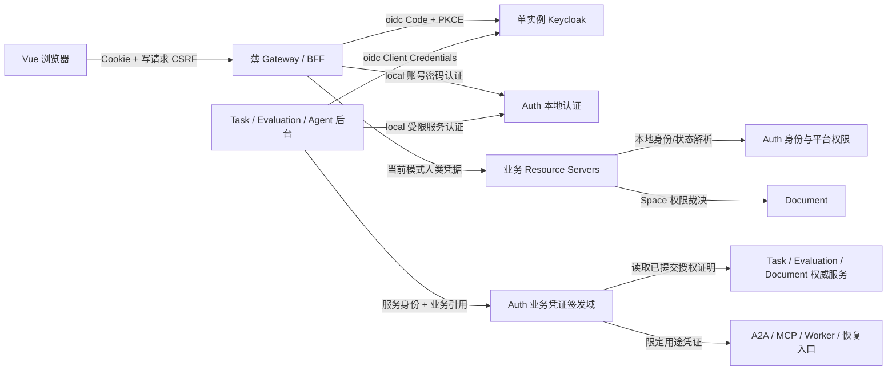
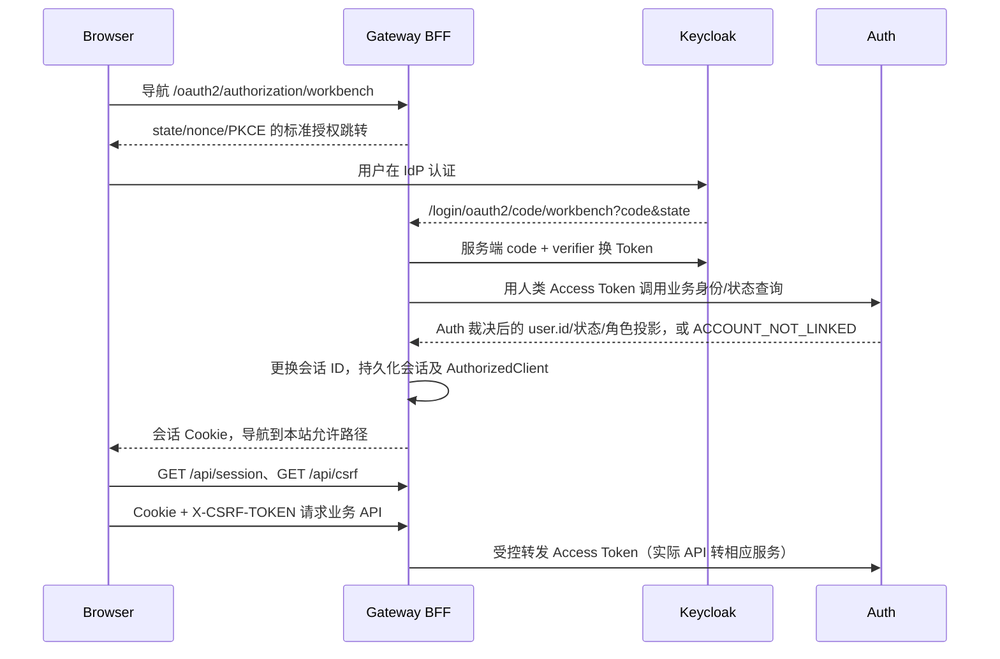

# v0.3.0 身份认证与业务授权技术设计

> 状态：详细设计草案。维护者于 2026-11-04 确认单实例 Keycloak、业务服务授权、薄 BFF，并新增可独立运行的本地账号模式；此前“仅 OIDC”的范围由本次双模式要求补充。本文新接口、数据模型及实现细节仍待评审和验证，不表示代码已经实现。
> 基线：`4d90137`，应用代码为 v0.2.0；P0 分支 `chore/v0.3.0-p0-auth-foundation`。

## 1. 目标、范围和约束

提供两种部署模式：OIDC 模式以标准 OIDC 完成人类登录、以 OAuth2 Client Credentials 建立服务身份，身份账号、密码策略、MFA、身份会话及 OAuth 令牌签发/吊销由 Keycloak 管理；本地模式由现有 Auth 提供简易账号密码认证，无需 Keycloak。两种模式共用浏览器会话接口和业务授权规则。租户成员、平台角色、Space RBAC、Capability、Skill 权限、资源 ACL 和审批全部由对应业务服务裁决；租户职责归属不意味着本版新增完整租户系统。

关联：[现状评估](auth-oidc-analysis.md)、[ADR-0008](../adr/0008-standard-identity-and-business-authorization.md)、[Run 身份](../adr/0001-run-compatible-execution-model.md)、[Replay 隔离](../adr/0002-replay-side-effect-isolation.md)、[审计边界](../adr/0003-telemetry-audit-ledger-boundaries.md)、[终态恢复](../adr/0006-task-terminal-recovery.md)、[线上 A/B](../adr/0007-controlled-online-ab.md)。

本版目标范围：

| 编号 | 要求 |
| --- | --- |
| ID-01 | OIDC 模式使用授权码 + PKCE S256；本地模式提供显式账号密码登录；不保留旧公开密码换 Token/Refresh 协议 |
| ID-02 | 浏览器仅持应用会话 Cookie；薄 BFF 首版按单实例设计，会话恢复、并发和退出正确 |
| ID-03 | OIDC 可信 issuer/sub 绑定稳定本地 user.id；本地模式使用本地账号；不按邮箱自动合并 |
| ID-04 | 服务端默认拒绝，公开/人类/服务/Agent/线上/恢复用途分离 |
| ID-05 | 内部服务认证独立于用户；签发范围来自领域权威记录 |
| ID-06 | 保留 Task/Worker/WAIT/CONTROL/OBSERVE/CANCEL/恢复/收尾等窄授权 |
| ID-07 | 旧任务安全收尾，旧用户重新登录，历史身份和审批不重写 |
| ID-08 | 禁用、注销、超时及凭证撤销具有可测量的传播边界 |
| ID-09 | 现有平台用户/组织/权限 UI 与外置凭据管理分工明确 |
| ID-10 | 正常/紧急密钥轮换、依赖故障和升级回退可操作 |
| ID-11 | 不增加明文秘密快照、日志或遥测；审计可关联 |
| ID-12 | 全入口清单、协议测试、跨服务与真实浏览器验收覆盖 |
| ID-13 | 部署配置选择 local/oidc；local 不依赖 Keycloak，oidc 故障不自动回退；两种模式业务授权一致 |

不纳入：Keycloak 集群/高可用编排、复杂身份联邦、BFF 多实例部署承诺、SAS 并行实现、通用 IAM/策略引擎、公开动态客户端注册、SCIM、自动组织授权、外部 MCP OAuth 接入、CLI/Device Flow、多 IdP 动态租户、自主 Agent 编排。本地模式不另建 MFA/SSO/联邦能力；OIDC 模式通过 Keycloak 现有配置管理密码策略及 MFA，不据此要求所有用户默认强制 MFA。

本地 MySQL 5.7、JDK 21、Boot 3.5.8、Cloud 2025.0.0 为当前约束；不为本次接入隐式升级 Spring 主版本。OIDC开发/测试可用内置H2（dev-file），维护者已选择本次P0直接运行单Keycloak+独立PG容器；正式持久部署也使用独立PG，不增加HA/复制设施或升级业务MySQL。模板固定Keycloak26.8.1/PG17.11及镜像digest；当前同版本运行实例已完成隔离协议与BFF验证，生产部署/重启恢复仍待验收；H2仅保留为开发测试选项。[Keycloak数据库说明](https://www.keycloak.org/server/db)、[容器部署说明](../../deploy/identity/README.md)。

### 1.1 模式选择及部署边界

统一配置拟为 `workbench.auth.mode=local|oidc`，环境变量为 `WORKBENCH_AUTH_MODE`。Auth服务已开始按模式装配人类JWT；Gateway及其他业务服务尚未完成该开关，当前不得作为整机OIDC接入使用。新装开发/自用部署目标默认 local，OIDC 部署模板显式设为 oidc。选择在启动时固定，修改后按部署流程重启受影响服务，不提供在线切换按钮。

| 项目 | local | oidc |
| --- | --- | --- |
| 账号/密码权威 | Auth 本地账号及 BCrypt 密码 | Keycloak；应用不接收其密码/MFA 凭据 |
| 浏览器登录 | 本地表单经 BFF 转交 Auth 校验 | Code + PKCE 跳转 Keycloak |
| 服务间身份 | Auth 基于受限服务凭据签发的本地服务证明，契约在 P0 冻结 | Keycloak Client Credentials |
| 附加依赖 | 复用现有业务 MySQL/Redis，无 Keycloak/PG | 单 Keycloak；开发 H2、正式独立 PG；复用 Redis |
| 业务权限 | 对应业务服务读取当前领域记录裁决 | 相同规则和稳定 user.id |
| 密码策略/MFA/SSO | 基本密码校验、哈希存储、登录限流；不提供 MFA/SSO | Keycloak 管理 |

local 不创建或初始化 OIDC 客户端、Discovery/JWKS 请求、Keycloak/PG 连接或相关 readiness 依赖；未知模式、配置不一致或 oidc 必需配置缺失必须报错。oidc 认证失败或 IdP 故障不能尝试本地密码，也不能同时接受另一个模式的人类/服务 Token。业务 Capability 仍是独立验证域。

这是部署选择，不是账号迁移工具。切换先准备目标模式的管理员和身份映射，再清理旧模式会话/客户端状态并重新登录；保留历史 user.id/业务关系，不按同名或邮箱自动绑定，不复制或同步 Keycloak 密码。本地账号没有已设置的本地密码时不能因为切换模式而获得登录能力。

## 2. 系统职责及信任域

| 组件 | 负责 | 权限边界 |
| --- | --- | --- |
| Keycloak（oidc） | 身份用户、登录、密码策略、MFA、SSO、OAuth 令牌签发/吊销、服务客户端及 IdP 密钥 | 不存租户/空间成员、业务角色、Capability、Skill 权限或资源 ACL；不配置业务授权策略引擎 |
| Gateway/BFF | 会话/Cookie/CSRF、登录协议适配、授权码换 Token、刷新、登出转发及受控 TokenRelay | 不查租户/空间/Skill/ACL，不决定业务角色或 Capability，不通过 X-User-* 给下游赋予身份 |
| Auth | 本地身份绑定/业务启停、平台角色、用户投影；local 账号认证；独立业务凭证签名 | 作为业务服务裁决自身领域权限；不跨域访问 Task/Document Mapper，不重写其他领域授权规则 |
| Document | Space RBAC、文档归属、审批/版本写入约束 | 有效 Access Token 不等于有资源权限 |
| Task/Evaluation | 任务、批次、Run、线上保护的权威业务状态与已授权范围 | 后台 service 不能自行扩展任务范围 |
| Agent | A2A 接入、冻结上下文、执行和回调证据 | 服务身份不能取代单 Task/文档动作授权 |

“Keycloak 管用户”指身份账号及认证生命周期；Workbench 本地 user 是业务档案和稳定关联身份，不是 oidc 的第二套密码账户。Keycloak 全局禁用/吊销与 Workbench 业务停用、租户/空间移除分别生效：前者改变身份可用性，后者由业务服务限制该应用/资源访问，不能靠同步 Keycloak 角色替代。Gateway 不实现这两类业务状态的判断，只处理认证会话并转发业务服务的结果。

oidc 首版只有一个应用 realm、一个预登记 issuer 和实际需要的客户端；不按租户/Space 创建 realm 或 group。优先使用标准声明，mapper 仅补必要 aud/协议 scope，不透出业务角色、成员清单、ACL 或可编辑 workbench_user_id。其发现元数据、JWKS 和客户端配置来自可信部署配置，不能用未验证 Token 的 iss 动态访问任意 URL。local 只信任显式配置的本地认证域；未来新增 issuer 必须显式配置和评审。

## 3. 主体、Token 和 audience 契约

### 3.1 三类在线主体

| 主体 | 认证输入 | 本地身份 | 使用位置 |
| --- | --- | --- | --- |
| HUMAN | 当前模式的服务端人类凭据；oidc 为 Keycloak Access Token，local 见 4.6 | oidc 由 issuer/sub 映射；local 由可信本地主体解析为 user.id | 用户 API、平台权限、Space RBAC |
| SERVICE | 当前模式的受信服务证明 | 受信 client_id；oidc 的 azp 经适配归一化 | 明确允许的内部 API |
| AGENT | Workbench Task Capability | taskId/agentId/冻结输入及动作 | 指定 A2A、MCP、任务文档工具 |

线上保护和恢复凭证不进入通用 HUMAN/SERVICE/AGENT SecurityContext，通过专用入口校验。BFF 内部会话只表示浏览器登录状态，业务服务依然验证当前模式的真实凭据，并执行自身权限判断。下列 OAuth client/scope 配置适用于 oidc；local 证明也须满足同等主体、受众及用途约束，但不伪称标准 OAuth 授权服务器。

不能把数字 sub 当作 HUMAN 标志；不能把任意签名 JWT 当作服务 Token；不能只凭调用者提供的 actorType/client_id 请求头分类。Keycloak 的 azp/client_id 映射以及 Access/ID Token 的类型检查以锁定版本夹具验证。

### 3.2 目标受众与最小客户端集合

| 类别 | 建议 audience | 约束 |
| --- | --- | --- |
| 人类应用 API | `workbench-api` | 仅接受登记的人类 BFF client，scope 含 `workbench:access`，再查本地身份与 RBAC |
| Auth 内部 | `workbench-auth-internal` | 身份解析、特定签发/用户投影按各自 service scope 放行 |
| Task 内部 | `workbench-task-internal` | 任务/Worker 证明读取等单用途 scope |
| Agent 内部 | `workbench-agent-internal` | 执行事实/报告证明按操作区分，敏感内容另受授权约束 |
| Evaluation 内部 | `workbench-evaluation-internal` | Run/线上业务证明读取，不直接授予实验控制 |
| Document 内部 | `workbench-document-internal` | 对既有业务主体的权限证明查询，不模拟用户会话 |
| 业务 Capability | 保留各现有用途 aud | 与上面 Keycloak Access Token 不互换 |

这些名称是目标契约建议，Phase 0 冻结后客户端配置和测试必须使用同一组常量。人类 API 作为一个明确的应用资源组，不要求与微服务进程一一对应；新服务不得自动加入接受范围。

最小注册客户端：`workbench-web`（机密 BFF，authorization_code + refresh，启用 PKCE）；`workbench-auth`、`workbench-task`、`workbench-agent`、`workbench-evaluation`、`workbench-document`（按实际出站调用授予 client_credentials）。某服务没有对应出站需求就不配置额外 scope；不按服务名自动授予全部 internal 访问。

建议的关键 scope 与调用者：

| scope | 允许客户端/作用 |
| --- | --- |
| `identity:resolve` | 需要解析人类主体的资源服务，向 Auth 解析已绑定用户 |
| `user:projection:read` | 原批量展示信息调用方；返回最小资料 |
| `capability:task:issue` | Task；只申请已受理任务的凭证 |
| `capability:worker:issue` | Task；只申请已授权 Run/精确任务集的 Worker 凭证 |
| `capability:recovery:issue` | Task；仍需原历史证明与既有远端绑定 |
| `proof:task:read`、`proof:worker:read` | Auth；读取 Task 权威签发证明 |
| `proof:evaluation:read` | 经过需要性评审的 Task/Auth，用于 Run/批次权威复核 |
| `proof:permission:read` | 明确登记的业务服务，校验由领域记录确定的用户/空间/权限 |
| `execution:projection:read`、`report:proof:read` | 对应事实读取调用方；不能借此读取任意 Prompt/正文 |

scope 只是 API 能力上限。签发 Task/Worker 前还要核对第 8 节的权威证明，不能仅因 service 拥有 scope 就接受任意 actions。

### 3.3 签名与验证

Keycloak Access Token 校验：允许算法、签名、精确 iss、期望 aud、exp/nbf、必需字段、受信 client、scope 集合及用途。ID Token 不能调用 API。规范允许的时钟偏差先按最多 30 秒验证，强撤销操作不额外加宽为 JWT 的宽限时间。

业务 JWT 使用独立 issuer 和独立 RSA 密钥环，建议 issuer 为 Workbench 固定 HTTPS `/capabilities` 标识、JWKS 为 Auth 内部 `/internal/security/capabilities/jwks`。该 issuer 是业务签发域标识，不伪称 OIDC Discovery Provider。旧 issuer `agent-doc-workbench` 仅进入限时 legacy 验证器。

同一把 key 的 kid 稳定；人类和服务 Token 可共享同一 Keycloak realm 的签名密钥，靠受众、client、scope 和主体约束分流。业务独立签名域不能仅换 kid 继续复用 Keycloak 私钥。

## 4. 人类登录、BFF 会话和前端

### 4.1 OIDC 正常流程

认证过程使用 Spring Security 标准 OAuth2 Login；WebFlux API、可用配置和 PKCE 行为以 Spring Security 6.5.x 实际版本验证，不复制 7.x 示例直接升级依赖。[Spring WebFlux OAuth2 Login](https://docs.spring.io/spring-security/reference/6.5/reactive/oauth2/login/advanced.html)

### 4.2 BFF 协议

| 入口 | 目标行为 |
| --- | --- |
| GET `/oauth2/authorization/workbench` | 框架标准登录发起；导航使用，不由 Axios 当 JSON 请求 |
| GET `/login/oauth2/code/workbench` | 框架回调，严格 state/nonce/PKCE；精确 redirect URI |
| GET `/api/session` | 200 返回 user、platformRoles、会话到期提示；未登录 401；不返回任何 OAuth Token |
| GET `/api/auth/config` | 仅返回当前 mode 和可用登录/退出方式；不得暴露 secret、内部地址或可修改模式的入口 |
| POST `/api/session/login` | 仅 local 开放，CSRF 保护，经 BFF 转交 Auth 校验密码；返回会话结果，不返回 Token；oidc 禁用 |
| GET `/api/csrf` | 200 返回当前会话 CSRF Token/headerName；Cache-Control no-store，允许建立匿名会话 |
| POST `/api/session/logout` | CSRF 保护，通过校验后退出返回 204；重复请求不恢复会话，已失效 CSRF 仍可被拒绝 |
| POST `/api/session/logout-sso` | CSRF 保护，清本地后返回经服务端验证的标准 IdP 注销导航地址，前端进行导航 |
| GET `/logged-out` | 无副作用静态退出页，不自动发起新登录 |

`/api/session` 示例：`{"user":{"id":"...","username":"...","nickname":"..."},"platformRoles":[],"expiresAt":"..."}`。雪花 ID 作为字符串输出。会话到期提示不构成可绕过服务端的授权证据。

API 未认证返回 HTTP 401，已认证但未绑定/被业务禁用返回 403 和稳定原因；依赖临时不可用返回 503，不伪造成密码错误或必定清除所有会话。不得把异常中的 Provider HTML、Token 响应或原始错误直接转给浏览器。

BFF 仅转发 Auth 返回的业务身份/角色投影和错误结果，不实现绑定、启停、平台角色或资源权限规则。`/api/session` 的投影供 UI 展示，不作为下游授权证据。这里的 token 交换指授权码换取 Token，不引入 RFC 8693 通用 Token Exchange。local 不暴露 OIDC 发起/回调/SSO 注销入口；oidc 不暴露本地密码入口，前端按只读 mode 配置展示对应操作。

Keycloak 回调认证成功但应用绑定失败时，不完成可用业务会话；撤销/移除本地 AuthorizedClient，进入受控错误页。unknown subject 不自动按 email 建用户，也不能因 IdP 登录成功访问任意 Space。

### 4.3 Cookie、CSRF 与会话时间

生产 Cookie 建议 `__Host-adw-session`，Secure、HttpOnly、Path `/`、不设置 Domain，SameSite=Lax 配合顶层 GET 回调；本地 HTTP 使用明确不同开发 Cookie 配置。若改用 form_post 必须重新验证策略，不能全局降级 SameSite=None 后关闭 CSRF。

采用会话型 `WebSessionServerCsrfTokenRepository`，通过 `/api/csrf` 获取 Token 并在写方法带 `X-CSRF-TOKEN`。前端只将 CSRF Token 保存在内存；它不是 Access Token。OAuth 回调端点按框架匹配精确处理，不豁免所有 `/api/**`。Spring WebFlux 默认支持会话 CSRF 仓储。[Spring CSRF](https://docs.spring.io/spring-security/reference/6.5/reactive/exploits/csrf.html)

同源为默认部署；跨域仅精确可信 Origin。外部代理转发头仅信任实际登记的代理，issuer 和 callback 依据公开 HTTPS 地址，不能信任任意 Host/X-Forwarded-* 构造重定向。

| 参数 | 设计候选值 | 状态 |
| --- | --- | --- |
| 人类 Access TTL | 7 天 | 维护者于 2026-11-04 确认，PoC 验证实际 exp |
| BFF 空闲/绝对超时 | 7 天 / 7 天 | 维护者于 2026-11-04 确认；自动刷新不延长绝对上限 |
| remember | 保留；勾选时 Cookie 跨浏览器关闭保留，最多 7 天；不勾选为会话 Cookie | 维护者于 2026-11-04 确认；不扩大服务端授权窗口 |
| 本地业务禁用传播 | 最迟 60 秒，敏感操作前实时复核 | 待容量和故障验证 |
| 本地注销 | 成功响应后旧会话不能发起新授权请求 | 目标约束 |

Keycloak SSO 会话与 BFF 会话分别配置，PoC 同步使用 7 天窗口，remember 不越过 BFF 的首次登录绝对截止。浏览器会话 Cookie 是否被浏览器恢复功能保留不是服务端可保证的“关浏览器即退出”；真正有效性始终由服务端窗口和注销控制。

IdP 禁用后的新登录/刷新最迟 60 秒拒绝为候选验收值；已签发的离线 Access Token 不因此即时失效。维护者选择的 7 天 Access TTL 使被复制 Token 在只验签/时间的 API 中最长残余约 7 天；BFF Cookie 清理不能撤销该副本。若要求它也在 60 秒内失效，应通过 introspection/撤销通知及可信缓存另行实现和验收，不能只调整 UI 会话。

### 4.4 单实例会话持久化与并发

采用 Redis 支持的 Reactive Session 和持久化 Reactive AuthorizedClient；不能把 Servlet Session 或 JDBC 阻塞访问直接放到 Gateway 事件循环。ClientRegistration/AuthorizedClientManager 使用标准接口，必要的存储适配控制在 Gateway 边界。[Spring Reactive OAuth Client](https://docs.spring.io/spring-security/reference/6.5/reactive/oauth2/client/core.html)

浏览器 AuthorizedClient 必须按 **sessionId + clientRegistrationId** 隔离，不能只按 user/sub/principalName 共用一条记录，否则同用户两个独立登录会相互覆盖 Refresh Token。优先验证会话型 ServerOAuth2AuthorizedClientRepository 与 Redis WebSession 组合，避免无必要地另建一套用户级 Token 表；OAuth Login、TokenRelay 和刷新 Manager 必须实际使用同一持久仓储，不能其中一条悄悄回到默认内存服务。Gateway 到 Auth/Keycloak 的调用使用响应式客户端，不能为复用 MVC Feign 而阻塞事件循环。

Session 值中可能含 OidcUser/ID Token，AuthorizedClient 含 Access/Refresh Token：两条序列化路径都要覆盖敏感值加密，不能只加密单独的 Refresh 字段。使用带 keyVersion 的认证加密，密钥经受管 Secret 提供，认证附加数据绑定存储域/格式版本；不把模型配置的 AES key 复用为 BFF key。Redis key 中的 Session ID 依然敏感，加密 value 不等于 Redis 只读泄露后不能劫持会话，必须限制网络、命令权限、备份和运维访问。

首版只支持单 Gateway 实例，仍需 Redis 持久化后的重启恢复和同实例多标签/并发请求验证。刷新优先使用同一 session/client 的进程内串行化，重新读取最新 AuthorizedClient 后再决定是否刷新；保存须校验会话仍有效及状态版本，等待者复用结果。暂不建设分布式租约/集群协调；容器升级不并行运行两个 Gateway 接管同一批会话。以后支持多实例时单独设计和验证协调机制。

IdP 已成功轮换但本地持久化失败时，旧 Refresh Token 不可安全复用；终止该登录会话并要求重新认证，不无限重试原 Token。注销与刷新竞争时，注销后的失效标记/Session 版本必须阻止迟到刷新复活会话。具体仓储/并发代码在 PoC 验证后冻结，不再发明第二套通用 Session 框架。

P0已在test原型验证Session与AuthorizedClient共同持久化、跨进程仓储恢复，以及真实刷新后注销的Redis条件写入竞争。Spring默认安全链追加的CSRF注销清理会更换并保存会话ID，删除Session应在这些处理完成之后执行，否则真实Redis仓储可能因会话已删除而返回500。上述结论不代表正式Gateway并发和部署恢复已验收。加密原型复用`AesGcmCrypto`，对象格式与密钥轮换仍在P2评审，不将测试用JDK序列化直接定为生产方案。

### 4.5 前端改造

- `stores/auth.ts` 保留 user/platformRoles/initialized，去掉用户 Access Token；恢复会话调用 `/api/session`。
- `api/client.ts` 保留 credentials，写操作带 CSRF；不再拦截 401 后调用自定义 refresh，也不自动重放可能已执行的写操作。
- `api/auth-session.ts` 收敛为会话失效/CSRF 获取协调；同页面并发 401 只触发一次退出 UI。
- LoginView 根据 mode 显示本地账号密码表单或 OIDC 登录导航；OIDC 密码不在 Workbench 输入，不展示未启用的注册/恢复入口。
- `main.ts` 先恢复应用会话；匿名 401 正常进入登录页；503 显示重试，不误导为已退出。
- 保留路由及 PermissionGate；403 不尝试刷新登录；API 不能把 302/HTML 当作 JSON 成功。
- Vite 代理补 `/oauth2`、`/login/oauth2`、`/api`，并验证 Host、回调来源和 Cookie；生产静态资源与 Gateway 同源。
- OIDC 用户改密/找回转 Keycloak Account/登录恢复入口；local 提供本人改密和管理员受控设置/重置，不新增邮件找回系统。跨标签退出至少在下一次请求受服务端阻断，前端更新用户和 Space 权限缓存。

### 4.6 本地简易账号模式

本节为满足local独立运行的最小实现提案；具体内部签发API、凭据声明和配置默认值在P0-05验证后冻结，不代表维护者已批准所有实现细节，也不是已存在的运行能力。

维护者确认禁用和强退目标：普通业务请求在60秒内感知本地禁用，敏感动作前实时复核；Keycloak禁用后拒绝新登录和刷新，对已签发的7天Access由业务侧在线状态检查控制。具体IdP状态传播、缓存上限与依赖故障策略仍须实现和实测，目标不能被表述为已有保障。

Keycloak 26.8.1 的Access Token introspection要求执行检查的机密客户端ID出现在Token的`aud`中；发行Token的BFF客户端若不在aud，即使Token有效也返回inactive。使用受限`workbench-api`受众客户端的隔离PoC中，临时用户禁用前active、禁用后inactive且刷新被拒绝；离线签名和exp仍有效。见[Keycloak受众校验说明](https://www.keycloak.org/docs/26.8.1/server_admin/#_token-introspection-audience-validation)。正式客户端身份、密钥保管、缓存和故障处理仍须P1/P4设计验证，不关闭受众检查，也不把单次测试等同于60秒SLA。

local 复用现有 Auth 账号、PasswordEncoder 和安全组件，不新增认证服务、SAS、通用身份插件 SPI 或第二套业务权限引擎。浏览器经 CSRF 保护的会话登录入口提交账号密码，Gateway 仅协议转发；Auth 校验密码、账号状态及登录限流，成功后由 BFF 更换会话 ID 并建立与 oidc 相同形状的应用会话。密码不持久化到 BFF Session，也不进入日志。

认证最小依赖为 MySQL + Redis，local 免除的是 Keycloak/独立 PG，不承诺 Redis 可选或移除完整业务所需的 MQ/对象存储。P1 限流采用 Redis；读写故障时登录返回503且不签发人类凭据，不自动放行或切换进程内计数，已存在/不存在账号的故障响应一致。必需配置缺失拒绝启动，运行期 MySQL/Redis 不可用使 Auth 就绪检查不通过，liveness 不因外部依赖故障失败；真实恢复及各模式影响必须通过故障样本验证。

为保持下游 Resource Server 的边界，Auth 向受限 BFF 调用方签发仅服务端持有的本地人类 JWT，包含必要的本地身份、固定 issuer/aud、主体类型、会话关联及到期声明；不把平台/空间/Skill 权限清单当作令牌授权权威。首版不增加本地 Refresh Token 协议，凭据到期不晚于本次会话的固定绝对截止，按已确认 7 天上限结束后重新登录。Cookie、remember、会话注销及本地状态撤销规则共用 4.3，不能恢复 v0.2.0 的宽松验证行为。

后台调用也必须在无 Keycloak 环境运行：拟由 Auth 基于各服务独立受管凭据签发有限期本地服务 JWT，认证该签发请求不依赖用户或远程身份解析，避免循环。服务用途及目标限制与 oidc 的 client/aud/scope 对齐；不能共享一个全权限密钥、使用任意 X-User-ID，或放开 internal。此内部契约在 P0 最小 PoC 冻结，不公开为 OAuth Token Endpoint。

本地人类/服务签名域与业务 Capability 独立；非当前模式的认证凭据一律拒绝，历史业务凭证仍只按第 10 节处理。本地签发、服务认证、模式切换和状态撤销都须有拒绝回归；轻量仅减少外部依赖，不减少业务权限检查。

SERVICE 证明首版仍为有效期内可重复使用的 Bearer，不引入逐请求 nonce/一次性消费协议。client/aud/scope 是用途限制，不等于发送者或请求绑定，单独加入 jti 也不构成防重放。local/oidc 最大服务 TTL 与允许偏差必须分别冻结；停用签发凭据后既有证明的最坏残余接受上限为最大 TTL 加偏差，重放不能延长 exp。更快紧急撤销或发送者绑定是需另定机制的要求，不能声称删除 Secret 已撤销全部 JWT。P1 验证签发/期限，P3 验证消费端授权/业务幂等，P5 验证实际撤销窗口。

2026-11-10维护者明确确认：local和oidc SERVICE最大TTL均60秒、允许偏差均30秒，停用受管签发凭据后的已有证明残余上限90秒；有效期内允许重用，重用不能延长exp。local登录采用规范化账号5次失败/15分钟、受信最终客户端IP 50次失败/5分钟，原子预占覆盖并发，成功只撤销本次预占、不清除其他失败；达限至窗口到期统一429，Redis故障统一503且不签发，不切换本地计数/放行。不存在账号走相同计数与失败语义。IP仅来自登记BFF的受信输入，不接受浏览器直接伪造X-Forwarded-*；P2继续验证代理/BFF来源。上述策略已确认，实现与真实故障证据仍须P1-06补齐。

P1-06固定技术契约（待实现验收）：local HUMAN与SERVICE使用一套独立于既有业务Capability的RSA-2048或以上RS256密钥，配置前缀`auth.identity`，缺失/无效密钥拒绝启动，不回退临时密钥。kid为`local-identity-`加公钥RFC7638指纹，issuer固定`urn:agent-doc-workbench:local-identity`，公开公钥仅由`GET /oauth2/identity-jwks`输出。两种身份的JOSE typ及载荷purpose、aud/scope严格区分，不借共享身份密钥扩大用途；不能复用既有`auth.jwt`的Capability密钥。oidc继续使用Keycloak签名域，跨模式不回退。

| 凭据 | 签名及必需声明 | 受限入口/状态 |
| --- | --- | --- |
| local HUMAN | JOSE typ=`adw-human+jwt`；purpose=`HUMAN_ACCESS`；sub为正数本地user.id的规范字符串；aud=`workbench-api`；azp=`workbench-web`；scope=`workbench:access`；actorType=`HUMAN`；sid为Auth生成的UUID；auth_version非负；iat/exp，寿命不超过7天 | 登记BFF以独立Basic Secret调用`POST /api/auth/internal/local-human-credentials`，提交用户名/密码/受信客户端IP；Auth验证限流、密码和当前状态后签发。到期固定，不接收调用方指定身份/版本/期限，不签Refresh；解析时查当前启用状态、版本与本地角色 |
| local SERVICE | JOSE typ=`adw-service+jwt`；purpose=`SERVICE_PROOF`；sub/azp均为登记client；aud=`workbench-internal`；scope=`workbench:service`；actorType=`SERVICE`；jti及iat/exp，寿命不超过60秒；无用户版本/sid | 独立登记SERVICE Secret调用`POST /api/auth/internal/service-proofs`；只接受固定受众/作用域请求，不查用户/本人Feign，不返回人类凭据；证明只允许后续登记内部通道，不能访问人类API。P3接入实际后台调用 |
| oidc HUMAN | 固定Keycloak issuer、aud=`workbench-api`、azp=`workbench-web`、scope含`workbench:access`、payload typ=`Bearer`、JOSE typ=`JWT`、RS256/kid/时间与可信auth_time | 绑定/启用/本地拒绝边界及受限内省；业务ID和角色由Auth投影，原sub不改；7天上限不变 |
| oidc SERVICE | Keycloak issuer/RS256/JOSE typ=`JWT`及payload typ=`Bearer`；登记服务azp、aud=`workbench-internal`、scope含`workbench:service`；iat/exp寿命不超过60秒，偏差30秒；sub不映射用户 | 仅独立Client Credentials服务客户端；不得把workbench-web列为服务客户端、不得信任realm role成为平台权限。P1补隔离真实声明样本/分类负例，P3配置实际客户及调用 |

受控内部签发响应必须把凭据交给登记BFF/SERVICE；这不属于浏览器或通用业务DTO的Token出口。内部响应/密码DTO的toString脱敏，凭据不进入日志、Span、审计或其他出参。旧`/api/auth/register|login|refresh|logout`在两模式均关闭，oidc同时关闭本地本人/管理员密码修改。local仅读取显式设置的有效BCrypt，不设置默认弱密码；当前迁移没有预置用户/密码，无需为这项约束新增数据清理迁移。

认证事件复用追加型audit_log：成功的人类登录使用已验证user.id；机器/未认证失败使用认证系统主体`actor_type=3, actor_id=0`，0不是可登录用户，不用于授权。detail只含登记client、账号/IP哈希、结果分类及必要sid/期限，不含原密码/Secret/JWT。既有整型列可表达该主体，不回改历史迁移。成功签发必须先完成审计再返回凭据，必需存储失败返回503，不报告签发成功。

限流采用Redis滑动窗口ZSET：同一Lua原子清理过期计数、检查账号/IP上限并预占两维；每次Auth生成独立attempt UUID，不接受调用方指定。失败保留该计数；成功仅ZREM自己的attempt，窗口换代也不会删除其他请求计数；拒绝不刷新窗口、不额外加次数，最早计数到期后按剩余计数恢复。账号按trim/lowercase规范化后哈希，IP为经字面量校验及规范化的受信值后哈希；键和值均不存密码/原始JWT/明文账号。P1复用现有单实例Redis，不声明额外Cluster部署能力。

## 5. 本地身份、用户状态和平台管理

### 5.1 身份绑定表（拟新增迁移）

| 字段 | 类型建议 | 约束/用途 |
| --- | --- | --- |
| id | BIGINT | 既有雪花 ID 规则 |
| identity_key | BINARY(32) | 唯一，issuer/sub 精确输入的 SHA-256 |
| issuer | VARCHAR(512) utf8mb4_bin | 精确匹配可信 issuer，不做小写/尾斜杠归一化 |
| subject | VARCHAR(255) utf8mb4_bin | 精确 sub，不假定 UUID/数字 |
| user_id | BIGINT | 本地 user.id，普通索引；通过 Auth 领域校验 |
| status | VARCHAR(16) | ACTIVE / REVOKED |
| bound_by / bound_at | BIGINT / DATETIME | 首次绑定操作者及时间 |
| revoked_by / revoked_at | BIGINT / DATETIME NULL | 撤销记录 |

摘要输入协议 v1：ASCII `adw-identity-v1`，后接 issuer UTF-8 字节长的 4 字节大端无符号数、issuer UTF-8 字节，再接 subject 的同样长度与字节；不增加分隔换行。唯一实现、边界/Unicode 固定向量测试。查询命中摘要后仍核验原字段完全相同；冲突拒绝，不自动合并。只有 binary(32) 参与唯一键，避免 MySQL 5.7 长联合索引限制。

绑定一旦使用不得静默换 user_id；撤销保留历史映射，不能靠逻辑删除释放唯一键重绑另一人。误绑定修复需要专用审计、两端身份核验和会话撤销，首版由受控运维流程办理，不做任意用户自助重绑。

维护者于2026-11-06确认，将P1中完成双模式业务权限对照所需的最小身份绑定、可信主体解析与适配前置到P0。该调整只改变实施顺序，不改变业务服务授权边界；身份绑定、模式装配和实时状态检查仍须分别验证，不因增加数据表就认定接入完成。

`user` 增加 `auth_version BIGINT NOT NULL DEFAULT 0`；业务禁用、身份撤销及需要强制退出时递增。OIDC-only 业务用户允许 `password_hash` 为 NULL；local 账号必须有已显式设置的 BCrypt 密码，不写假密码哈希。本地凭据是受支持模式的数据，不再统一按旧协议退役删除；OIDC 模式永远不读取它来回退认证，也不同步 Keycloak 密码。

P1 细化：`auth_version` 是用户级全局人类认证版本，用于该用户的人类凭据和应用会话，不用于 SERVICE、Task/Worker、线上或恢复凭据，不自动取消已经受理的业务任务。启用转禁用、有效绑定撤销、local 改密/重置和显式全端强退与本地业务变更同事务原子递增；同一状态重复设置及已撤销绑定的重复撤销不重复递增。显式强退POST的每次调用是新的撤销事件，不自动重试，不新增通用幂等表。重新启用保留当前版本、不重置，旧凭据不能恢复；资料修改不递增，权限变更仍须读取当前授权，不强制另建逐凭据版本表。

状态写入约束：普通资料更新只写资料列，登录时间回填只写最后登录时间并校验当前启用状态、已核验密码哈希和认证版本；不得把旧User实体的认证字段写回数据库。状态/改密操作锁定同一用户行，版本通过原子SQL递增；该行锁不扩展为Space执行锁。绑定/撤销应用服务与HTTP入口均执行本地平台角色复核。上述状态基础已有隔离数据库/真实安全代理验证，不代表新凭据和完整强退已验收。

local 人类 JWT 携带签发时版本并与当前版本比较，BFF 保存登录时版本并在 P2 接入检查。Keycloak 原始 Access 不含本地版本，单纯返回当前版本、清除 Cookie 或 introspection 仍显示 active，均不能证明 Workbench 强退了该 Token。OIDC使用以下持久时间边界拒绝旧认证，原始JWT不修改；必须以真实Access及旧Refresh负例验证，不能只凭数据库字段或introspection成功签收。

P1-04业务服务使用`agent-doc.security.identity-jwks-url`校验local HUMAN，必须显式配置该独立身份公钥端点；原`jwks-url`只供Task/Worker/恢复/线上Capability验证，不能回退为人类签名域。两模式的人类转换器均用同一原始Bearer调用受控Auth本人接口；local还要求返回user.id与签名sub一致、返回版本与签名auth_version一致，版本变化拒绝401、投影身份错配或依赖错误503。SERVICE不查询人类身份，不按客户端自报userId提升权限；Auth自己的安全链只查本地用户/绑定，不调用本人Feign，避免递归。缺少当前模式解码器/本人客户端或未知模式拒绝启动。Task/Worker的专用头和已登记Bearer入口在两模式均路由到既有独立验证器，不把恢复或业务Capability交给新人类解码器。

2026-11-10 维护者明确选择 Workbench 本地全端强退，并接受最小时间边界方案的短暂新登录等待：不退出其他SSO应用，不引入IdP管理凭据。V47新增`user.oidc_auth_not_before BIGINT NOT NULL DEFAULT 0`（UTC epoch秒）。每次上述撤销事件同事务执行`auth_version + 1`及`oidc_auth_not_before = max(原值, Auth当前秒 + 30)`，普通实体更新不得写回该边界。Auth对每个已验签OIDC人类Access在线检查当前启用用户和绑定，要求`auth_time`为正整数、不超过当前时刻加30秒、不超过iat加30秒，并严格大于持久边界；iat也不得超过当前时刻加30秒。缺失/非法声明、旧认证返回401；DB/IdP依赖失败返回503，不离线放行。Refresh更新iat但保留auth_time，因此旧Refresh不能恢复；重新启用不清除边界。

部署前提是Auth与IdP偏差在既有30秒约束内，越界属于时钟故障，不能宣称仍有该撤销保证。新认证须产生严格大于边界的auth_time：时钟同步时最多约31秒，IdP慢30秒时最多约61秒；仅刷新Token或清Cookie不满足恢复条件。SQL的GREATEST保证并发及时间回退不降低已提交边界。策略owner/复核人为维护者，实现及真实Token证据由执行者提供；证据失败则撤销验收保持BLOCKED，不放宽比较。显式管理入口为`POST /api/platform/users/{userId}/auth-revocations`，实时复核本地SUPER_ADMIN并记录审计；P1-06新local凭据可拒绝旧版本前仅在oidc模式暴露，不能给旧local凭据返回虚假撤销成功。SERVICE和Task/Worker不读取该用户边界。Keycloak用户禁用、会话登出、绑定撤销与本地强退分别记录introspection active及本应用API结果，不能用logout HTTP成功替代旧Access拒绝。[Keycloak 会话管理](https://www.keycloak.org/docs/26.8.1/server_admin/#_user-session-management)

### 5.2 解析与缓存

Auth 作为唯一身份解析权威，自己的用户请求在本地查询。维护者于2026-11-06确认：同步人类请求的其他业务服务先验签，再将同一用户Access Token转发至Auth的“查询本人身份”入口；Auth独立验证Token及状态，只返回该身份对应的本地user.id和当前平台角色，不接受客户端指定issuer/sub或user.id。调用必须直连受控Auth地址、限制超时、不跟随重定向且不记录Token；Auth自身本地解析，避免递归。该接口不能用于后台服务、任务或任意其他用户查询。local仅解析本地主体并复核用户状态；外部身份绑定表不成为local登录前置条件。

同步请求使用`GET /api/auth/identity`返回本人最小身份投影，不返回密码/凭证；不将其当作任意身份批量查询接口。后台调用仍使用独立服务证明；确需批量跨主体解析时另设计受限service契约，不能让用户Bearer指定其他主体。受信service证明不能当作人类Bearer调用用户API。

该投影固定包含本地 `userId`、当前 `platformRoles` 和非负 `authVersion`，用于后续BFF会话比较；版本来自Auth当前用户记录，不从外部JWT可编辑声明或调用者参数获取。缺少/非法版本视为认证依赖契约错误并返回503，不默认为0；该字段不修改原Keycloak JWT，也不能单独证明旧Access已被撤销。

正缓存最长 30 秒、负缓存不超过 5 秒为实现候选值；状态变更主动失效是优化，不能依赖消息必达满足 60 秒上限。缓存超期且 Auth 不可用时拒绝新的受保护操作并返回 503；不能无限 stale-while-error。敏感操作直接重新取当前启用状态及权限。

P1 首版不缓存身份/状态结果，保留逐请求在线检查：业务服务验签后调用 Auth 本人身份接口，Auth 本地查用户/绑定及可比较的认证版本；OIDC 分支在 Auth 中通过受限 introspection 检查 IdP 状态，其他业务服务不各自直连 IdP。敏感动作前重新复核当前状态及领域权限。本人身份调用不自动重试、不跟随重定向，Auth 自身不得经本人 Feign 解析自己；连接/读取时限须在接线前固定并测试。上述逐请求策略有容量和依赖可用性代价，须在后续部署与容量验证中实测，不能据此声称已有完整 SLA 证据。

身份无效/撤销/禁用返回 401，有效身份缺资源权限返回 403，Auth/数据库/IdP 等必需依赖故障返回 503；IdP 配置错误不伪装为用户密码错误。无缓存时 IdP 不可用拒绝依赖它的 OIDC 人类请求，不自动回退离线放行，不因此把 local 或独立业务凭据也改为依赖 IdP。上述 30/5 秒仍为候选值，不表示 P1 已启用缓存；未来引入缓存必须分别定义本地/IdP 状态最大年龄、失效与故障语义，不能直接用 60 秒目标充当缓存 TTL 或无限使用过期成功结果。

P1固定依赖预算：本人身份Feign连接2秒/读取5秒、总调用最多8秒，每业务进程每Auth目标最多32个在途；Auth introspection连接1秒/读取2秒、总调用最多4秒，每Auth进程最多16个在途。两条依赖使用各自独立的Apache HttpClient5连接池，总数/每路由上限分别32/16、借连接最多100ms，准入无应用等待队列，超额503。只加入标准HTTP传输依赖，不引入feign-hc5或改变其他Feign客户端。

技术取舍：仅socket超时不能覆盖整次调用及DNS阶段，JDK默认HTTP客户端也不能按客户端显式禁用全部自动重试。因此这两条依赖用受限虚拟线程执行HC5同步调用，Servlet调用方只等待总预算；每个已准入调用最多一个虚拟线程，许可一直覆盖实际请求清理，不在外层超时后继续无界接收后台任务。超时取消HTTP请求并中断该线程，关闭响应后才释放许可，无通用线程池/熔断框架。操作系统原生DNS解析须具有有限完成时间；不能承诺Java中断可强杀所有原生解析，异常占槽仍受32/16上限约束，后续请求快速503；部署DNS异常及容量恢复需P4实测。受控无响应、慢响应体、连接失败、DNS失败/延迟和取消后的许可/连接恢复须在本批取证，不能据配置值宣称完整SLA。

本人身份及introspection显式禁用Feign/HC5自动重试、HTTP认证挑战重试、重定向、Cookie管理和认证缓存。本人身份仅在标准Spring Cloud OpenFeign 4.3 eager工厂中追加专用传输/NEVER_RETRY/无日志配置，其他Feign客户端沿用其装配；启用`spring.cloud.openfeign.lazy-attributes-resolution`直接拒绝启动，避免绕过工厂边界。Keycloak内省URI必须为无userinfo/query/fragment的HTTP(S)地址，启动时验证并固定，不通过URL携带秘密。[Spring Cloud OpenFeign 默认重试说明](https://docs.spring.io/spring-cloud-openfeign/reference/spring-cloud-openfeign.html)

使用既有OTel API记录`auth.dependency.calls`、`auth.dependency.duration`和`auth.dependency.in_flight`；标签仅固定依赖及结果分类，不写URL、账号、Token、Cookie或正文。受限执行线程显式传递OTel Context，不创建第二套SDK；实际导出与部署容量仍按既有OTel/P4配置验证。Auth不可用会影响两模式依赖它的人类请求，Keycloak单独不可用只影响OIDC所需检查，local模式不创建内省传输；不能将此扩大成独立业务凭证全部失效。

HUMAN以`ResolvedHumanAuthentication`持有可信本地userId及Auth角色，保留原Jwt的sub/iss不变；`AuthUtils`仅从已认证的该投影取人类ID/角色，不再把原始JWT的数字sub、scope=user或platformRoles视为用户/超管，不接受任意Authentication.name。`currentJwt()`也拒绝未认证上下文。SERVICE的name为登记client，Task的sub/name保持任务身份，专用Filter验签后才建立已认证的任务上下文。单测中的人类与任务夹具分别模拟这些可信边界，不保留生产兼容分支来迁就旧测试。

不采用 Keycloak 自定义 `workbench_user_id` mapper 作为首版必要条件，避免应用信任用户可编辑属性；后续需要时另评审。平台角色仍由 Auth 实时裁决，IdP realm role 不直接成为平台超级管理员。

`AuthUtils.hasPlatformRole` 只读取可信转换器从 Auth 取得的当前人类角色投影，不读取原 JWT 自报角色或 IdP realm/client roles。角色投影用于 UI/快速拒绝；敏感平台操作重新复核 Auth 的当前启用状态及角色。P1-05 将当前用户平台角色复核契约从通用 Gateway Feign 移到 `AuthIdentityFeign`：显式携带同一已验证人类 Bearer，使用本人接口相同的受控直连地址、连接池/准入/期限、不重试、不重定向及脱敏边界；不得指定其他用户，也不附带服务/Task 证明。Auth 在本地复核，不调用自身 Feign。确认无角色返回 403，身份失效返回 401，依赖故障或畸形响应返回 503；不能捕获异常后降级为无角色或空间成员权限。方法鉴权表达式包装的复核异常也须保持该 HTTP 语义，不改变无关业务异常原有 HTTP 200 + code 契约。授予和撤销角色分别验证旧 Token 的可见性。

Auth 的当前平台角色查询及 Document 的当前成员权限判断遇到必需数据库故障时，同样抛出受控的人类授权复核异常并映射 503，不能被方法鉴权表达式包装为通用 500。该异常只保留固定分类，不携带底层 SQL、连接信息或凭据。敏感操作的第二次 Auth 复核与本人解析共用每实例 32 个在途请求的预算，不据组件验证宣称部署容量 SLA。

### 5.3 账号供应与管理 UI

OIDC 模式采用已确认的 IdP 建账号 + Workbench 管理员预绑定；local 由本地管理员创建账号及设置本地密码。两种模式首版均关闭公开自助注册，OIDC 另关闭 JIT/自动邮箱关联。Workbench 继续管理展示资料、部门和业务权限；启用自注册时另定义可信邀请/供应流程，不能默认继承 Space 权限。

| 原能力 | 目标处理 |
| --- | --- |
| 用户资料、部门、职位、业务禁用、平台角色 | Workbench 保留 |
| 创建身份账号/密码/MFA/找回/认证邮箱验证 | oidc 由 Keycloak Console/Account 负责，不保存宽 realm-admin secret；local 仅由 Auth 提供基本账号和密码能力 |
| 平台创建用户 | oidc 创建业务档案并绑定受核验 issuer/sub，不接收密码；local 创建本地账号并受控设置密码 |
| 管理员重置密码 | oidc 显示 IdP 管理入口并禁用本地重置；local 由 Auth 校验平台管理员权限后执行本地重置和会话撤销 |
| 修改昵称/头像/展示邮箱 | 首版以 Workbench 业务展示字段为准，不登录即覆盖；认证邮箱归 Keycloak |
| 禁用用户 | Workbench 启停独立生效；需要同时退出 IdP 时通过已确认管理流程操作，不假装一个本地事务覆盖两系统 |
| 最后平台超管 | 保留本地保护；目标模式至少两个管理员完成真实登录/恢复验证后才允许迁移切换，oidc 另需绑定 |

最后启用超管保护采用MySQL事务内的单一锁顺序：可能授予/撤销超管或改变用户启用状态的管理写入，先`FOR UPDATE`锁定受保护`PLATFORM_SUPER_ADMIN`角色行，再锁目标用户。现有角色绑定及剩余启用超管使用锁后的当前读，不能使用已存在RR快照的普通count证明还有管理员；并发禁用/撤销角色只允许一方移除最后两个管理员之一，另一方409并回滚。创建超管同样遵循角色锁在前，不引入Redis分布式锁或长时间IdP网络事务；普通资料更新与密码/认证版本事务不参与角色锁。此处保护的是本地启用角色不变量，不替代迁移前两名管理员真实认证/恢复验收。

接口变更是 v0.3.0 明示的升级行为；不预设旧密码 API 永久兼容。若选中使用场景要求应用内一键 IdP 供应，再单独设计最小管理凭据和跨系统补偿，不混入基础接入。

## 6. 安全链、入口和错误协议

### 6.1 默认拒绝与入口分类

| 分类 | Gateway | 下游 |
| --- | --- | --- |
| 健康/明确公开资料/静态资源 | 精确公开列表 | 同样精确公开，不开放整个 Actuator/Swagger 家族 |
| OIDC 发起/回调 | 框架链；状态验证 | Keycloak 处理标准协议 |
| local 会话登录/改密 | 仅 local 启用；CSRF、受限协议转发 | Auth 校验凭据/状态及本人或管理员权限；oidc 禁用 |
| 浏览器 API | Cookie 会话 + CSRF，TokenRelay 受控人类 Access | 人类 Token + 本地启用状态 + RBAC |
| 内部服务 API | 公共 Gateway 拒绝，不依赖白名单放行 | 直连 HTTPS/可信加密网络，service aud/client/scope + 用途授权 |
| A2A/MCP | 首版作为内部任务数据面，不经公共浏览器路由 | Task Capability，限定入口和冻结资源；不是通用 Keycloak 服务身份 |
| 专用线上/恢复 | 公共 Gateway 拒绝 | 传输约束 + 专用凭证；机器认证只在特定签发入口 |

冻结现有 409 个 HTTP 映射与 MCP 动态入口的分类表；每个方法必须有上述一类及对应测试，新增方法默认拒绝。部分 `/api/.../internal/**` 当前用于用户透传的查询应区分：真正用户资源入口迁移到用户语义路径；内部事实投影使用 service 身份，不简单全开或全部靠字符串 internal 判断。

通用安全链不再 `anyRequest().permitAll()`。先完成用户、任务和特殊头的分链/过滤器顺序，再切默认 authenticated/deny；不能让 Task 的专用头因为普通 Bearer 链先拒绝而断链。精确匹配、路径编码、matrix 参数、重复斜杠、OPTIONS 均纳入测试。

`@RequireLogin` 在标准链覆盖之后逐个退役；`@PreAuthorize` 和 Service 资源授权保留。不能删除一个注解就认为已有全部授权。

### 6.2 错误协议

| 场景 | HTTP | 应用语义 |
| --- | --- | --- |
| 无认证/过期/签名错误 | 401 | UNAUTHORIZED，用户 API 返回 JSON，Bearer 入口保留合适的挑战头 |
| 业务禁用/未绑定/无权限/CSRF 失败 | 403 | 明确但不泄密的稳定原因，不自动刷新 |
| 幂等键内容冲突/版本冲突 | 409 | 不覆盖历史状态 |
| Auth/Keycloak/Redis/证明服务临时不可用 | 503 | 不能返回认证成功，也不伪造无权限或执行终态 |
| 旧协议/非当前模式入口 | 410/404 或明确升级拒绝状态 | 最终状态码 Phase 0 冻结，无自动 fallback；local 新入口不等于兼容旧 Token 协议 |

OAuth/OIDC 标准端点的协议响应交框架/IdP，不套 Workbench Result。业务 API 保留 Result 结构，但认证/授权错误不继续 HTTP 200；本次不扩大为统一重构所有无关业务错误。

## 7. 服务调用与凭证传递

### 7.1 P0过渡止损与目标契约的区别

在local/oidc完整服务Token契约落地前，已复现的两个内部签发入口及Agent执行档案先采用独立Task机器凭据的HTTP Basic认证，仅接受`task-service`。这不是用户密码登录或新的OAuth Provider，不代替下列目标模式的Token协议。受信Task仍沿用现有领域检查；actions/资源范围由权威证明推导的完整改造继续由第8节/P3完成，不能将入口止损等同于授权证明已完整。

配置前缀`agent-doc.task-internal-auth`，`TASK_INTERNAL_AUTH_SECRET`为Task/Auth/Agent一致的独立随机文本（至少32字节），不复用恢复机器密钥、JWT或模型密钥。为空/过短时接收方返回503、调用方在发请求前失败，不回退用户Token。跨主机使用HTTPS；已有受信加密内部网络时才显式设置`TASK_INTERNAL_TRUSTED_ENCRYPTED_NETWORK=true`，本机回环HTTP允许用于开发。凭据不得出现在日志、模板或业务快照。

现有AuthFeign/AgentFeign仅在登记的两个POST签发和GET执行档案契约分支改用受控直连：`TASK_INTERNAL_AUTH_URL`默认本机8081，`TASK_INTERNAL_AGENT_URL`默认本机8084；清除用户Authorization和Task/恢复/线上证明，不向其他路径附加机器凭据。Task的Auth/Agent客户端不跟随重定向、不记录认证头，并有连接/读取超时。公共网关在白名单/OPTIONS之前拒绝这些路径及编码变体；下游也独立验证机器身份，不靠网关赋予权限。

该过渡认证只限上述入口；其他internal端点的分类继续逐项迁移，不能据此宣布全入口关闭。P0回归改为默认执行的拒绝/受限成功测试；接入目标服务Token时替换这层认证及其临时配置，保留同一入口/主体/用途的负例，不永久叠加Basic与OAuth两套可接受凭据。

### 7.2 目标模式的调用约束

同步以用户身份完成的跨服务用例，保留当前模式人类凭据的受控透传；不同时附带“可替代用户”的 service Token。真正内部查询使用当前模式的服务认证：oidc 通过标准 OAuth Client 获取目标 aud/scope 的服务 Token，local 按 4.6 的受限服务证明契约。Bearer 只能有一个，不能把两个 Token 逗号拼接。

`AuthHeaderForwardInterceptor` 改为按声明的 Feign 契约/客户端分类处理，不对所有 URL 无差别透传用户头。内部出站 service Token、用户委托和 Task/线上/恢复专用凭证各有明确入口；未知类别拒绝。身份解析向 Auth 发起的机器请求不得再次进入人类解析，防止递归调用。

服务 Token 缓存在内存至安全刷新窗口即可；Client Credentials 没有必要依赖浏览器会话或保存用户 Refresh Token。每服务独立 secret，由部署 Secret 管理、支持轮换；如已有证书设施可评估 private_key_jwt/mTLS，不为首版强制搭建 PKI。网络 mTLS 和 OAuth 客户端认证不替代应用 scope/资源判断。

异步 MQ 不携带用户 Token。保留 taskId 及既有 Trace Context，执行通过 Task/Worker 等授权凭证。业务授权人的 user.id 来自被冻结且可追踪的领域记录，服务不能通过任意 X-User-ID 冒用用户。线程上下文继续 finally 清理。

## 8. 业务 Capability 签发与执行

### 8.1 签发模型

Auth 保留单一业务签名实现，但与当前模式的人类/服务认证签名域分离。请求者只提交已受理的业务引用、用途和版本，不再提交任意 actions/TTL/Space/文档冻结值让签名端照抄。

| 签发申请 | 唯一申请方 | 权威证明 | 目标约束 |
| --- | --- | --- | --- |
| Task | Task service client | 已提交 Task、原授权人、冻结输入、文档类型/模式、固定签发窗口 | actions 按模式/文档类型固定推导 |
| Worker | Task service client | 已提交 Run 授权及精确批次 Task 集合/版本，当前 Run 生命周期 | 固定 workerActions，原任务集不得拓宽 |
| Recovery/Finalization | Task service client | 既有 Task/A2A 身份、历史签名证明、当前活动/取消事实、可信终态 | 沿用 ADR-0006 的 300/60 秒及动作 |
| Online CONTROL | 真实人类 OWNER 操作 + 已认证协调服务 | Document 当前 OWNER/权限、Evaluation manifest | 不把 client_credentials 直接当 OWNER |
| WAIT/交换/OBSERVE/CANCEL | 指定 Task/Evaluation 服务 + 来源窄凭证 | assignment、binding、权威槽/精确 Task 集合 | 沿用 ADR-0007，不跳过 WAIT 交换 |

### 8.2 Task 权威证明与事务顺序

目标签发入口仍可复用 `/api/auth/internal/task-capabilities`，载荷改为 `{taskId, grantVersion}`。Auth 使用自己的 service 身份请求 Task 的专用只读签发证明；Task 在本领域读取权威记录，并通过 Document/Agent 契约复核当前允许条件，Auth 不跨域查表。

证明至少含 taskId、agentId、spaceId、documentId、docType、executionMode、冻结版本/输入 hash、lineage/派生 hash、原授权人、grantVersion、固定 issuedAt/expiresAt，以及线上标志。普通 Task 签发拒绝线上分配身份，线上仍走专用交换。

批量场景按集合加载 Task、Run、用户状态及权限证明，必要时提供批量证明/签发契约；不能在批次循环中逐条跨域查库/RPC。真正独立到达的单任务异步派发仍可按单Task处理，不为此预先建设通用批处理框架。

顺序：用户权限/归属检查 → 短事务保存 Task 和冻结授权窗口 → 提交 → Auth 受控读取证明并签名 → 短事务条件写入加密凭证 → 提交后发布 MQ。Task 被取消/版本改变/权限失效时证明拒绝；领取签名不等于已经准许执行，接收方继续回查当前状态。

现有普通创建、clientRequestKey 创建意图、手动 Replay、批量 Replay 的事务入口必须分别审查。**不能在未提交 Task 的事务中调用 Auth，再让 Auth 回调读取该 Task**；也不能在长期事务中等待 IdP/签名网络调用。

拟在 Task 增加最少签发元数据：授权代次、首次签发时间、固定到期时间。具体列与现有创建意图复用方式在 PoC 冻结；不新增通用授权工作流。动作仍由单一领域策略生成：ISOLATED 仅 READ_FRAGMENT/CAPTURE_EXECUTION_ARTIFACT；LIVE 草稿 READ_FRAGMENT/WRITE_DRAFT；LIVE 正式 READ_FRAGMENT/CREATE_CHANGE_REQUEST。

重试只复用同一代次/冻结窗口，不刷新历史 Task 的完整能力有效期。并发签名可能得到不同 jti，但只将条件更新胜出的凭证作为当前 Task 证明和派发输入；失败者重新读取胜出记录，不将未持久化凭证派发。超时/签发成功但写入失败保留幂等重试，不伪造已执行或删除已提交 Task。

### 8.3 Worker 授权与批次

Evaluation 必须先提交 Run、原授权人与冻结计划，再请求 Task 创建批次；Task 预检 Run/Space/允许派生请求后，以短事务持久化任务集和不可变 Worker 授权引用，再向 Auth 申请签发。不存在“给一个未知 runId 和任意 taskIdsHash 就签名”的入口。

Worker 授权最少保存 runId、spaceId、grantVersion、原授权人、排序 Task ID 集合及 hash、固定 actions/到期、状态。优先复用现有批次/分片实体；确实无法表达时在 Task 领域新增专用 `task_worker_grant`，不建设通用 IAM grant 表。Proof 返回由权威集合计算的 hash，签发端不信任调用者提供的替代集合。

续签/追加批次沿用当前业务条件和明确授权，不因换 OAuth 自动获得无限续期。Worker 只能管理其精确 Run/集合，不能进入人类 API、LIVE 文档写、普通 A2A send 或别的实验。授权失效时保留必要的安全查询/取消路径是否可继续，按既有领域策略逐动作验证，不借自动续签重新授予读取/写入。

### 8.4 长任务与历史证明

Task 默认仍为 6 小时业务凭证，Worker 的 300–86400 秒上限、线上 300 秒、恢复 300/60 秒不随人类 Access TTL 改动。正常调用拒绝过期，恢复专用历史证明 Decoder 才能接受过期 exp，其签名/issuer/aud/冻结身份/iat/nbf 仍严格验证。

ADR-0006 机器身份由当前模式受限 Task 服务证明替换（oidc 使用 OAuth 客户端，local 见 4.6），Query/Cancel/Finalize/Discard 的业务约束保留；迁移重叠按每个入口和截止期控制。ADR-0007 的 CONTROL/WAIT/slot 与真实 OWNER 复核不变。A2A callback、stream、subscribe、cancel、推送配置及 MCP tools 全部纳入认证回归。

报告首次证明的 HMAC 可在新 service 认证 + 已保存候选/Run/hash 权威授权覆盖后退役；仅有普通 service Token 尚不充分时保留窄证明。是否完成替换必须有证明请求完整性与跨 Run 拒绝测试，不能为了“全 OAuth”先删保护。

## 9. 数据迁移、密钥与部署

V1–V46不可变。V45新增身份绑定表；V46新增用户认证版本及外部账号空密码支持，已在隔离MySQL5.7验证，未在业务环境执行。V47独立新增上述OIDC持久撤销边界；Task/Worker签发元数据仍需后续独立迁移，不能回改已执行版本。

不批量改历史 user.id、Task/AgentExecution、Space owner/member、DocumentVersion 或授权人。迁移证据包括账号启停/邮箱质量、两名有效管理员、绑定唯一性、历史业务统计和运行中任务清单。不要按 email 自动导入绑定，不直接假定 Keycloak 支持当前 BCrypt hash 的导入格式。

local 部署复用业务 MySQL/Redis，配置本地认证签名密钥、每服务受管凭据及独立业务密钥环，不启动 Keycloak/PG。oidc 开发/测试仅新增一个 Keycloak（内置 H2），正式持久部署另配独立 PG；配置公开 HTTPS issuer、受限管理面、BFF 加密密钥及实际需要的客户端凭据。两种模式均提供明确启动模板，OIDC 组件仅随显式选择启动。单应用 realm/client 配置可重复初始化，生产模板不含真实 secret，不破坏性覆盖已有 realm。

外网 Gateway 仅暴露用户入口；internal、A2A/MCP 数据面按实际内部服务网络连接。私钥和凭据缺失时生产启动或相应能力就绪检查失败，不生成临时私钥维持服务。IdP、Redis、Auth 映射、业务 JWKS 各有 readiness 和告警，不能都折叠成“登录失败”。

正常轮换：发布新公钥 → 验证各消费服务缓存可见 → 新私钥签发 → 旧 key 停签 → 旧凭证/历史证明接受截止 → 验证撤销与缓存 → 退役验证 key。历史恢复窗口必须给出具体截止时间；泄露应急直接撤销，不等待正常窗口。

## 10. 切换与兼容

首版推荐维护窗口切换，不预设复杂的在线双 issuer 用户灰度。先关闭新任务/实验受理并排空或登记在途，再完成身份映射和新安全链；用户统一重新登录。旧用户 JWT 不进入新普通 API。

旧 Task/Worker/恢复凭证只在专门 legacy 业务验证器中接受，并与预登记历史 Task/Run、旧 issuer/aud/用途、截止时间交叉检查；不允许旧 signer 再为新任务签发。现有遗留凭证无法满足新证明要求时，按受控历史任务/人工收尾处理，不能伪造新快照或改文档状态。

退出旧登录后，原 `/api/auth/login/register/refresh/password` 等旧协议给出明确升级行为，清除原 `/api/auth` Path 的 Refresh Cookie 与旧用户索引。local 使用新的会话登录/本地密码管理契约，oidc 只提供 IdP 入口；保留本地账号能力不代表继续接受旧用户 JWT。旧 `/oauth2/jwks` 仅按旧业务验证需要内部保留，不再作为人类 OIDC Provider。

local/oidc 切换按 1.1 执行：统一配置并重启、清理旧模式会话、验证目标管理员和主体类型、再恢复入口。每次只接受当前认证模式，不使用“两个 issuer 都放行”简化切换；不能因 Keycloak 不可用自动切 local。OIDC-only 用户返回 local 前必须受控设置本地凭据，切换本身不生成密码。

回滚有三个边界：新应用尚未接受写入时可回退构建/入口；新增身份数据后按已验证向前兼容保留；密码供应/业务写入已经变化后不能靠回退 JAR/数据库恢复成无损旧登录。回滚不能重新开放已确认有问题的任意签发入口。

## 11. 审计、可观测与故障行为

保留业务审计与 OTel 独立边界。关键事件：身份绑定/撤销、业务启停/强退、登录/回调失败、本地/SSO 注销、服务认证拒绝、业务凭证申请与拒绝、密钥启停。IdP 事件保留与 Workbench 审计按 issuer/sub、本地 user.id、client、task/run/execution/request/trace ID 关联。

Metrics 使用低基数结果/服务/操作类别，不使用用户、任务、sub、tokenHash 或自由 URL 标签。Span/日志不保存 code、state、nonce、PKCE verifier、Token、密码、私钥、Cookie 和完整认证 URL。未完成脱敏验证不得将调试日志作为验收证据导出。

| 故障 | 行为 |
| --- | --- |
| Keycloak 不可用（oidc） | 新登录/刷新/服务 Token 获取失败；有效 Access + 可用验证 key 的已有调用按合同处理，不关闭验签、不自动切 local |
| Keycloak/PG 未部署（local） | 不创建依赖，不请求 Discovery，不影响本地账号/会话/后台服务 |
| Redis 不可用 | BFF 会话/刷新状态不可可靠读取时 503，写操作不转发；已有机器数据面由自身有效凭证约束 |
| Auth 身份解析不可用 | 缓存有效期内按合同使用；过期或敏感操作 503，不无限陈旧放行 |
| 业务证明获取失败 | 不签发，保留可观测失败和幂等引用，不发 MQ 创建新执行 |
| 未知 kid/被撤销 key | 拒绝，不尝试任意远程地址或降级旧用户登录 |
| 网络超时/重复回调 | 保持既有状态机、账本和版本幂等，不假装终态 |

## 12. 实施交付与验证出口

源码变更预期集中于 Auth、Gateway、Security/Web/Feign Starter、common-core、四业务服务的身份入口与签发证明、前端会话及部署配置。业务 Mapper 不跨域，公共模块不放业务 Controller，只有本次替换造成的无用代码才删除。

发布前必须提供：409 映射和动态入口分类；无 Keycloak/PG 的 local 完整链路；单 Keycloak H2 开发及独立 PG 持久部署验证；真实 OIDC 登录/回调/注销和配置密码策略/MFA 的样本；单 Gateway 重启恢复、多标签刷新/注销竞争；跨模式凭据拒绝及切换；两种模式的服务最小权限、身份/状态、业务授权与 Task/Worker/线上/恢复回归；历史迁移和密钥演练、公开操作说明与 CI。不得因 BFF 会话通过而省略下游业务授权负例，不把多实例 HA 作为本版门槛。环境跳过不计通过，缩短 TTL 的模拟过期不替代长时运行场景，保留演练限制。

本设计的详细排期、证据和机器环境信息由版本实施材料管理，公开文档不依赖未跟踪本地文件。当前P0过渡源码已实施并验证（第7.1节）；维护者启动的单Keycloak/PG已用于真实协议及隔离WebFlux BFF验证，身份映射与业务安全链接线也已进行隔离验证，结果与限制见[公开P0基线](v0.3.0-p0-auth-baseline.md)。BFF会话仍是test原型，正式Gateway尚未切换，未执行业务数据库迁移或业务写入。
